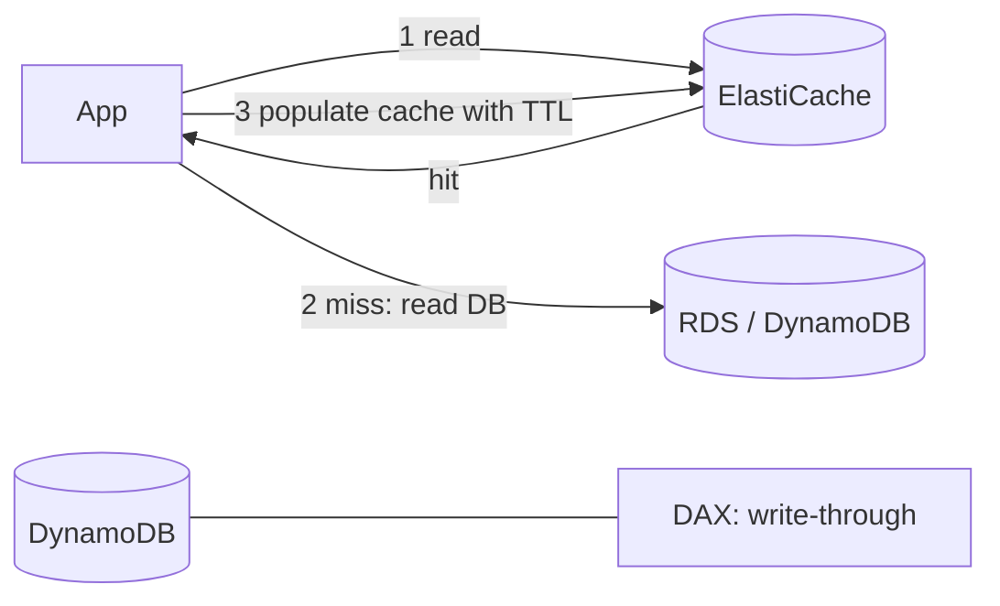

## 1. Core Concept

**ElastiCache** is managed Redis/Valkey or Memcached placed in front of a database to reduce latency and load; **DAX** is a cache dedicated to DynamoDB; **CloudFront** caches content at the edge. They solve the pain of a database that is slow and expensive for repeated reads, in exchange for taking on the problem of **cache consistency**.

**Mental model:** a cache is **a shelf of frequently used items right next to your desk** — a hundred times faster than running to the warehouse (the DB), but the items on the shelf may be **stale** if the warehouse changed, and the shelf is small so you need a rule for what gets cleared (eviction/TTL).

## 2. How It Works

**Redis vs Memcached → Two engines**
- **Redis (or Valkey)**: data structures (string, list, set, **sorted set**, hash), pub/sub, **persistence** (snapshots), **replication** (1 primary + up to 5 replicas), **automatic Multi-AZ failover**, **cluster mode** (sharding), AUTH/TLS/at-rest encryption. Used for sessions, leaderboards, rate limiting.
- **Memcached**: simple, **multithreaded**, **no replication, no persistence**, client-side sharding; suits pure caching where losing data is fine.

**Caching strategies → When to write/read**
- **Cache-aside (lazy loading)**: read the cache, on a **miss** read the DB and populate the cache with a **TTL**; only requested data enters the cache, but the first read is slow and data may be stale.
- **Write-through**: write the DB and the cache together, so the cache is always fresh, but writes are slower and data nobody reads may be loaded.
- **TTL** bounds staleness; **eviction** (`allkeys-lru`, `volatile-ttl`...) decides what to remove when memory is full.

**DAX → A cache for DynamoDB**
- An in-memory **write-through** cache for items and queries, with latency around **microseconds**, DynamoDB API compatible, **serving only eventually consistent reads** (strongly consistent reads go straight to the table).

**Operations**
- Runs in a VPC, controlled with SGs. Monitor **CacheHitRate**, **Evictions**, CPU, **ReplicationLag**.

```python
def get_user(uid):
    v = redis.get(f"u:{uid}")
    if v: return json.loads(v)                 # hit
    row = db.fetch(uid)                        # miss
    redis.setex(f"u:{uid}", 300, json.dumps(row))  # TTL 300s
    return row
```

## 3. Visual Diagram



## 4. Rules of Thumb & Trade-offs

| Situation / Need | What to choose |
| --- | --- |
| Data structures, HA, persistence | Redis |
| Simple pure cache, multithreaded | Memcached |
| Speed up DynamoDB reads without many code changes | DAX |
| Sessions for a stateless application | Redis (ElastiCache) |
| Global static HTTP content | CloudFront |
| Data must be fresh after every write | Write-through (+ a short TTL) |

- **What you gain:** a significant drop in latency and DB load. **What you lose:** data may be stale, you must design invalidation, memory cost and complexity.

## 5. Must Remember / Production Pitfalls

- **Stale data is shown to users → writing the DB without invalidating/updating the cache → write-through or delete the key on write, a sensible TTL**.
- **The DB is swamped when a hot key expires (cache stampede) → many requests reload at once → a randomized TTL (jitter), a single-request reload lock, pre-warming**.
- **Data is lost when a cache node dies → treating the cache as the primary source → the cache must always be rebuildable from the DB**.
- **One shard is overloaded → a hot key → split the key, add read replicas, a short-lived local cache**.
- **Memory fills and eviction happens unexpectedly → no TTL/maxmemory-policy set → set TTLs, monitor Evictions**.
- Exam trap: "where to store sessions so the app is stateless" → **ElastiCache Redis (or DynamoDB)**; "speed up DynamoDB to microseconds" → **DAX**; "needs HA/persistence" → **Redis**, not Memcached.

## 6. Search Hooks

- `ElastiCache Redis vs Memcached` — choosing the engine.
- `cache-aside write-through lazy loading` — caching strategies.
- `DynamoDB DAX` — an in-memory cache for DynamoDB.
- `Redis cluster mode sharding` — scaling Redis by shards.
- `cache stampede` — many requests reloading when a key expires.
