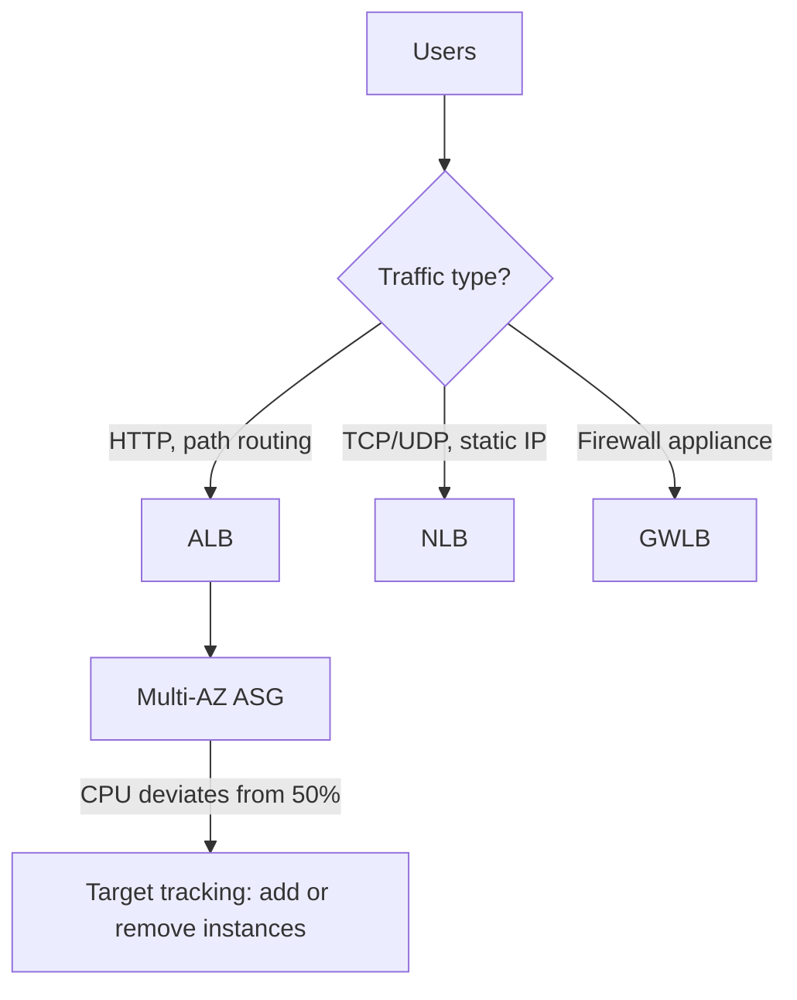

## 1. Core Concept

**Elastic Load Balancing (ELB)** distributes requests across healthy targets, while an **EC2 Auto Scaling Group (ASG)** automatically increases and decreases the number of instances with load. Together they give an application **multi-AZ fault tolerance** and **pay-for-what-you-need cost**, instead of guessing capacity in advance.

**Mental model:** ELB is **the gate coordinator** pointing guests to counters that are free; ASG is **the shift manager** hiring or sending home staff according to the number of guests. To add or remove counters safely, the staff must be **stateless** — anyone can work any counter.

## 2. How It Works

**Choosing a load balancer type → By network layer**
- **ALB (Layer 7)**: routes by **path, host, header, query string**, supports instance, IP or Lambda targets, WebSocket, HTTP/2, redirects, fixed responses, OIDC/Cognito authentication. The SG is attached to the ALB. Example: `/api/*` to service A, `/img/*` to service B.
- **NLB (Layer 4)**: TCP/UDP/TLS, millions of requests/second, ultra-low latency, **a static IP/Elastic IP per AZ**, preserves the client IP; it is the required choice when you need a **PrivateLink endpoint service**.
- **GWLB (Layer 3)**: inserts **third-party appliances** (firewalls, IDS) into the traffic path via **GENEVE**.

**Cross-Zone Load Balancing → Even distribution across AZs**
- **On by default for ALB** (no inter-AZ charge), **off by default for NLB/GWLB**; enabling it on an NLB distributes evenly by target but **incurs inter-AZ traffic charges**.

**Health checks and Deregistration Delay → Do not cut connections**
- ELB sends traffic only to healthy targets. **Deregistration delay** (default **300 seconds**) lets in-flight connections finish when an instance is replaced or scaled in.

**ASG → Min, Desired, Max and scaling policies**
- You declare **min/desired/max** and a **launch template**; the ASG spreads instances across AZs and replaces failed ones (use the **ELB health check** to replace them even when the application hangs).
- **Target tracking** keeps a metric at a target (for example **CPU 50%**), the simplest; **Step/Simple scaling** follow alarm thresholds; **Scheduled** is for scheduled load; **Predictive** learns load patterns.
- **Lifecycle hooks** run scripts before an instance enters service (`Pending:Wait`) or save logs before it is terminated (`Terminating:Wait`). The **cooldown** (default 300 seconds) prevents constant scaling.

```bash
aws autoscaling put-scaling-policy --auto-scaling-group-name web \
  --policy-name cpu50 --policy-type TargetTrackingScaling \
  --target-tracking-configuration '{"PredefinedMetricSpecification":{"PredefinedMetricType":"ASGAverageCPUUtilization"},"TargetValue":50}'
```

## 3. Visual Diagram



## 4. Rules of Thumb & Trade-offs

| Situation / Need | What to choose |
| --- | --- |
| Web/microservices, routing by path/host | ALB |
| Ultra-high performance, static IP, TCP/UDP | NLB |
| Inserting a third-party firewall | GWLB |
| Keep CPU around one level | Target tracking |
| Known scheduled load | Scheduled scaling |
| Setup needed before receiving traffic | Lifecycle hook |

- **What you gain:** automatic fault tolerance and elasticity. **What you lose:** you must design **stateless**; scale-out has a startup delay (use a warm pool or a pre-baked AMI).

## 5. Must Remember / Production Pitfalls

- **Login sessions are lost when scaling → sessions stored on the instance → move state to ElastiCache/DynamoDB or use sticky sessions deliberately**.
- **Requests fail during scale-in → connections are cut → keep a suitable deregistration delay**.
- **An instance hangs but still looks "healthy" → the ASG only uses EC2 status checks → enable the ELB health check for the ASG**.
- **Scaling oscillates constantly → a tight threshold and a short cooldown → target tracking, a sensible cooldown/warm-up**.
- **The NLB bill rises unexpectedly → cross-zone was enabled → inter-AZ traffic charges**.
- Exam trap: "route by URL path" → **ALB**; "keep CPU around 50%" → **target tracking**; "static IP/ultra-high performance" → **NLB**; "third-party appliance" → **GWLB**.

## 6. Search Hooks

- `ALB vs NLB vs GWLB` — choose a load balancer by network layer.
- `ELB cross-zone load balancing` — even distribution across AZs and its cost.
- `Auto Scaling target tracking policy` — keep a metric at a target level.
- `ELB deregistration delay connection draining` — do not cut connections.
- `Auto Scaling lifecycle hooks` — insert scripts into the instance lifecycle.
