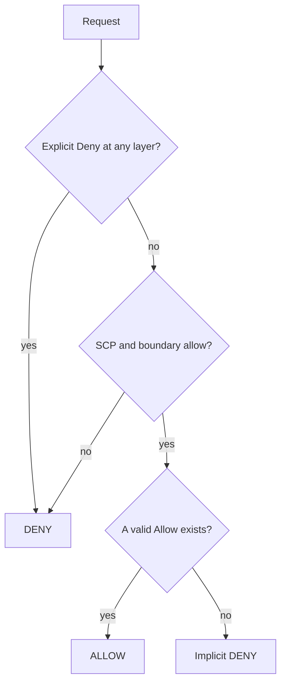

## 1. Core Concept

**AWS IAM (Identity and Access Management)** exists to answer exactly one question for every request into AWS: **who** (the principal) may perform **what** (the action) on **which resource**, under **what condition**. IAM is a global service, free of charge, and the foundational security layer for every other service.

**Mental model:** IAM is like **a building guard who trusts only the list**: if your name is not on the list you cannot enter (implicit deny), and if you are on the list but also on the banned list you are still blocked (an explicit Deny always wins).

## 2. How It Works

**Principal → Who is calling**
- The **root user** (the email used to register the account) has full access and **is not restricted by IAM policies**. What to do: enable **MFA**, delete the root access keys and use root only for a few mandatory tasks such as changing the support plan or closing the account. Impact: a leaked root user means losing the whole account.
- A **user** is a long-term identity for a person or an application; an "empty" user (no group, no policy) can do nothing. A **group** is a collection of users for attaching shared policies; groups **cannot be nested** and **cannot be a principal** in a resource-based policy.
- A **role** is an identity that is **assumed** temporarily through **STS**, returning short-lived credentials (typically 1 hour) that rotate automatically. It is used for EC2/Lambda/ECS, cross-account access and federation. Impact: there is no long-term secret to leak.

**Policy → The concrete permissions**
- A JSON policy contains `Effect`, `Action`, `Resource` and `Condition`. Three kinds: **AWS managed** (created and updated by AWS, convenient but often broad such as `AdministratorAccess`), **customer managed** (written by you, reusable, versioned) and **inline** (embedded in exactly one user/group/role).

```json
{ "Effect": "Allow", "Action": ["s3:GetObject"],
  "Resource": "arn:aws:s3:::reports-bucket/*",
  "Condition": { "Bool": { "aws:MultiFactorAuthPresent": "true" } } }
```

**Policy Evaluation Logic → The final outcome**
- Step 1: if there is an **explicit Deny** at any layer (identity policy, resource policy, **SCP**, **permission boundary**) the result is **DENY**.
- Step 2: otherwise there must be at least one valid **Allow**; SCPs and permission boundaries only **narrow** the limit and never grant permissions by themselves.
- Step 3: with no Allow the result is an **implicit deny**. Example: a policy `Allow s3:*` plus a policy `Deny s3:DeleteObject` still rejects deleting an object.

**Role / AssumeRole → Temporary credentials**
- EC2 attaches an **instance profile**; the SDK calls STS by itself to get credentials from the metadata service and renews them before they expire. Cross-account access uses a trust policy that allows the other account to assume the role.

**Identity Federation → Sign in once**
- **IAM Identity Center** connects the company IdP through **SAML 2.0/OIDC** so users get SSO into many accounts with permission sets, without separate IAM users. Impact: offboarding staff only requires disabling them in the IdP.

**Least Privilege → In practice**
- Start from the smallest permissions and widen them; use **IAM Access Analyzer** to generate a policy from real CloudTrail activity. Each policy should have a specific `Resource` and `Condition` instead of `*`.

## 3. Visual Diagram



## 4. Rules of Thumb & Trade-offs

| Situation / Need | What to choose |
| --- | --- |
| An app on EC2/Lambda/ECS that must call AWS | IAM Role (instance profile) |
| Many people or many accounts | IAM Identity Center + the company IdP |
| Granting permissions to many people in the same job function | Group + customer managed policy |
| A maximum limit for a whole account | SCP (through Organizations) |
| Temporary permissions for a third party | STS AssumeRole with conditions |

- **What you gain:** precise, temporary, easy-to-audit permissions. **What you lose:** policy maintenance effort; AWS managed policies are convenient but broad, customer managed ones are precise but laborious.

## 5. Must Remember / Production Pitfalls

- **An access key leaks on GitHub → bots scan it within minutes → crypto-mining/data deletion** → use temporary credentials, rotate keys, enable CloudTrail and billing alarms.
- **Attaching `AdministratorAccess` "to be quick" → every workload has global permissions → one vulnerability loses everything** → least privilege, Access Analyzer.
- **Attaching policies directly to each user → a person who changes teams keeps old permissions** → attach to groups/roles and review periodically.
- **You just changed permissions and still get AccessDenied → IAM is eventually consistent** → wait a few seconds, do not rush to delete/recreate.
- **Believing an Allow in one policy beats a Deny in another → wrong, an explicit Deny wins over everything** (including SCPs).
- Exam trap: "let EC2 read S3" → **an IAM Role / instance profile**, never store access keys on the instance; "can a group be a principal?" → **no**.

## 6. Search Hooks

- `IAM policy evaluation logic` — the order in which Deny and Allow are evaluated across policy types.
- `Principle of Least Privilege` — grant only the minimum permissions needed.
- `AWS managed vs customer managed policy` — the differences and when to use each.
- `IAM Role AssumeRole STS` — issue temporary credentials instead of long-term access keys.
- `IAM Identity Center SAML federation` — sign in to AWS with the company IdP.
- `root user MFA best practices` — protecting the root account.
