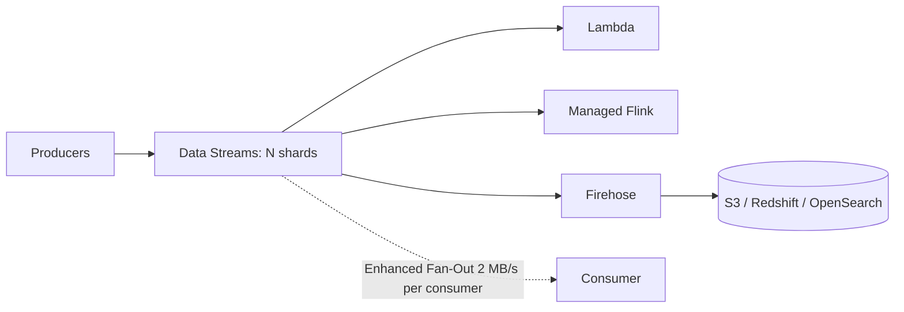

## 1. Core Concept

**Amazon Kinesis** is a family of streaming services: **Data Streams** (a distributed log ordered per shard, replayable), **Data Firehose** (a near-real-time ingestion pipe into S3/Redshift/OpenSearch with no code) and **Managed Service for Apache Flink** (stream processing). They solve collecting and processing continuous data streams such as logs, clickstreams and IoT.

**Mental model:** Data Streams is like **a conveyor belt split into lanes (shards)**: each lane has a limited speed and keeps order, many people can stand beside it to watch and can rewind; Firehose is **a delivery truck gathering goods** that runs periodically and drops them into a warehouse — once delivered, they cannot be rewound.

## 2. How It Works

**Data Streams → The shard is the unit of parallelism**
- Each **shard** accepts **1 MB/s or 1,000 records/s** of writes and **2 MB/s** of reads; a record is at most **1 MB**. The **partition key** is hashed to a shard, so **the same key always lands on the same shard** and keeps order; there is **no global ordering** across shards.
- **Retention** from 24 hours to **365 days**, allowing **replay**. Two modes: **provisioned** (you choose the shard count, split/merge) and **on-demand**.
- Example: 5 MB/s of writes needs at least 5 shards.

**Consumers → Sharing bandwidth**
- **Shared throughput**: all consumers share the shard's **2 MB/s**. **Enhanced Fan-Out (EFO)**: each consumer gets **its own 2 MB/s**, pushed over HTTP/2 with lower latency (extra cost). **KCL** manages checkpoints in DynamoDB; Lambda reads through an event source mapping.

**Firehose → Near-real-time delivery**
- Buffers by size/time and then writes to **S3, Redshift, OpenSearch, Splunk, HTTP endpoints**; transforms with Lambda and **converts the format to Parquet/ORC**. It **does not retain for replay** and has buffer latency so it is **not truly real time**.

**Managed Flink → Stream processing**
- Time windows, joins and aggregations over streams (Java/SQL/Python).

```python
import boto3, json
k = boto3.client("kinesis")
k.put_record(StreamName="clicks", Data=json.dumps({"u": 42}), PartitionKey="user-42")
```

## 3. Visual Diagram



## 4. Rules of Thumb & Trade-offs

| Situation / Need | What to choose |
| --- | --- |
| Replay, many consumers, ordering per key | Data Streams |
| Simple log ingestion into S3/Redshift, no code | Firehose |
| Many consumers each needing its own bandwidth | Enhanced Fan-Out |
| A single-consumer queue, no ordering/replay needed | SQS |
| Time-window processing on a stream | Managed Flink |

- **What you gain:** ordering per key, replay, many consumers. **What you lose:** shard management, EFO cost, complexity compared with SQS/Firehose.

## 5. Must Remember / Production Pitfalls

- **`ProvisionedThroughputExceeded` although total shards suffice → a hot shard from a skewed partition key → choose an evenly distributed key or add a random suffix**.
- **A slow consumer falls behind retention → unread data is lost → add consumers/retention, monitor iterator age**.
- **Wrong ordering after resharding → key-to-shard mapping changed → process by sequence and control resharding**.
- **You need 7 days of replay but use Firehose/SQS → nothing is kept for re-reading → use Data Streams**.
- **Many consumers fight over 2 MB/s → throttling → Enhanced Fan-Out**.
- Exam trap: "replay data and many consumers" → **Data Streams**; "ingest logs into S3 as Parquet in the simplest way" → **Firehose**; "each consumer gets its own 2 MB/s" → **Enhanced Fan-Out**.

## 6. Search Hooks

- `Kinesis Data Streams shards partition key` — distributing data across shards.
- `Kinesis enhanced fan-out` — dedicated bandwidth per consumer.
- `Kinesis Data Firehose buffering` — how Firehose batches and delivers data.
- `Kinesis vs SQS vs MSK` — comparing messaging/streaming options.
- `Kinesis hot shard` — diagnosing an overloaded shard.
