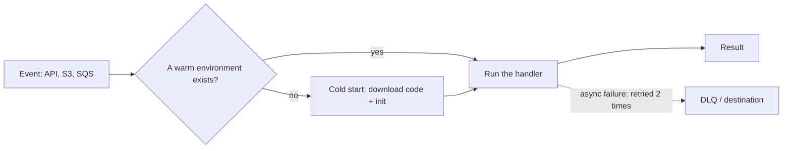

## 1. Core Concept

**AWS Lambda** runs code in response to events without you managing servers: you upload a function, AWS provisions the environment, runs it, scales it and bills only by **number of invocations and GB-seconds**. It solves the pain of operations and paying for idle time.

**Mental model:** Lambda is like **a taxi called per trip**: no need to buy a car (a server), if a car is ready you leave at once, if not you wait a few hundred milliseconds for a new car (**cold start**), and each trip has a time limit.

## 2. How It Works

**Execution environment → Cold start and warm**
- The first request (or when concurrency grows) creates a new **execution environment**: download the code, start the runtime, run init → that is a **cold start** (from tens of milliseconds to a few seconds depending on runtime/size). The environment is **reused** for later invocations (warm), so initialize connections outside the handler.
- To reduce cold starts: **Provisioned Concurrency** (keeps environments ready, billed) or **SnapStart** (restores from a snapshot after init, for supported runtimes).

**Concurrency → Scaling and limits**
- By default at most **1,000 concurrent executions** per Region per account (can be raised). **Reserved concurrency** both **guarantees** and **caps** a function (protecting a downstream DB); **Provisioned** keeps environments hot. Exceeding the limit → **throttling (429)**.

**Resource limits**
- Timeout at most **15 minutes**; memory **128 MB–10,240 MB** (CPU grows with memory); `/tmp` 512 MB–10 GB; a zip package of 50 MB (250 MB unzipped) or a container image up to 10 GB.

**Invocation types → Who handles errors**
- **Synchronous** (API Gateway, SDK `RequestResponse`): the caller waits and **handles errors/retries itself**.
- **Asynchronous** (S3, SNS, EventBridge): Lambda queues and **retries 2 times by itself**, supporting **DLQ/destinations**.
- **Event source mapping** (SQS, Kinesis, DynamoDB Streams): Lambda **polls** the source, reads in **batches** and invokes the function; if the whole batch fails it is retried (use `ReportBatchItemFailures`).

**Lambda in a VPC → Networking**
- A function running in a VPC has **no Internet access by default**: you need a **NAT Gateway** or **VPC endpoints** to call outside services.

```python
import boto3
s3 = boto3.client("s3")          # initialized outside the handler, reused when warm
def handler(event, context):
    return s3.list_buckets()["Buckets"][:1]
```

## 3. Visual Diagram



## 4. Rules of Thumb & Trade-offs

| Situation / Need | What to choose |
| --- | --- |
| A function needing stable latency, limited cold starts | Provisioned Concurrency / SnapStart |
| Protect a DB from overload, cap parallelism | Reserved concurrency |
| Processing queues/streams in batches | Event source mapping |
| Tasks longer than 15 minutes | Step Functions, ECS/Fargate, Batch |
| High steady load all day | Consider Fargate/EC2 (may be cheaper) |

- **What you gain:** no operations, automatic scaling, pay per use. **What you lose:** cold starts, a 15-minute/runtime limit, hard local debugging, high cost under large continuous load.

## 5. Must Remember / Production Pitfalls

- **A Lambda in a VPC times out calling the Internet → no outbound path → a NAT Gateway or VPC endpoints**.
- **Erratic latency at peak load → cold starts → Provisioned Concurrency/SnapStart**, initialize outside the handler, shrink the package.
- **DB connections run out as load grows → every environment opens a connection → RDS Proxy and reserved concurrency**.
- **A 20-minute task is cut off → the 15-minute maximum timeout → Step Functions or Fargate**.
- **SQS messages are processed repeatedly → a failed batch is retried → an idempotent consumer and `ReportBatchItemFailures`**.
- Exam trap: "reduce cold starts for a critical function" → **Provisioned Concurrency** (not reserved); "Lambda in a VPC needs the Internet" → **NAT Gateway/endpoint**; "runtime limit" → **15 minutes**.

## 6. Search Hooks

- `Lambda cold start` — why it happens and how to reduce it.
- `Lambda reserved vs provisioned concurrency` — capping versus keeping warm.
- `Lambda synchronous vs asynchronous invocation` — who retries and handles errors.
- `Lambda event source mapping` — polling SQS, Kinesis, DynamoDB Streams.
- `Lambda SnapStart` — restore from a snapshot to reduce cold starts.
