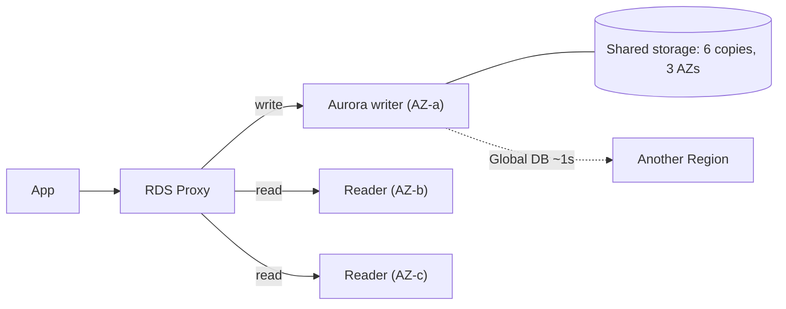

## 1. Core Concept

**RDS** is a managed relational database service (MySQL, PostgreSQL, SQL Server, Oracle, MariaDB), while **Aurora** is an engine redesigned by AWS with distributed storage decoupled from compute. They solve three pains: **patching and backups**, **AZ fault tolerance** and **read scaling**, without operating database servers yourself.

**Mental model:** **Multi-AZ is a co-pilot already seated** (synchronous, not flying, taking over when needed); a **Read Replica is an extra driver serving read-only passengers** (asynchronous, with lag). They solve two different problems, do not confuse them.

## 2. How It Works

**RDS Multi-AZ → Fault tolerance**
- A **synchronous** standby in another AZ; on failure the DNS endpoint **fails over automatically** (typically 60–120 seconds). The standby **does not serve reads**; the application does not need to change its connection string.

**Read Replica → Read scaling**
- **Asynchronous** replication (with **replica lag**), up to 5 RDS replicas, can be **cross-Region**, and can be **promoted** to a standalone DB. The application must point its read queries to the replica endpoint itself.

**Backup and encryption**
- **Automated backups** (kept 1–35 days, supporting **point-in-time recovery**) and manual snapshots. **Encryption is chosen at creation**; to encrypt an unencrypted DB you must **create a snapshot → copy the snapshot with encryption → restore**.

**Aurora Storage → Fault tolerance at the storage layer**
- One **writer** and up to **15 readers** share a cluster volume that grows automatically up to **128 TiB**, with data held as **6 copies across 3 AZs**. Failover is typically **under ~30 seconds** because readers already have the data and only need to be promoted.

**Aurora Global Database → Cross-Region DR**
- Storage-level replication of about **1 second** to another Region, cross-Region failover around **a minute**; suits DR with a very small RPO.

**RDS Proxy → Protection from connection storms**
- Connection pooling, reduced failover time, protecting the DB from thousands of connections from **Lambda**, with **IAM auth** and **Secrets Manager** support.

**Aurora Serverless v2 → Erratic load**
- Scales continuously by **ACU** without dropping connections; suits dev/test and variable load.

## 3. Visual Diagram

## 4. Rules of Thumb & Trade-offs

| Situation / Need | What to choose |
| --- | --- |
| AZ fault tolerance, no read scaling needed yet | RDS Multi-AZ |
| Increase read throughput | Read Replica / Aurora Replica |
| Fast failover, lots of read scaling | Aurora |
| Multi-Region DR with a small RPO | Aurora Global Database |
| Lambda opening many connections | RDS Proxy |
| Erratic load, dev/test | Aurora Serverless v2 |

- **What you gain:** HA and read scaling without operating it yourself. **What you lose:** Aurora costs more than ordinary RDS; a Read Replica has replica lag so reads may be stale.

## 5. Must Remember / Production Pitfalls

- **The application reads stale data after writing → reading from a lagging replica → read-after-write uses the writer**.
- **Thinking Multi-AZ scales reads → the standby does not serve reads → use a Read Replica**.
- **You want to enable encryption on a running RDS → it cannot be enabled directly → snapshot, encrypted copy, restore** (with a cutover downtime).
- **Lambda exhausts DB connections → every invoke opens a new connection → RDS Proxy**.
- **Failover still interrupts for tens of seconds → the application does not retry/does not use the DNS endpoint → configure retries and the cluster endpoint**.
- Exam trap: "AZ fault tolerance, no read scaling needed" → **Multi-AZ**; "encrypt a running DB" → **snapshot → encrypted copy → restore**; "increase read throughput, a little lag accepted" → **Read Replica**.

## 6. Search Hooks

- `RDS Multi-AZ vs read replica` — synchronous HA versus asynchronous read scaling.
- `Aurora storage architecture` — 6 copies, 3 AZs, up to 15 readers.
- `Aurora Global Database` — multi-Region DR with about 1-second replication.
- `RDS Proxy` — connection pooling and fast failover.
- `Aurora Serverless v2` — ACU-based scaling for erratic load.
- `RDS encryption snapshot copy` — how to enable encryption for an existing DB.
