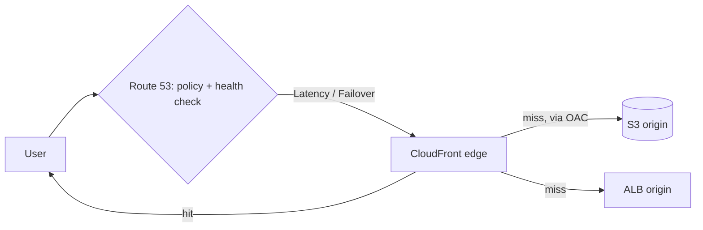

## 1. Core Concept

**Route 53** is managed DNS plus health checks and intelligent routing; **CloudFront** is a CDN that caches content at **edge locations** close to users. Together they solve two pains: **sending users to the healthiest right endpoint** and **reducing latency and load on the origin**.

**Mental model:** Route 53 is **the person giving directions** (answering "which address" by your rules), CloudFront is **a chain of convenience stores** near the customer's home, keeping stock on hand and only going back to the main warehouse (the origin) when it runs out.

## 2. How It Works

**Route 53 Routing Policies → DNS answer rules**
- **Simple**, **Weighted** (split by ratio, 90/10 canary), **Latency** (the Region with the lowest latency), **Failover** (primary/secondary with a **health check**), **Geolocation** (by user location, for compliance/language), **Geoproximity** (by distance with a bias, through Traffic Flow), **IP-based**, **Multivalue** (returns up to 8 healthy records). A health check removes failing endpoints from answers.
- **Alias vs CNAME:** a CNAME **cannot be set at the zone apex** (`example.com`); an **Alias** can point the root domain to an ELB, CloudFront or an S3 website, queries to AWS resources are **free**, and it tracks IP changes.

**CloudFront → Caching at the edge**
- A request goes to the nearest edge; a **cache hit** returns immediately, a **miss** fetches from the origin (S3, ALB, custom) and caches by **TTL**. A **regional edge cache** sits between the edge and the origin.
- **Origin Access Control (OAC)** keeps the S3 bucket **non-public** while content is still delivered through the CDN (replacing the old OAI). **Signed URLs/cookies** serve private content.
- **Updating content:** invalidations cost effort/fees beyond the quota (the first 1,000 paths/month are free); a better approach is **versioned file names** (`app.v2.js`).
- **CloudFront Functions** (lightweight, sub-millisecond, change headers/URLs) vs **Lambda@Edge** (more runtimes, network access, heavier processing).

**Global Accelerator → Different from CloudFront**
- Provides 2 **static anycast IPs**, sends traffic into the AWS backbone, supports **TCP/UDP**, fast failover, and **does not cache**.

```bash
aws route53 change-resource-record-sets --hosted-zone-id Z1 --change-batch \
 '{"Changes":[{"Action":"UPSERT","ResourceRecordSet":{"Name":"example.com","Type":"A",
 "AliasTarget":{"HostedZoneId":"Z2","DNSName":"my-alb-123.elb.amazonaws.com","EvaluateTargetHealth":true}}}]}'
```

## 3. Visual Diagram



## 4. Rules of Thumb & Trade-offs

| Situation / Need | What to choose |
| --- | --- |
| Point the root domain at an ALB/CloudFront | Alias record |
| Failover to a standby Region | Failover routing + health check |
| A 90/10 canary | Weighted routing |
| Users go to the Region closest to them | Latency routing |
| Block direct S3 access, only through the CDN | CloudFront + OAC |
| Static IP, TCP/UDP, no cache | Global Accelerator |

- **What you gain:** low latency, fault tolerance, reduced origin load. **What you lose:** content may be stale within the TTL; invalidations take effort.

## 5. Must Remember / Production Pitfalls

- **You cannot point the root domain → using a CNAME at the apex → use an Alias**.
- **Users still see the old version after a deploy → it is still in the cache TTL → versioned file names or invalidate the right path**.
- **The S3 bucket is still directly accessible → not locked down with OAC → a bucket policy that only allows CloudFront**.
- **Failover does not work → no health check attached → always attach a health check to failover records**.
- **Caching on extra query strings/cookies → a low hit ratio → forward only the values you really need**.
- Exam trap: "point the root domain at an ALB" → **Alias**; "switch to a standby Region" → **Failover + health check**; "S3 only through CloudFront" → **OAC**; "TCP/UDP, static IP" → **Global Accelerator**, not CloudFront.

## 6. Search Hooks

- `Route 53 routing policies` — DNS routing policies.
- `Route 53 Alias vs CNAME` — why an Alias works at the root domain.
- `CloudFront Origin Access Control` — keep S3 private behind the CDN.
- `Lambda@Edge vs CloudFront Functions` — running code at the edge.
- `Global Accelerator vs CloudFront` — TCP/UDP acceleration versus an HTTP caching CDN.
