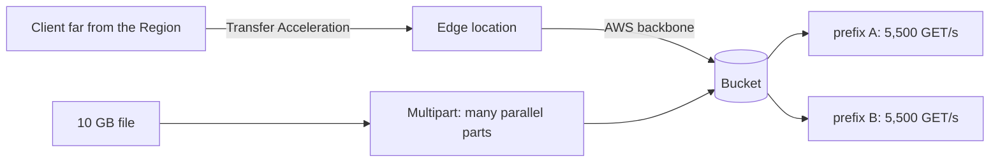

## 1. Core Concept

S3 scales almost without limit if you **parallelize**: it limits request rate **per prefix**, and large uploads/downloads are fastest when **split** into many parts running concurrently. Optimizing S3 is therefore a problem of spreading load, splitting work and shortening the network path.

**Mental model:** S3 is like **a warehouse with many loading doors**: each prefix is a door that can handle 3,500 writes and 5,500 reads per second. To serve more, open more doors (add prefixes) and split large goods into many small crates carried in parallel (multipart).

## 2. How It Works

**Request rate per prefix → Spread the load**
- Each prefix supports at least **3,500 PUT/COPY/POST/DELETE** and **5,500 GET/HEAD** requests per second, with no limit on the number of prefixes. Example: 10 prefixes give at least **55,000 GETs/second**. Impact: data spread across several prefixes multiplies throughput.

**Multipart Upload → Large uploads, fault tolerant**
- Mechanism: split an object into **parts of 5 MB–5 GB** (at most **10,000 parts**, object up to **5 TB**), upload in parallel and S3 reassembles them. Recommended for files **> 100 MB**, **required for > 5 GB**.
- Impact: on a network error only the failed part is retried; a 10 GB upload no longer breaks midway. Remember to clean up incomplete parts with Lifecycle.

**Byte-Range Fetch → Parallel download or reading a part**
- A `GET` with the header `Range: bytes=0-1048575` downloads chunks in parallel or fetches just the needed part (for example the footer of a Parquet file). Impact: faster and less data transferred.

```bash
aws s3api get-object --bucket b --key big.bin --range bytes=0-1048575 part0.bin
```

**Transfer Acceleration → Shortening the network path**
- The client uploads to the **nearest edge location** and then travels over the **AWS backbone** to the bucket. It suits clients far from the Region; it costs extra and uses a dedicated endpoint.

**SSE-KMS → A hidden bottleneck**
- Every upload/download calls KMS and is subject to the **KMS request quota**; high traffic can be throttled. Reduce it with an **S3 Bucket Key**.

## 3. Visual Diagram



## 4. Rules of Thumb & Trade-offs

| Situation / Need | What to choose |
| --- | --- |
| Large files, uploads often break | Multipart Upload |
| You need to read part of an object | Byte-Range Fetch |
| Client far from the Region, slow uploads | Transfer Acceleration |
| Exceeding the per-prefix request limit | Spread objects across multiple prefixes |
| Serving content globally | CloudFront in front of S3 |
| SSE-KMS is throttled | S3 Bucket Key |

- **What you gain:** high throughput, good fault tolerance. **What you lose:** extra client-side complexity (managing parts) and extra cost when using Transfer Acceleration.

## 5. Must Remember / Production Pitfalls

- **A 10 GB upload often breaks midway → a single PUT is limited to 5 GB and cannot retry per part → Multipart Upload**.
- **You get 503 SlowDown even with few prefixes → load piles onto one prefix → spread across more prefixes and add retries with backoff**.
- **Storage grows mysteriously → incomplete multipart uploads are not cleaned up → a Lifecycle AbortIncompleteMultipartUpload rule**.
- **Performance drops after enabling SSE-KMS → the KMS quota is exceeded → a Bucket Key or a higher quota**.
- **Using Transfer Acceleration for clients near the Region → no benefit and still costs → use it only when clients are far away**.
- Exam trap: "upload a 5 GB file fast and fault-tolerantly" → **Multipart**; "a client far from the Region uploads fast over the AWS backbone" → **Transfer Acceleration**; "5,500 GET/s per prefix" → scale with **more prefixes**.

## 6. Search Hooks

- `S3 request rate per prefix` — the per-prefix request limit and how to scale it.
- `S3 multipart upload` — split large files for parallel upload.
- `S3 byte-range fetch` — parallel download or reading part of an object.
- `S3 Transfer Acceleration` — upload through the nearest edge location.
- `KMS request quota S3 Bucket Key` — avoid throttling when using SSE-KMS.
