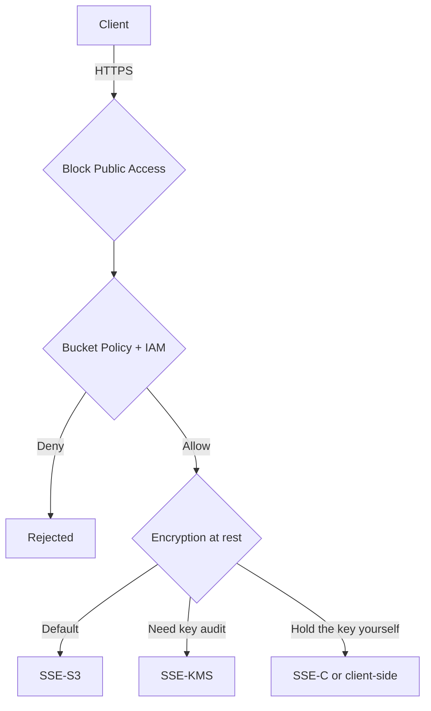

## 1. Core Concept

S3 security has two independent layers: **access control** (who may read/write the bucket and objects) and **encryption** (data is encrypted in transit and at rest). A new bucket is **private** by default, has **Block Public Access** on, ACLs disabled, and since 2023 every new object is encrypted automatically with **SSE-S3**.

**Mental model:** Block Public Access is **the main breaker** of the whole building, a Bucket Policy is **the house rules of each room**, an ACL is **an old sign** that should be turned off; and encryption is **the safe** — the only question is who holds the key.

## 2. How It Works

**Access control → Who gets in**
- A **Bucket Policy** is a resource-based JSON policy that applies to the whole bucket or a prefix; it supports cross-account access and conditions on IP, **VPC endpoint**, HTTPS or the encryption header. An explicit `Deny` here beats any `Allow` in IAM.
- **Object Ownership = Bucket owner enforced** (the default for new buckets) makes **ACLs disabled**: the bucket owner owns every object and permissions are managed only through policies. Impact: no more objects uploaded by another account that the bucket owner cannot read.
- **Block Public Access** overrides any policy/ACL that would make the bucket public, and can be set at the **account** level. To really make something public you must turn this breaker off **and** write a policy.

**Encryption in transit → Against eavesdropping**
- HTTPS/TLS protects the transport; enforce it with a bucket policy `Deny` when `aws:SecureTransport = false`.

```json
{ "Effect": "Deny", "Principal": "*", "Action": "s3:*",
  "Resource": ["arn:aws:s3:::my-bucket", "arn:aws:s3:::my-bucket/*"],
  "Condition": { "Bool": { "aws:SecureTransport": "false" } } }
```

**Encryption at rest → Who holds the key**
- **SSE-S3**: S3 manages the key (AES-256), the default, free, with no separate audit of each key use.
- **SSE-KMS**: the key lives in **AWS KMS**; every upload/download makes S3 call KMS, so you get **auditing through CloudTrail**, key-level permissions and key rotation; in exchange it costs money and is subject to the **KMS request quota** (thousands of requests/second depending on the Region), so high traffic can be throttled. An **S3 Bucket Key** reduces the number of requests to KMS and can cut costs by up to ~99%.
- **SSE-C**: you send the key in **every request** (HTTPS required), S3 does not store the key; losing the key means **losing the data**.
- **Client-side encryption**: you encrypt before uploading and S3 only sees ciphertext.

**Temporary sharing → Presigned URL**
- A pre-signed URL carries **the signer's permissions** and has an expiry (for example 15 minutes), letting a partner upload without an IAM user.

**Cross-account with SSE-KMS**
- Permissions are needed in **both the key policy and IAM** (or a grant); otherwise you can read the bucket but cannot decrypt.

## 3. Visual Diagram



## 4. Rules of Thumb & Trade-offs

| Situation / Need | What to choose |
| --- | --- |
| You only need the data encrypted | SSE-S3 (the default) |
| Audit who decrypts, per-key permissions, compliance | SSE-KMS (+ Bucket Key) |
| Hold the key yourself, S3 must not store it | SSE-C |
| S3 must never see plaintext | Client-side encryption |
| A public static website | CloudFront + Origin Access Control, the bucket stays private |
| A temporary partner upload | Presigned URL |

- **What you gain:** SSE-KMS gives detailed control and auditing. **What you lose:** KMS cost, added latency and a throttling risk under high traffic.

## 5. Must Remember / Production Pitfalls

- **Uploads/downloads return 503 SlowDown as traffic grows → SSE-KMS exceeds the KMS quota → enable S3 Bucket Key, raise the quota or use SSE-S3** if you do not need auditing.
- **A partner in another account can read the bucket but decryption fails → the key policy does not allow that account → grant permissions in both the key policy and IAM**.
- **A bucket accidentally becomes public → Block Public Access was turned off at the account level or old ACLs → enable account-level Block Public Access, keep ACLs disabled**.
- **An SSE-C key is lost → AWS cannot recover it → keep the key somewhere durable or move to SSE-KMS**.
- **You must force the company's own KMS key → default encryption is not enough → add a bucket policy rejecting PUTs without `x-amz-server-side-encryption: aws:kms`**.
- Exam trap: "audit who used the key" → **SSE-KMS**; "fully managed by AWS, no extra charge" → **SSE-S3**; "let a partner upload for 15 minutes without an IAM user" → **a presigned URL**; "a new bucket's default" → **private, Block Public Access on, ACLs disabled**.

## 6. Search Hooks

- `S3 bucket policy examples` — sample policies restricting IP, VPC endpoint, HTTPS.
- `S3 Object Ownership bucket owner enforced` — the default mechanism that disables ACLs.
- `S3 Block Public Access` — the breaker that blocks any configuration making a bucket public.
- `SSE-S3 vs SSE-KMS vs SSE-C` — comparing the three server-side encryption types.
- `aws:SecureTransport` — the condition that enforces HTTPS.
- `S3 Bucket Key KMS cost` — reducing KMS requests and cost.
