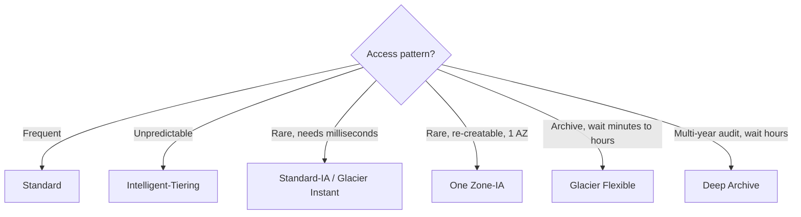

## 1. Core Concept

**S3 Storage Classes** let you pay the right price for the right access level: hot data sits in an expensive but fast tier, cold data in a cheap tier that carries retrieval fees or wait time. **Lifecycle Configuration** automatically transitions and deletes objects by age so you do not have to do it by hand.

**Mental model:** like **a multi-level warehouse**: best sellers sit right by the door (Standard), slow sellers go deeper into storage (IA, Glacier) — cheap to put in, but costly in effort or money to take out, and with **a minimum storage duration** even if you withdraw early.

## 2. How It Works

**The classes → Price, latency, durability**
- **Standard**: frequent access, ≥3 AZs, no retrieval fee.
- **Intelligent-Tiering**: automatically moves objects between tiers by access pattern (Frequent → Infrequent after 30 days untouched → Archive Instant after 90 days), **no retrieval fee** but a **per-object monitoring fee**; objects smaller than 128 KB are not auto-tiered.
- **Standard-IA**: infrequent access but needs fast retrieval, charged a per-GB retrieval fee, with a **128 KB minimum per object** and **30 days**.
- **One Zone-IA**: like IA but **in only 1 AZ** (data is lost if the AZ is destroyed), about 20% cheaper; suits re-creatable copies.
- **Glacier Instant Retrieval**: long-term storage, retrieved in **milliseconds**, 90-day minimum.
- **Glacier Flexible Retrieval**: Expedited **1–5 minutes**, Standard **3–5 hours**, Bulk **5–12 hours**; 90-day minimum.
- **Glacier Deep Archive**: the cheapest, Standard **≤ 12 hours**, Bulk **≤ 48 hours**; **180-day** minimum.

**Lifecycle → Automation**
- **Transition actions** change the storage class by age; **Expiration actions** delete objects, **noncurrent versions** or **incomplete multipart uploads**.
- Transitions only go **down to colder tiers** (a waterfall) and never revert on their own; Standard → IA/One Zone-IA requires the object to have been in Standard for at least **30 days**.

```xml
<Rule><Status>Enabled</Status>
  <Transition><Days>30</Days><StorageClass>STANDARD_IA</StorageClass></Transition>
  <Transition><Days>180</Days><StorageClass>DEEP_ARCHIVE</StorageClass></Transition>
  <AbortIncompleteMultipartUpload><DaysAfterInitiation>7</DaysAfterInitiation></AbortIncompleteMultipartUpload>
</Rule>
```

**A hidden cost example:** 1 million 10 KB files moved to Standard-IA are billed as 128 KB each, so they can cost **more** than Standard.

## 3. Visual Diagram



## 4. Rules of Thumb & Trade-offs

| Situation / Need | What to choose |
| --- | --- |
| Frequent access | Standard |
| Unpredictable access pattern, no retrieval fees wanted | Intelligent-Tiering |
| Rarely accessed but needs to be fast | Standard-IA or Glacier Instant |
| A secondary, re-creatable copy | One Zone-IA |
| 7-year audit logs, a wait of many hours is acceptable | Glacier Deep Archive |

- **What you gain:** a large drop in storage cost. **What you lose:** retrieval fees, wait time, minimum storage duration and monitoring/transition fees.

## 5. Must Remember / Production Pitfalls

- **Moving small files to IA → billed at a 128 KB minimum per object → cost rises → bundle files or keep Standard**.
- **Deleting or transitioning before the minimum duration → you are still billed for the full days** (IA 30, Glacier 90, Deep Archive 180).
- **"Ghost" storage grows → incomplete multipart uploads are not cleaned up → add an AbortIncompleteMultipartUpload rule**.
- **Old objects in a versioned bucket bloat → noncurrent versions do not expire → a rule that expires noncurrent versions**.
- **You need Glacier data urgently → you pay for Expedited or must wait → use Glacier Instant if sudden reads are expected**.
- Exam trap: "unpredictable access pattern" → **Intelligent-Tiering**; "7-year logs rarely read, a multi-hour wait is acceptable, cheapest" → **Deep Archive**.

## 6. Search Hooks

- `S3 storage classes comparison` — compare price, latency and AZ count across classes.
- `S3 Intelligent-Tiering` — automatic tiering with no retrieval fee.
- `S3 Glacier retrieval options` — Expedited, Standard, Bulk for Glacier.
- `S3 Lifecycle configuration` — transition and expiration rules.
- `S3 minimum storage duration charge` — minimum storage duration per class.
