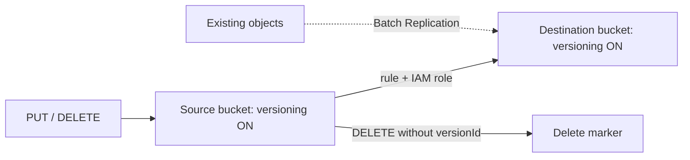

## 1. Core Concept

**S3 Versioning** keeps every version of an object in the same bucket so you can recover from overwrites or accidental deletes. **S3 Replication** copies objects asynchronously to another bucket (in the same or a different Region/account) for DR, lower latency or compliance.

**Mental model:** Versioning is **the Undo button** inside one bucket (protecting against human error); Replication is **a copy in another building** (protecting against losing a whole bucket or Region) — but it copies bad overwrites too, so it is **not a backup**.

## 2. How It Works

**Versioning → Undo**
- A bucket has three states: **Unversioned → Enabled → Suspended**. Once enabled you **cannot return to Unversioned**, only Suspend; old versions are kept and still billed.
- Every write creates a new `versionId`; a `GET` without `versionId` returns the **latest version**. Old versions can be read with `GET ?versionId=...` if you have `s3:GetObjectVersion`.
- **Permissions are per version:** making the latest version public does **not** make old versions public.
- A `DELETE` without `versionId` only inserts a **delete marker**; removing the marker is an "undelete". A permanent delete must specify the `versionId`.
- **MFA Delete** requires the root user's MFA to permanently delete a version or change the versioning state.
- **Cost example:** a 1 GB object overwritten 10 times takes **10 GB**; use Lifecycle to expire **noncurrent versions** after N days.

**Replication → An asynchronous copy**
- **CRR** (Cross-Region) and **SRR** (Same-Region). **Versioning must be enabled on both source and destination** and an **IAM role** is required for S3 to perform the copy.
- A rule applies only to **new** objects after it is created; for existing objects use **S3 Batch Replication** (also used to re-run objects that failed to replicate).
- Deletes with a `versionId` are **never** replicated (so a deliberate deletion does not spread to the copy); delete markers can be replicated as an option. **There is no chaining**: with A→B and B→C, objects from A do not automatically reach C.
- **Replication Time Control (RTC)** commits to replicating 99.99% of objects within **15 minutes**, at additional cost.
- **SSE-C** encrypted objects cannot be replicated; **SSE-KMS** requires key configuration at the destination.

```bash
aws s3api put-bucket-versioning --bucket src \
  --versioning-configuration Status=Enabled
```

## 3. Visual Diagram



## 4. Rules of Thumb & Trade-offs

| Situation / Need | What to choose |
| --- | --- |
| Recover from accidental deletes/overwrites | Versioning (+ MFA Delete) |
| DR, compliance, users in another Region | CRR |
| Aggregating logs, syncing prod/test in the same Region | SRR |
| Copying data that already exists | Batch Replication |
| You need a 15-minute SLA | Replication Time Control |
| Data must be immutable | Versioning + Object Lock |

- **What you gain:** recovery and high durability. **What you lose:** storage cost for every version, inter-Region data transfer cost and replication delay.

## 5. Must Remember / Production Pitfalls

- **You enabled replication but old data did not copy → a rule applies only to new objects → use S3 Batch Replication**.
- **The storage bill keeps rising → every version is billed, even when Suspended → a Lifecycle rule to expire noncurrent versions**.
- **You deleted by mistake and the object seems "lost" → there is only a delete marker → remove the delete marker to recover**.
- **Thinking replication is a backup → a bad overwrite is still copied to the destination → combine versioning, Object Lock and point-in-time backups**.
- **Replication fails for KMS objects → a missing key or permission at the destination → configure the destination key and permissions for the replication role**.
- Exam trap: "replication enabled, old objects did not copy" → **S3 Batch Replication**; "requirements to enable replication" → **versioning on both buckets and an IAM role** (the destination may be in the same or a different Region).

## 6. Search Hooks

- `S3 Versioning suspended state` — behavior when versioning is suspended.
- `S3 delete marker` — the soft-delete mechanism in a versioned bucket.
- `S3 MFA Delete` — require MFA to permanently delete versions.
- `S3 Cross-Region Replication requirements` — the conditions for CRR/SRR to work.
- `S3 Batch Replication existing objects` — copy objects that existed before the rule was created.
- `S3 Replication Time Control` — the 15-minute replication SLA.
