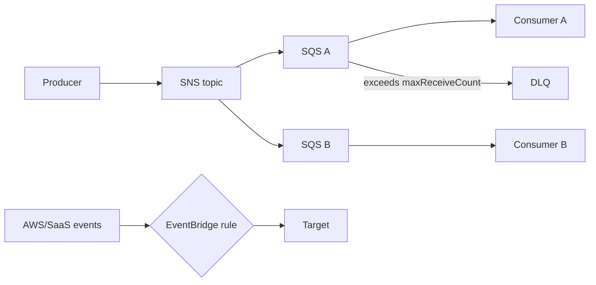

## 1. Core Concept

**SQS** (queue), **SNS** (pub/sub) and **EventBridge** (event bus) are AWS's three messaging services for **decoupling** producers from consumers: the producer sends and is done, the consumer processes at its own pace, and a failure on one side does not bring down the other. They address the pain of synchronous coupling and load spikes.

**Mental model:** SQS is **a mailbox with people waiting to pick up each letter** (one person handles each letter), SNS is **a loudspeaker** (one announcement, many listeners), EventBridge is **a sorting post office** (it reads the content of the event and forwards it to the right place by rule).

## 2. How It Works

**SQS Standard vs FIFO → Ordering and duplication**
- **Standard**: near-unlimited throughput, **at-least-once** (duplicates possible), best-effort ordering.
- **FIFO**: correct ordering **per message group** (`MessageGroupId`), **deduplication** within a 5-minute window (`MessageDeduplicationId`), the queue name ends in `.fifo`; lower throughput (about 300 msg/s per API action, 3,000 with batching).

**Visibility Timeout → Preventing two consumers from processing the same message**
- When a consumer receives a message, it is **hidden** from other consumers for the visibility timeout (**default 30 seconds**, at most 12 hours). After processing you must **delete the message**; once it expires the message **reappears** and may be processed again.
- Example: processing takes 60 seconds but the timeout is 30 seconds → the message is processed twice.

**Dead-Letter Queue (DLQ) → Isolating poison messages**
- A message that exceeds **`maxReceiveCount`** is moved to a DLQ for investigation instead of looping forever and blocking the main flow.

**Operating SQS**
- **Long polling** (`WaitTimeSeconds` up to 20 seconds) reduces empty requests and cost; default retention is **4 days** (up to 14); maximum message size **256 KB**; delay queues up to 15 minutes.

**SNS + SQS Fan-out → One event, many consumers**
- Publish once to an **SNS topic** and SNS sends copies to several **SQS queues** (or Lambda, HTTP, email). Each consumer processes independently with a queue's durability; use **filter policies** so each subscriber only receives the event types it needs.

**EventBridge → Content-based routing**
- Receives events from **AWS services, SaaS and applications**; a **rule** matches an **event pattern** and sends to a **target**; includes a **Scheduler**, a **schema registry**, and **archive and replay**.

**Idempotent Consumer → Mandatory**
- Because delivery is at-least-once, the consumer must tolerate repeated processing (a `processed_message_id` table or an upsert by business key).

## 3. Visual Diagram

## 4. Rules of Thumb & Trade-offs

| Situation / Need | What to choose |
| --- | --- |
| Buffering load, one worker per message | SQS |
| One event to many independent systems | SNS fan-out to several SQS queues |
| You need ordering and no duplicates | SQS FIFO |
| Content-based routing, SaaS/AWS events, schedules | EventBridge |
| Highest throughput, duplicates acceptable | SQS Standard |

- **What you gain:** decoupling, spike tolerance, natural retries. **What you lose:** eventual consistency, handling of duplicates/ordering, FIFO's throughput limit.

## 5. Must Remember / Production Pitfalls

- **A message is processed twice → the visibility timeout is shorter than processing time → set the timeout ≥ processing time** (or extend it while processing) and make the consumer idempotent.
- **One failing message blocks the whole flow → a poison message loops forever → a DLQ with a sensible `maxReceiveCount` and an alarm on the DLQ**.
- **Duplicate data when using Standard → at-least-once → dedupe by business key**, or use FIFO when truly needed.
- **A high SQS bill with an empty queue → constant short polling → enable long polling**.
- **Messages vanish after 4 days → the default retention → raise retention or keep a DLQ**.
- Exam trap: "one event to many systems" → **SNS fan-out to several SQS queues**; "correct ordering and no duplicates" → **SQS FIFO**; "SQS Standard" → **at-least-once, may duplicate, no ordering guarantee**.

## 6. Search Hooks

- `SQS Standard vs FIFO` — ordering, duplication and throughput.
- `SQS visibility timeout` — why messages are processed twice.
- `SQS dead-letter queue maxReceiveCount` — isolating poison messages.
- `SNS SQS fan-out pattern` — one event to many independent consumers.
- `Amazon EventBridge event bus` — routing events by pattern.
- `idempotent consumer` — processing safely when receiving repeated messages.
