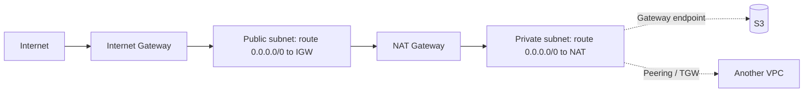

## 1. Core Concept

**Amazon VPC** is your own private virtual network in AWS: you choose the IP range (CIDR), divide it into subnets by AZ, and decide routing with route tables and gateways to and from the Internet. It solves the problem of **network isolation and control** for every service running in the account.

**Mental model:** a VPC is **a walled complex**; subnets are the buildings (each in exactly one AZ); route tables are **the road signs**; the Internet Gateway is **the main gate** and the NAT Gateway is **a one-way exit gate**.

## 2. How It Works

**Subnet and Route Table → Public or private**
- A subnet is **public** when its route table has `0.0.0.0/0` pointing to an **Internet Gateway (IGW)** and the resources have a public IP/Elastic IP. Without that route it is **private**.
- Each subnet lives in **exactly one AZ**, and AWS reserves **5 IPs** in each subnet (network address, router, DNS, reserved for future use, broadcast). Example: a `/24` subnet has 256 addresses, **251** usable.

**NAT Gateway → One-way access to the Internet**
- Placed in a **public subnet**, it lets instances in a private subnet **go out** (to update packages) while blocking connections from outside coming in. It is **tied to one AZ**: you need **one NAT Gateway per AZ** for fault tolerance. IPv6 uses an **Egress-only Internet Gateway**.

**VPC Endpoint → Without crossing the Internet**
- A **Gateway endpoint** is only for **S3 and DynamoDB**, is **free**, and adds a route to the route table. An **Interface endpoint (PrivateLink)** uses an ENI in the subnet, is billed per hour and per GB, and supports most other services.
- Impact: S3 traffic through NAT incurs per-GB processing charges, while through a Gateway endpoint it is free.

**Connecting multiple VPCs → Peering or Transit Gateway**
- **VPC Peering** is a 1-to-1 relationship, **non-transitive**, the two VPCs **must not have overlapping CIDRs**, and it works cross-Region and cross-account.
- **Transit Gateway** is hub-and-spoke with **transitive routing**, replacing a tangled mesh of peering when there are many VPCs.

**Traffic filtering**
- **Security Group** (stateful, Allow-only, instance level) and **NACL** (stateless, has Deny, subnet level).

```bash
aws ec2 create-route --route-table-id rtb-public \
  --destination-cidr-block 0.0.0.0/0 --gateway-id igw-123
```

## 3. Visual Diagram



## 4. Rules of Thumb & Trade-offs

| Situation / Need | What to choose |
| --- | --- |
| A private subnet accessing S3/DynamoDB, cheapest | Gateway endpoint |
| A private subnet needing package updates from the Internet | A NAT Gateway in a public subnet |
| Privately accessing other AWS services | Interface endpoint |
| 2–3 VPCs connected directly | VPC Peering |
| Many VPCs needing transitive connectivity | Transit Gateway |
| Block an IP | NACL |

- **What you gain:** isolation, control over routing, lower NAT cost through endpoints. **What you lose:** a NAT Gateway is billed per hour and per GB; Transit Gateway costs more than Peering.

## 5. Must Remember / Production Pitfalls

- **A peers with B, B peers with C but A cannot reach C → Peering is non-transitive → peer A–C directly or use Transit Gateway**.
- **Two VPCs with overlapping CIDRs cannot peer → design non-overlapping CIDRs from the start** (especially when connecting on-prem).
- **Internet access is lost when one AZ fails → only one NAT Gateway → one NAT per AZ, route per AZ**.
- **A high NAT bill → S3 traffic goes through NAT → use a Gateway endpoint**.
- **An instance in a public subnet still cannot reach the Internet → missing a public IP or a 0.0.0.0/0 route to the IGW → check both**.
- Exam trap: "a private subnet accessing S3 without the Internet, cheapest" → **Gateway endpoint**; "A–B, B–C: can A reach C" → **no**; "can two VPCs with overlapping CIDRs peer" → **no**.

## 6. Search Hooks

- `VPC subnet route table public private` — what makes a subnet public.
- `NAT Gateway high availability per AZ` — one NAT per AZ for fault tolerance.
- `VPC gateway endpoint vs interface endpoint` — the two kinds of endpoints.
- `VPC peering transitive routing` — why Peering is non-transitive.
- `AWS Transit Gateway` — a hub connecting many VPCs and on-prem.
- `security group vs network ACL` — two layers of traffic filtering.
