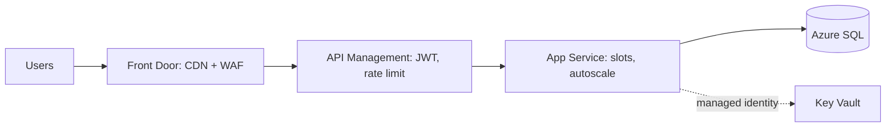

## 1. Core Concept

**App Service** runs web apps/APIs as PaaS (no servers to manage), **API Management (APIM)** is an API gateway applying policies (authentication, rate limiting, transformation, versioning), and **Front Door/Application Gateway** is the L7 load balancer in front. These three layers solve three pains: **running applications with less operations**, **publishing and protecting APIs consistently**, and **bringing traffic to the right place, safely, globally**.

**Mental model:** App Service is **a pre-built office building for rent** (you just bring your tools), APIM is **the building's reception desk** (checking badges, limiting visits, forwarding), and Front Door is **the gate of the whole complex** routing visitors to the right building by location, with security.

## 2. How It Works

**App Service → PaaS for web/APIs**
- Runs in an **App Service Plan** (**Free/Shared/Basic/Standard/Premium/Isolated** tiers) that determines resources and features; several apps can share one plan. **Scale up** (change size) vs **scale out** (add instances, **autoscale** from Standard by metric/schedule).
- **Deployment slots** (from Standard): staging and production of the same app, **swapped** with no downtime after warm-up; settings marked as **slot settings** stick to the slot. **Always On** keeps the app from idling (not available on Free/Shared).
- **Networking**: **VNet integration** for **outbound** traffic from the app into the VNet; **Private Endpoint** for private **inbound**; **App Service Environment** (Isolated) for full isolation. Fetch secrets with a **Key Vault reference** and **managed identity**.

**API Management → API gateway**
- Three parts: the **gateway** (handles requests), the **management plane** and the **developer portal**. **Policies** run in four phases `inbound → backend → outbound → on-error`: `rate-limit-by-key`, `quota`, `validate-jwt`, `set-header`, `cache-lookup`, `rewrite-uri`, `mock-response`.
- **Products + subscription keys** control who can call which API; **named values** store configuration/secrets; a **version** (breaking change, separate path) differs from a **revision** (safe change). **Tiers**: Consumption, **Developer (no SLA, not for production)**, Basic, Standard, **Premium** (multi-Region, VNet).

**L7 load balancing and routing**
- **Application Gateway** (in-Region): WAF, URL/host routing, **SSL offload**, autoscale. **Front Door** (global): anycast, **CDN + WAF**, caching, multi-Region failover, **Private Link** to the origin. **Traffic Manager**: DNS-based, only returns endpoints, depends on TTL; **Load Balancer**: L4.

```xml
<inbound>
  <validate-jwt header-name="Authorization" failed-validation-httpcode="401">
    <openid-config url="https://login.microsoftonline.com/{tenant}/v2.0/.well-known/openid-configuration" />
  </validate-jwt>
  <rate-limit-by-key calls="100" renewal-period="60" counter-key="@(context.Subscription.Id)" />
</inbound>
```

## 3. Visual Diagram



## 4. Rules of Thumb & Trade-offs

| Situation / Need | What to choose |
| --- | --- |
| A PaaS web app, no servers to manage | App Service |
| Zero-downtime deployment | Deployment slot swap |
| Rate limit, JWT, quota, versioning for APIs | API Management |
| Global L7, CDN, WAF, multi-Region failover | Front Door |
| L7 within one Region, WAF, URL routing | Application Gateway |
| DNS routing, any protocol | Traffic Manager |
| L4 TCP/UDP | Load Balancer |

- **What you gain:** less operations, consistent API policy. **What you lose:** less control than VMs/AKS; APIM and Front Door cost money and add one hop of latency.

## 5. Must Remember / Production Pitfalls

- **After a swap, production uses staging config → slot settings were forgotten → mark environment-specific settings as slot settings**.
- **The app idles and the first request is slow → Free/Shared has no Always On → use Basic or higher and enable Always On**.
- **Scaling out loses state → it was kept in instance memory → external Redis/DB**.
- **APIM Developer tier running production → no SLA → use Standard/Premium**.
- **The backend is exposed to the Internet, bypassing APIM → the origin is still public → restrict access to APIM/Front Door only (Private Link, IP restriction)**.
- Exam trap: "zero-downtime deployment on App Service" → **slot swap**; "global L7 load balancing with WAF" → **Front Door**; "rate limit and JWT for APIs" → **API Management policies**.

## 6. Search Hooks

- `Azure App Service deployment slots swap` — zero-downtime deployment.
- `App Service plan scale up vs scale out` — the two scaling styles.
- `Azure API Management policies` — API gateway policies.
- `Azure Front Door vs Application Gateway` — global L7 vs in-Region.
- `Azure Traffic Manager` — DNS-based load balancing.
