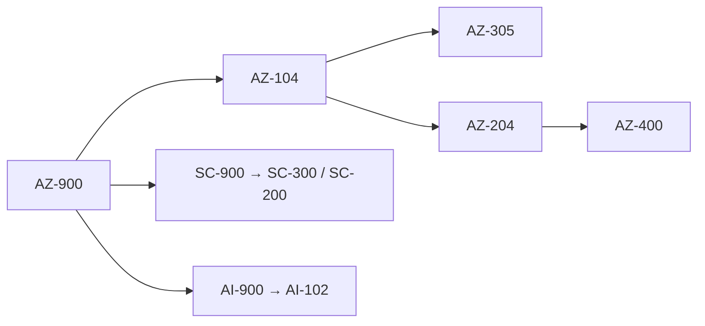

## 1. Core Concept

Microsoft Azure certifications are split by **role and level**: **Fundamentals** (AZ-900 Azure, AI-900 AI, DP-900 data, SC-900 security), **Associate** (AZ-104 Administrator, AZ-204 Developer, AI-102 AI Engineer, SC-200/SC-300…), **Expert** (AZ-305 Solutions Architect, AZ-400 DevOps). Exam codes and the list change over time (for example DP-203 has been replaced by the Fabric Data Engineer certification), so **always cross-check Microsoft Learn** before choosing.

**Mental model:** choose by **job role**, then study from the **"skills measured"** table (domains and weightings) in the exam's study guide; Azure usually asks you to choose the **right service** under constraints of **cost, SLA, compliance and operational complexity**.

## 2. How It Works

**Suggested path**
- AZ-900 (foundations) → **AZ-104** (administration: identity/governance, storage, compute, networking, monitoring) → **AZ-305** (solution design) or **AZ-204** (development) → **AZ-400** (DevOps).
- **Data/AI branch**: DP-900 → a data engineer certification; AI-900 → AI-102. **Security branch**: SC-900 → SC-300 (identity), SC-200 (SecOps), SC-100 (architect).

**Exam format**
- About 40–60 questions, a 1000-point scale with a passing mark usually of **700**; there are **case studies** (several questions based on one scenario), **drag-and-drop**, chained **yes/no** items and multiple-answer questions. Check the specifics in the current study guide.

**Mapping to lessons in this Playbook**
- **Foundations**: core architecture, governance/cost. **Identity/security**: Entra ID/RBAC, Key Vault/Defender. **Compute**: VMs, App Service/Functions/containers. **Networking**: VNet, load balancing, hybrid. **Data**: Storage, SQL/Cosmos, data platform, messaging. **DevOps**: Bicep/Azure DevOps. **Monitoring**: Azure Monitor.

**Composite SLA calculation**
- Services **in series**: multiply SLAs (for example 99.95% × 99.99% ≈ **99.94%**). **Parallel** redundancy: failure probabilities multiply (two instances at 99.9% each → about 99.9999%). Adding a dependent service **lowers** the composite SLA.

**Exam technique**
- Underline constraint keywords (cheapest, least operations, compliance, latency), eliminate answers that violate them, prefer **PaaS/managed** unless stated otherwise; take the **practice assessment** on Microsoft Learn and practice in a sandbox.

## 3. Visual Diagram

## 4. Rules of Thumb & Trade-offs

| Situation / Need | What to choose |
| --- | --- |
| Brand new to Azure | AZ-900 |
| Administering Azure infrastructure | AZ-104 |
| Designing solutions | AZ-305 |
| Programming cloud applications | AZ-204 |
| DevOps/CI-CD | AZ-400 |
| Security | SC-series |

- **What you gain:** a clear path, focused study. **What you lose:** studying broadly costs time versus studying deeply the high-weight domains; old material goes stale easily.

## 5. Must Remember / Production Pitfalls

- **Confusing Availability Zone with Region pair → choosing AZ for a whole-Region-loss problem → AZ tolerates datacenter failure, DR needs another Region**.
- **Confusing Entra roles with Azure RBAC roles → choosing the wrong kind of role → Entra manages identity, RBAC manages Azure resources**.
- **Confusing Azure Policy with RBAC → enforcing Region/tag with roles → Policy controls resources, RBAC controls who can do what**.
- **Studying old names (Azure AD, Blueprints…) → outdated → cross-check the current study guide**.
- **Ignoring composite SLA → miscalculating availability when chaining several services → multiply the SLAs of components in series**.
- Exam trap: "prevent creating resources outside allowed Regions" → **Azure Policy**, not RBAC; "tolerate datacenter failure" → **Availability Zone**; "SLA of two services in series" → **multiply SLAs, lower than either one**.

## 6. Search Hooks

- `Azure certification paths` — the path by role.
- `AZ-104 skills measured` — the domains of AZ-104.
- `AZ-305 solutions architect case study` — the architecture exam format.
- `Microsoft Learn practice assessment` — the official practice assessment.
- `Azure composite SLA calculation` — calculating composite SLA.
