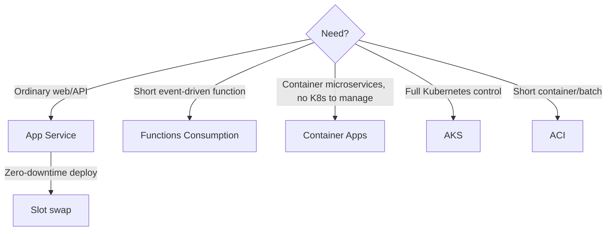

## 1. Core Concept

Beyond VMs, Azure offers a whole spectrum of compute with **less operational work**: **App Service** (PaaS for web/APIs), **Azure Functions** (event-driven serverless), **Container Apps/ACI** (containers without managing a cluster) and **AKS** (managed Kubernetes). Choosing the right rung decides how much **operations** you carry in exchange for how much **control**.

**Mental model:** think of **a ladder**: at the bottom you manage everything yourself (VMs, AKS), higher up Azure gradually takes over the infrastructure (Container Apps, App Service), and at the top you only write functions and pay per execution (Functions). Each step up means **less control but less work**.

## 2. How It Works

**App Service → PaaS for web/APIs**
- Runs .NET, Java, Node.js, Python… inside an **App Service Plan** (which determines the **Free/Shared/Basic/Standard/Premium/Isolated** tier, size and scale); several apps share one plan and therefore share its resources and bill.
- **Deployment slots** (from the **Standard** tier): a staging environment of the same app that you **swap** into production with **no downtime** after warm-up. Settings marked as **slot settings** stick to their slot and do not swap with it. **Scale up** (change size) versus **scale out** (add instances, autoscale from Standard).

**Azure Functions → Event-driven serverless**
- A function is bound to a **trigger** (HTTP, Timer, Queue, Blob, Event Grid, Service Bus) and **bindings** (declarative data read/write, less code). **Plans:** **Consumption** (pay per execution, **scales to 0**, has **cold start**, short default timeout), **Flex Consumption/Premium** (pre-warmed instances, **VNet support**, avoids cold start) and **Dedicated** (runs on an App Service Plan). **Durable Functions** handle stateful workflows (fan-out/fan-in, waiting for human approval).

**Containers → ACI, Container Apps, AKS**
- **ACI**: runs a single container quickly, **billed per second**, no cluster; fits short tasks/batch.
- **Container Apps**: a serverless container platform (Kubernetes-based), scaling on HTTP/events with **KEDA**, **scaling to 0**, supporting revisions and traffic splitting; good for microservices.
- **AKS**: managed Kubernetes — Azure manages the **control plane**, you manage **node pools** (autoscaler, upgrades, node patching); needed when you want full Kubernetes control (operators, custom networking).
- **ACR** stores images (Basic/Standard/Premium SKUs, geo-replication on Premium).

**Related**
- **Logic Apps** (low-code integration workflows), **Service Bus/Event Grid/Event Hubs** (messaging and events).

```python
import azure.functions as func
app = func.FunctionApp()

@app.blob_trigger(arg_name="blob", path="uploads/{name}", connection="Storage")
def on_upload(blob: func.InputStream):
    print(f"New blob {blob.name} ({blob.length} bytes)")
```

## 3. Visual Diagram



## 4. Rules of Thumb & Trade-offs

| Situation / Need | What to choose |
| --- | --- |
| Ordinary web/API, low operations | App Service |
| Run code when a new blob arrives, pay per execution | Azure Functions |
| Need VNet and no cold start | Functions Premium/Flex |
| Container microservices, no Kubernetes to manage | Container Apps |
| Full Kubernetes control | AKS |
| One short container/batch | ACI |
| Zero-downtime deployment | Deployment slot |

- **What you gain:** less operations, automatic scaling, pay per use. **What you lose:** serverless has cold starts and limits on run time/context; AKS is the most flexible but the most operational work.

## 5. Must Remember / Production Pitfalls

- **The first call after idle is slow → Consumption cold start → Premium/Flex or keep an instance warm**.
- **A slot swap makes production use staging config → you forgot to mark slot settings → mark environment-specific settings as slot settings**.
- **Several apps in one App Service Plan fight for resources → one CPU-hungry app drags the group down → separate plans for critical apps**.
- **AKS nodes do not patch the OS by themselves → security risk accumulates → enable auto-upgrade/node image upgrade**.
- **Using AKS for a simple application → excess operations → Container Apps or App Service**.
- Exam trap: "run code when a new file lands in Blob, pay per execution" → **Functions**; "zero-downtime deployment" → **deployment slots**; "containers without managing a cluster" → **Container Apps**.

## 6. Search Hooks

- `Azure App Service plan deployment slots` — PaaS web hosting and zero-downtime swaps.
- `Azure Functions triggers and bindings` — how Functions connect events and data.
- `Azure Functions Consumption vs Premium plan` — the trade-off between cost, cold start and VNet.
- `Azure Container Apps vs AKS` — serverless containers versus self-managed Kubernetes.
- `Azure Container Instances` — run a single container quickly, no cluster needed.
- `Durable Functions orchestration` — stateful workflows on Functions.
