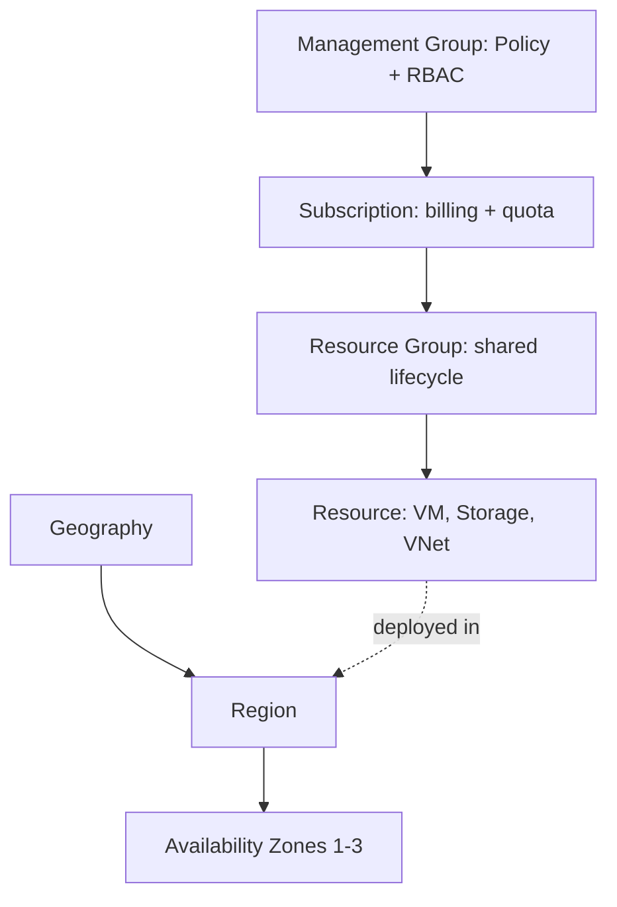

## 1. Core Concept

Azure's foundation has **two axes** you must keep separate: the **physical infrastructure** (Geography → Region → Availability Zone), which determines **latency, fault tolerance and where data lives**, and the **management structure** (Management Group → Subscription → Resource Group → Resource), which determines **who pays, who can do what and which policies apply**. Every Azure design, from the AZ-900 exam to a real architecture, starts by getting these two axes right.

**Mental model:** think of **a corporation with many branches**: a Region is the city where a branch sits, an Availability Zone is an independent building within the city, and Management Group/Subscription/Resource Group are the **org chart and the ledger** — they decide which department may spend money and which house rules it follows.

## 2. How It Works

**Physical infrastructure → Choosing where resources live**
- A **Region** is a set of datacenters within a low-latency perimeter; a Region belongs to a **Geography** (a data and compliance boundary, such as Europe or Southeast Asia). Choose a Region by **latency to users**, **data residency/compliance**, **service availability** and **price** (the same VM can cost differently between Regions).
- **Availability Zones (AZ)** are physically separate locations (independent power, cooling and networking) within **one Region**; a Region that supports AZs has **at least 3 zones**. A service can be **zonal** (pinned to one zone, you replicate yourself) or **zone-redundant** (Azure spreads it across zones for you).
- **Region pair**: many Regions are paired with another Region in the same geography (usually far apart) for DR; Azure **updates paired Regions sequentially** and prioritizes recovery of one Region in each pair. Not every Region has a pair or AZs.
- **SLA example:** a single VM with Premium SSD is about **99.9%**, two VMs in an availability set **99.95%**, two VMs in different AZs **99.99%**.

**Management structure → Policy and permissions inherit top-down**
- **Management Groups** group many subscriptions to apply **Azure Policy/RBAC** at scale (nesting up to 6 levels).
- A **Subscription** is the **billing** and **quota** boundary (for example vCPU limits per Region and per VM family). Split by prod/dev environment or business unit.
- A **Resource Group (RG)** is a logical container for resources that share a **lifecycle**; each resource belongs to **exactly one** RG, RGs **cannot be nested**, and you can move resources between RGs.
- **Azure Resource Manager (ARM)** is the management layer for every operation (portal, CLI, SDK) and deploys **ARM templates/Bicep** declaratively (IaC). All management access passes through ARM, so RBAC, Policy and locks all apply there.

**Protecting resources**
- **Resource locks** (`CanNotDelete`, `ReadOnly`) block accidental deletion/modification; **tags** attribute cost (they are not inherited automatically unless you use Policy).

**Shared Responsibility model**
- From on-premises → **IaaS** → **PaaS** → **SaaS**, the higher you go the more Azure manages, but **data, identity and access are always the customer's responsibility**.

```bash
az group create --name rg-orders-prod --location southeastasia
az lock create --name nodelete --lock-type CanNotDelete --resource-group rg-orders-prod
```

## 3. Visual Diagram



## 4. Rules of Thumb & Trade-offs

| Situation / Need | What to choose |
| --- | --- |
| Survive a single datacenter failure | Zone-redundant across at least 2 AZs |
| Survive a whole-Region failure | Region pair / DR to another Region |
| Group many subscriptions to apply policy | Management Group |
| Billing and quota boundary | Subscription |
| Group resources with a shared lifecycle | Resource Group |
| Block accidental deletion | CanNotDelete resource lock |

- **What you gain:** centralized governance, clear cost and permissions, fault tolerance at each level. **What you lose:** many subscriptions/management groups isolate well but add administrative work; zone-redundant costs more and adds small cross-zone latency.

## 5. Must Remember / Production Pitfalls

- **Deleting a Resource Group → every resource inside is lost → use a CanNotDelete resource lock and split RGs by lifecycle**.
- **Treating an RG as a network boundary → resources in different RGs still talk over the VNet → control networking with VNet/NSG, not with RGs**.
- **A large deployment is blocked → quotas are per subscription and Region → request a quota increase before deploying**.
- **Expecting every Region to have AZs → not every Region/service supports them → check the AZ support table before designing**.
- **Confusing Availability Zone with Region pair → assuming AZs survive a whole-Region incident → AZs only tolerate datacenter failure, Region-level DR needs a pair/another Region**.
- Exam trap: "group many subscriptions to apply policy" → **Management Group**; "billing boundary" → **Subscription**; "datacenter-level failure" → **Availability Zone**; "how many RGs does a resource belong to" → **exactly one**.

## 6. Search Hooks

- `Azure regions and availability zones` — physical infrastructure and how to choose a Region/AZ.
- `Azure region pairs` — paired Regions for DR and sequential updates.
- `Azure management groups subscriptions resource groups` — the management hierarchy and policy inheritance.
- `Azure Resource Manager ARM Bicep` — Azure's management layer and declarative IaC.
- `Azure shared responsibility IaaS PaaS SaaS` — division of responsibility by service model.
