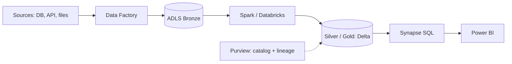

## 1. Core Concept

The Azure data platform revolves around a **data lake** on **ADLS Gen2**: **Data Factory** ingests and orchestrates, **Synapse/Databricks** transform and analyze, **Power BI** visualizes, **Purview** governs, and **Microsoft Fabric** packages it all into a unified SaaS platform. They solve the problem of gathering scattered data into one cheap place and then using the right engine for each need.

**Mental model:** the lake is **a huge raw-materials warehouse**; ADF is **the trucks plus delivery schedule** that bring materials in; Spark/Databricks is **the processing workshop**; Synapse SQL is **the finished-goods counter** for analysts; and **medallion** (Bronze → Silver → Gold) is how you stack the shelves from raw materials to verified finished goods.

## 2. How It Works

**ADLS Gen2 → The lake**
- It is **Blob Storage + hierarchical namespace** (real directories, fast rename/delete of directories), supports **POSIX-style ACLs** alongside RBAC, and is accessed through `abfss://`. Layered as **medallion**: **Bronze** (raw), **Silver** (cleaned), **Gold** (BI-serving models).

**Data Factory → Ingest and orchestrate**
- A **pipeline** consists of **activities** (Copy, Data Flow, Lookup, ForEach…), **linked services** (connections) and **datasets**. **Integration runtimes**: Azure IR, **self-hosted IR** for connecting to on-premises, Azure-SSIS. **Triggers**: schedule, tumbling window, event. **Mapping data flows** run on Spark.

**Synapse Analytics → Warehouse and querying the lake**
- A **dedicated SQL pool** (MPP, 60 distributions; **hash/round-robin/replicated** distribution types; **billed while running**, can be **paused**) and a **serverless SQL pool** (queries files directly on the lake with T-SQL, **pay per data processed**, no cluster to provision). It also has Spark pools and pipelines.

**Databricks → Spark and lakehouse**
- Managed Spark, notebooks, jobs; **Delta Lake** adds **ACID transactions**, schema enforcement, **time travel** and `MERGE` on Parquet files; **Unity Catalog** provides central governance.

**Fabric → Unification**
- **OneLake** (one logical lake for the whole organization), Lakehouse, Warehouse, Data Factory, Real-Time Intelligence and Power BI on one platform billed by **capacity**; **Direct Lake** lets Power BI read straight from the lake.

**Streaming and governance**
- **Event Hubs + Stream Analytics/Spark** for real-time data; **Purview** for catalog, lineage and data classification.

```sql
-- Synapse serverless: query Parquet on the lake, pay per data scanned
SELECT TOP 10 country, SUM(amount) AS total
FROM OPENROWSET(BULK 'https://lake.dfs.core.windows.net/gold/sales/*.parquet',
                FORMAT = 'PARQUET') AS r
GROUP BY country ORDER BY total DESC;
```

## 3. Visual Diagram



## 4. Rules of Thumb & Trade-offs

| Situation / Need | What to choose |
| --- | --- |
| Orchestrate ETL by schedule/event | Data Factory |
| Query Parquet on the lake quickly, no cluster | Synapse serverless SQL |
| MPP warehouse, steady BI load | Synapse dedicated pool |
| Spark/ML lakehouse, Delta Lake | Databricks |
| A unified platform with low operations | Microsoft Fabric |
| Catalog, lineage, data classification | Purview |

- **What you gain:** cheap storage, flexible engines per need. **What you lose:** many separate services add complexity; Fabric is simpler but tightly bound to the platform and the capacity model.

## 5. Must Remember / Production Pitfalls

- **A high Synapse bill → the dedicated pool keeps running when unused → pause the pool or use serverless**.
- **Joins/aggregates are slow on a dedicated pool → a wrong distribution key causes data movement → hash on the join column, replicated for small tables**.
- **Lake queries are slow → too many small files → compact files, Delta Lake OPTIMIZE**.
- **A messy lake where anyone can read/write → ACL/RBAC is missing → grant permissions per container/directory**.
- **An ADF pipeline rerun creates duplicate data → it is not idempotent → write by partition/overwrite or upsert**.
- Exam trap: "query Parquet on the lake without a cluster" → **Synapse serverless SQL**; "ACID on a data lake" → **Delta Lake**; "orchestrate ETL on a schedule" → **Data Factory**.

## 6. Search Hooks

- `Azure Data Lake Storage Gen2 hierarchical namespace` — the lake on Blob.
- `medallion architecture bronze silver gold` — the data layers.
- `Azure Synapse dedicated vs serverless SQL pool` — the two SQL modes.
- `Delta Lake ACID` — transactions on a data lake.
- `Microsoft Fabric OneLake` — the unified data platform.
