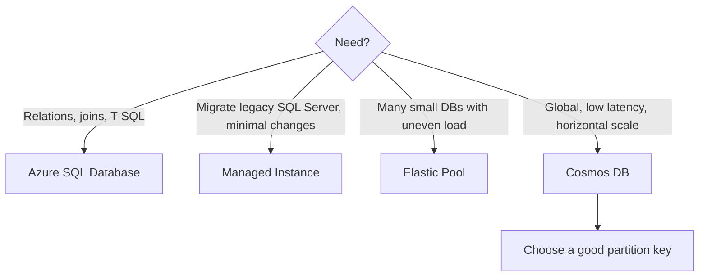

## 1. Core Concept

Azure has two main data pillars: **Azure SQL** (the managed relational family: SQL Database, Managed Instance, SQL Server on VMs) and **Cosmos DB** (a globally distributed multi-model NoSQL database). They solve two different problems: **transactions and relations with T-SQL** (Azure SQL) and **horizontal scale and low latency across many Regions with tunable consistency** (Cosmos DB).

**Mental model:** Azure SQL is **an accounting ledger** (tight relations, ACID transactions, flexible queries); Cosmos DB is **a filing-cabinet system replicated across many cities** (very fast access by key, each cabinet has a read/write budget — **RU/s** — and you choose how "in sync" the cabinets are).

## 2. How It Works

**Azure SQL → Choose a deployment option and purchasing model**
- **SQL Database** (PaaS, one database is one unit, **serverless** with auto-pause), **Elastic Pool** (many databases sharing resources, good for uneven loads), **Managed Instance** (nearly full SQL Server compatibility, easy **lift-and-shift**), **SQL on VMs** (full-control IaaS).
- **Purchasing models**: **DTU** (bundled) vs **vCore** (choose compute/storage separately). **Tiers**: General Purpose, **Business Critical** (readable replicas, low latency), **Hyperscale** (storage up to 100 TB, fast restore).
- **HA/DR**: automatic backups and **PITR** (7 days by default, up to 35), **long-term retention** up to 10 years, **zone redundancy**, **active geo-replication** and **auto-failover groups** (read-write and read-only endpoints that stay stable across a failover).
- **Security**: **TDE** by default, **Always Encrypted**, **dynamic data masking**, **Entra ID auth**, **Private Endpoint**, auditing, Defender for SQL.

**Cosmos DB → Resource model and throughput**
- The structure is **account → database → container → item**; several APIs (**NoSQL**, MongoDB, Cassandra, Gremlin, Table, PostgreSQL). **Automatic indexing** of all properties.
- The **partition key** decides how data and load are distributed: items with the same key belong to one **logical partition** (up to 20 GB). **A good key**: high cardinality, even distribution, and **present in most queries**.
- **RU/s (Request Units)** are the throughput unit: a point read of a 1 KB item costs about **1 RU**, writes cost more, **cross-partition** queries cost more. Exceeding the budget returns **HTTP 429**. Modes: **provisioned** (manual or **autoscale**) and **serverless**.
- **Five consistency levels**: **Strong, Bounded Staleness, Session** (default), **Consistent Prefix, Eventual** — the stronger the level, the more latency/RU it costs and the lower multi-Region availability. **Multi-Region** writes resolve conflicts by **last-writer-wins** by default.
- The **change feed** is an ordered stream of changes used to trigger processing/synchronization.

```csharp
var resp = await container.ReadItemAsync<Order>(
    id: "o-1001", partitionKey: new PartitionKey("customer-42"));
Console.WriteLine(resp.RequestCharge); // ~1 RU for a point read
```

## 3. Visual Diagram



## 4. Rules of Thumb & Trade-offs

| Situation / Need | What to choose |
| --- | --- |
| A new relational, transactional application | Azure SQL Database |
| Migrate on-premises SQL Server with minimal changes | Managed Instance |
| Many small DBs with uneven load | Elastic Pool |
| Sparse load, tolerant of auto-pause | SQL serverless |
| Global, key-value/document, large scale | Cosmos DB |
| A sensible default consistency level | Session |

- **What you gain:** SQL for strong queries and constraints; Cosmos for scale and globally consistent latency. **What you lose:** **Strong** consistency costs RU and latency; Cosmos is weak at cross-partition queries and joins.

## 5. Must Remember / Production Pitfalls

- **Cosmos returns 429 even though total RU remains → a hot partition from a skewed key → choose a key with even distribution and high cardinality**.
- **A query costs a lot of RU → it is cross-partition → include the partition key in the query condition**.
- **A high Cosmos bill with sparse load → RU/s fixed at a high value → autoscale or serverless**.
- **A failover group does not switch the application → the app points directly at the primary server → use the failover group endpoint**.
- **Confusing Managed Instance with SQL Database → missing instance-level features (SQL Agent, cross-DB) → choose MI when you need near-full compatibility**.
- Exam trap: "Cosmos default consistency level" → **Session**; "migrate on-premises SQL Server with the least change" → **Managed Instance**; "Cosmos frequent 429" → **a hot partition or insufficient RU**.

## 6. Search Hooks

- `Cosmos DB consistency levels` — the five consistency levels.
- `Cosmos DB partition key request units` — designing partitions and RUs.
- `Azure SQL elastic pool vs managed instance` — choosing a deployment option.
- `Azure SQL failover groups` — multi-Region failover.
- `Cosmos DB change feed` — the stream of data changes.
