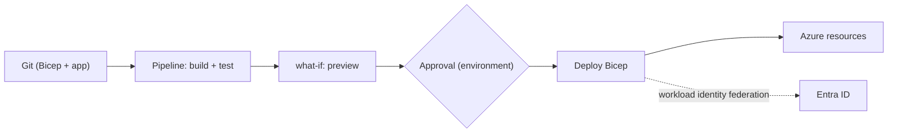

## 1. Core Concept

On Azure, **Infrastructure as Code (IaC)** uses **ARM templates** (native JSON), **Bicep** (a concise DSL that compiles to ARM) or **Terraform**; **Azure DevOps** or **GitHub Actions** run CI/CD pipelines to deploy automatically. They solve the pain of building infrastructure by hand: not repeatable, not reviewable, not testable.

**Mental model:** a template is **a blueprint declaring the desired state**; Azure Resource Manager is **the builder** who compares the blueprint with the building and only fixes what differs; `what-if` is **a preview of changes**; a pipeline is **an assembly line** that passes the blueprint through checks before building, with an approval gate.

## 2. How It Works

**Bicep and ARM → Declaring infrastructure**
- Bicep has `param`, `var`, `resource`, `module`, `output`, loops and conditions; it compiles to ARM JSON. Deployments are idempotent at several **scopes**: resource group, subscription, management group, tenant (`az deployment group|sub|mg create`).
- **`what-if`** shows which resources will be created/modified/deleted before applying.
- **Deployment mode**: **Incremental** (default, only adds/modifies) vs **Complete** (deletes resources **not in** the template — dangerous). **Template specs** and **deployment stacks** package and manage lifecycle.

```bicep
param location string = resourceGroup().location
resource sa 'Microsoft.Storage/storageAccounts@2023-01-01' = {
  name: 'st${uniqueString(resourceGroup().id)}'
  location: location
  sku: { name: 'Standard_LRS' }
  kind: 'StorageV2'
}
```

**Azure DevOps → CI/CD**
- **Repos, Boards, Pipelines, Artifacts, Test Plans**. A **YAML pipeline** has `trigger`, `pool`, **stages → jobs → steps**, `variables`, reusable **templates**; **environments** attach **approvals and checks** before deploying; **agents** are Microsoft-hosted or self-hosted (to reach internal networks).
- A **service connection** to Azure should prefer **workload identity federation** (no stored secret, no expiring secret) over a client secret. A **variable group** linked to Key Vault keeps secrets out of the pipeline.
- **Deployment strategies**: `runOnce`, `rolling`, `canary`; for App Service use **slot swap**. GitHub Actions can also use OIDC.

**Guardrails**
- **Azure Policy**/**landing zone** enforce standards; combine with **what-if** in PRs to review infrastructure changes.

```yaml
stages:
- stage: Deploy
  jobs:
  - deployment: infra
    environment: prod        # has an approval check
    strategy:
      runOnce:
        deploy:
          steps:
          - task: AzureCLI@2
            inputs: { azureSubscription: 'wif-prod', scriptType: bash, scriptLocation: inlineScript,
                      inlineScript: 'az deployment group what-if -g rg-app -f main.bicep' }
```

## 3. Visual Diagram



## 4. Rules of Thumb & Trade-offs

| Situation / Need | What to choose |
| --- | --- |
| IaC for Azure only | Bicep |
| Multicloud IaC | Terraform |
| Preview changes before deploying | `what-if` |
| Zero-downtime web app deployment | Slot swap |
| A pipeline accessing Azure without stored secrets | Workload identity federation |
| An approval gate before production | Environment approvals |

- **What you gain:** versioned, reviewed, repeatable infrastructure. **What you lose:** Bicep is tied to Azure; Terraform adds a tool and state management; pipelines need careful permission and secret management.

## 5. Must Remember / Production Pitfalls

- **Resources deleted unexpectedly → Complete mode was used → use Incremental and run `what-if` first**.
- **A pipeline breaks when a secret expires → a service principal secret → workload identity federation or managed identity**.
- **Secrets sit in pipeline variables → leaked in logs/repo → Key Vault + variable group**.
- **A duplicate storage name causes an error → names are globally unique → `uniqueString(resourceGroup().id)`**.
- **A service connection has overly broad permissions → a hijacked pipeline loses the subscription → minimal RBAC by scope**.
- Exam trap: "preview changes before deploying" → **what-if**; "multicloud IaC" → **Terraform**; "a pipeline accessing Azure without stored secrets" → **workload identity federation**.

## 6. Search Hooks

- `Bicep vs ARM templates` — Azure's IaC languages.
- `az deployment what-if` — previewing changes.
- `Azure DevOps YAML pipelines` — CI/CD on Azure DevOps.
- `workload identity federation Azure DevOps` — authentication without secrets.
- `Azure Policy landing zone` — guardrails and landing zones.
