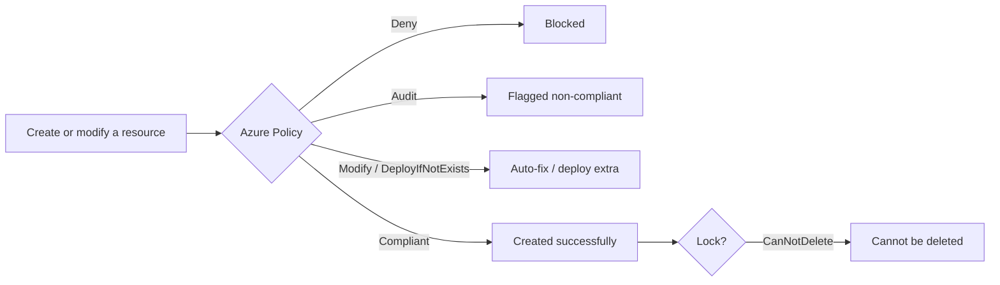

## 1. Core Concept

**Governance** on Azure is the toolset to **set rules**, **protect resources** and **control cost** across many subscriptions: **Azure Policy** (rules about resources), **resource locks** (block accidental deletion/modification), **tags** (classification and cost attribution) and **Cost Management** (measuring and alerting on cost). The most commonly confused point is distinguishing **Policy** (what resources may look like) from **RBAC** (what users may do).

**Mental model:** RBAC is **an employee's access badge**; Policy is **the building code** (nobody, not even the director, may build against it); a Lock is **a seal** on critical equipment; a Budget is **a meter alarm** that sounds when you exceed the budget but does not cut the power itself.

## 2. How It Works

**Azure Policy → Set rules and evaluate compliance**
- A **policy definition** (JSON) has a `rule` (condition) and an **effect** (action). Group several policies into an **initiative** and **assign** it at any scope (management group, subscription, resource group), optionally **excluding** some scopes.
- The **effects**: `Deny` (block non-compliant create/update), `Audit` (just flag), `AuditIfNotExists`, `Append`/`Modify` (add or change properties such as tags), `DeployIfNotExists` (automatically deploy a missing resource, for example enable diagnostic settings) and `Disabled`.
- Evaluated when resources are **created/updated** and periodically (about every 24 hours). `Deny` **does not fix existing resources**; to bring existing resources into compliance you need a **remediation task** (using a managed identity) for `Modify`/`DeployIfNotExists`.

**Resource locks → Protect from accidental operations**
- `CanNotDelete` (can modify, cannot delete) and `ReadOnly` (cannot modify or delete). Applied at subscription/resource group/resource, **inherited by child resources** and **applying even to Owners** (to remove one you need permission to manage locks).

**Tags → Classification and cost attribution**
- Key-value pairs (`env=prod`, `costCenter=1234`); they are **not inherited automatically** from the resource group to its resources, so use a Policy with `Modify`/`Append` to enforce or inherit tags.

**Cost Management → See and control cost**
- Analyze cost by **scope and tag**, with forecasting; a **Budget** sets thresholds and **alerts** (an Action Group can trigger automation); **Azure Advisor** recommends optimizations (cost, security, reliability, performance). Cost is driven by resource type, Region, size, **outbound bandwidth (egress)** and the pricing model (Reserved, Spot, Hybrid Benefit).
- The **Pricing Calculator** estimates Azure service cost before deployment; the **TCO Calculator** compares total cost of ownership with on-premises infrastructure.

**Compliance**
- **Microsoft Purview** governs data; the **Service Trust Portal** holds compliance documents; **Defender for Cloud** assesses against regulatory standards.

```json
{ "policyRule": {
    "if":   { "field": "tags['costCenter']", "exists": "false" },
    "then": { "effect": "deny" } } }
```

## 3. Visual Diagram



## 4. Rules of Thumb & Trade-offs

| Situation / Need | What to choose |
| --- | --- |
| Require tags on every resource, allow only specific Regions | Azure Policy `Deny` |
| Review before blocking | Policy `Audit` |
| Automatically enable diagnostic settings for new resources | Policy `DeployIfNotExists` |
| Prevent accidental deletion of a production database | CanNotDelete lock |
| Split cost by project/department | Tag + Cost Management |
| Alert when the budget is exceeded | Budget + alert |
| Estimate cost before deployment | Pricing Calculator |

- **What you gain:** systematic compliance, fewer mistakes, transparent cost. **What you lose:** an overly strict Policy `Deny` slows development teams — start with `Audit` and tighten gradually.

## 5. Must Remember / Production Pitfalls

- **An Owner is still blocked from creating resources → Policy Deny does not depend on permissions → fix the policy or add an exemption, do not grant more roles**.
- **A `ReadOnly` lock causes confusing errors (cannot stop a VM, cannot read keys) → operations that seem read-only actually need writes → use `CanNotDelete` unless you truly need ReadOnly**.
- **Cost reports are incomplete → tags are not inherited from the resource group → use Policy to enforce/inherit tags**.
- **The budget is exceeded but resources keep running → a budget only alerts → attach an Action Group/automation if you want to shut things down**.
- **Old resources are still non-compliant after assigning a policy → it only applies to new operations → run a remediation task**.
- Exam trap: "require every resource to have a tag" → **Policy**; "prevent accidental deletion" → **Lock**; "estimate cost before deployment" → **Pricing Calculator**; "compare with on-premises" → **TCO Calculator**.

## 6. Search Hooks

- `Azure Policy effects deny audit modify` — the effects of Azure Policy.
- `Azure Policy initiative remediation` — policy groups and fixing non-compliant resources.
- `Azure resource locks CanNotDelete ReadOnly` — blocking accidental deletion/modification.
- `Azure tags inheritance policy` — tags are not inherited, enforce them with Policy.
- `Azure Cost Management budgets alerts` — tracking and alerting on cost.
- `Azure Pricing Calculator vs TCO Calculator` — estimating Azure cost and comparing with on-premises.
