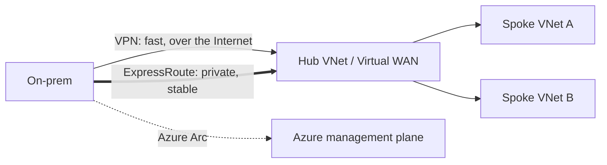

## 1. Core Concept

Connecting on-premises to Azure uses **VPN Gateway** (IPsec over the Internet), **ExpressRoute** (a private line), **Virtual WAN** (a global hub), together with **Azure Arc** (extending Azure management to resources outside Azure) and migration tools (**Azure Migrate, Site Recovery, Data Box**). They answer two questions: **which path to take** and **how to manage/migrate hybrid resources**.

**Mental model:** a VPN is **an encrypted public road** — quick and cheap to set up, but quality depends on the Internet; ExpressRoute is **a private highway** — stable, but expensive and slow to build; Arc is **an antenna linking the Azure control panel** to servers anywhere so you manage them like Azure resources.

## 2. How It Works

**VPN Gateway → Fast, cheap, over the Internet**
- **Site-to-Site** (network-to-network), **Point-to-Site** (user machines), **VNet-to-VNet**; **IPsec** encryption, supports **BGP** and **active-active**; the SKU determines bandwidth. Set up in **tens of minutes**.

**ExpressRoute → Private, stable**
- A private connection through a provider (or ExpressRoute Direct) that **does not traverse the Internet**, with steady latency and a high SLA. **Private peering** (to VNets), **Microsoft peering** (M365, public services); **Global Reach** links two sites over the Microsoft backbone. **Not encrypted by default**; provisioning takes **a few weeks**; use **two connections/two peering locations** or a **VPN backup**.

**Hub-and-spoke and Virtual WAN → Transit**
- **VNet Peering** is **not transitive**; the **hub-and-spoke** model puts shared services (Firewall, Gateway) in the hub and spokes use **gateway transit**. **Virtual WAN** is a managed hub for many sites/VNets in an any-to-any fashion.

**Azure Arc → Hybrid management**
- Attach servers, Kubernetes and SQL outside Azure to the Azure management plane to apply **Policy, Defender, Monitor, RBAC** as if they were Azure resources.

**Migration and DR**
- **Azure Migrate** (discover, assess, migrate), **Site Recovery** (DR for VMs), **Data Box** (a physical device for large data), **AzCopy**, **Azure File Sync**, **DNS Private Resolver**.
- A **Private Endpoint** (a private IP in the VNet) differs from a **Service Endpoint** (extends the VNet identity but still uses the service's public IP).

```bash
az network vnet-gateway create -g rg-net -n vpngw --vnet hub-vnet \
  --gateway-type Vpn --vpn-type RouteBased --sku VpnGw2 --public-ip-address vpngw-ip
```

## 3. Visual Diagram



## 4. Rules of Thumb & Trade-offs

| Situation / Need | What to choose |
| --- | --- |
| A fast, cheap connection | VPN Gateway |
| High bandwidth, stable, private | ExpressRoute (+ VPN backup) |
| Many global sites/VNets | Virtual WAN |
| Manage non-Azure servers with Policy/Defender | Azure Arc |
| Extremely large data, low bandwidth | Data Box |
| DR for VMs | Site Recovery |

- **What you gain:** the right tool for bandwidth/stability. **What you lose:** VPN depends on the Internet; ExpressRoute is expensive with a long lead time; hub-and-spoke needs routing management.

## 5. Must Remember / Production Pitfalls

- **VNets/on-premises cannot connect → overlapping address spaces → plan non-overlapping CIDRs from the start**.
- **ExpressRoute goes down and connectivity is lost → one circuit is a single point of failure → two circuits/peering locations or a VPN backup**.
- **Spoke A cannot reach spoke B → peering is not transitive → route through a Firewall/NVA in the hub or Virtual WAN**.
- **Assuming ExpressRoute is encrypted → it is not encrypted by default → VPN over ExpressRoute or MACsec if needed**.
- **Confusing Service Endpoint with Private Endpoint → PaaS still uses a public IP → Private Endpoint for a private IP**.
- Exam trap: "connect immediately while ExpressRoute takes weeks" → **VPN first**; "manage on-premises servers with Azure Policy" → **Azure Arc**; "a stable private connection not over the Internet" → **ExpressRoute**.

## 6. Search Hooks

- `ExpressRoute vs VPN Gateway` — choosing hybrid connectivity.
- `Azure hub and spoke topology` — the standard network model.
- `Azure Virtual WAN` — a global hub.
- `Azure Arc enabled servers` — managing servers outside Azure.
- `Private Endpoint vs Service Endpoint` — two ways to access PaaS.
