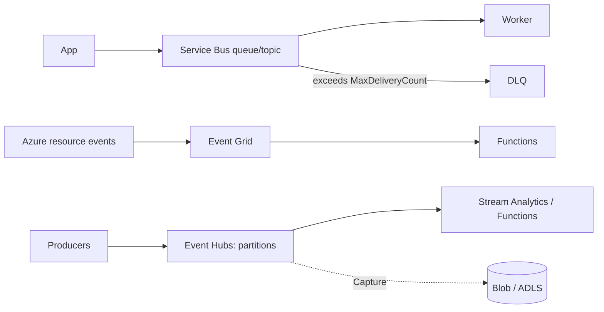

## 1. Core Concept

Azure has three messaging services with **different purposes** (plus a simple one, Storage Queue): **Service Bus** (an enterprise message broker for commands and transactions), **Event Grid** (reactive event distribution, "something happened") and **Event Hubs** (high-volume streaming ingestion, Kafka-compatible). Choosing wrong is the most common design mistake in decoupling problems on Azure.

**Mental model:** Service Bus is **a post office with a delivery receipt** (a letter reaches exactly the right person, order can be guaranteed, bad letters go in a separate bin); Event Grid is **a public-address speaker** ("the file was just uploaded!") for whoever subscribed; Event Hubs is **a conveyor belt that never stops**, accepting millions of records and keeping them so anyone who needs them can read them again.

## 2. How It Works

**Service Bus → Enterprise broker**
- **Queues** (point-to-point) and **Topics/Subscriptions** (pub/sub with **filters**). Receive using **peek-lock** (the message is locked, you `complete` it after processing, and if the lock expires the message reappears) or receive-and-delete.
- The **Dead-letter queue (DLQ)** receives messages that exceed `MaxDeliveryCount` (default **10**) or expire their TTL; **sessions** give FIFO per group; **duplicate detection** prevents duplicates within a time window; **scheduled messages**, **transactions**. Basic/Standard/Premium tiers (Premium: isolation, messages up to 100 MB). **At-least-once** by default.

**Event Grid → Reactive events**
- Sources (Azure services via a **system topic**, or a **custom topic**) **push** events to **handlers** (Functions, Logic Apps, webhooks), filtered by subject/event type, with **retries** on a backoff (up to 24 hours) and **dead-lettering** to Blob. At-least-once and **not retained for replay**.

**Event Hubs → Streaming**
- Data is split into **partitions**; **consumer groups** let multiple applications read independently; a **checkpoint** (usually stored in Blob) marks the read position; **retention** is by days (replay is possible within the period); **Capture** automatically writes to Blob/ADLS; a **Kafka** endpoint lets existing Kafka clients be used. Ordering is guaranteed **only within a partition**; throughput scales with throughput/processing units.

**Storage Queue**
- A simple, cheap queue with large capacity but **no built-in topics, sessions or DLQ** like Service Bus has.

```python
# Service Bus: peek-lock, complete only after processing
with client.get_queue_receiver("orders") as r:
    for m in r.receive_messages(max_message_count=10):
        try:
            handle(m); r.complete_message(m)
        except Exception:
            r.abandon_message(m)   # increments the delivery count, after 10 attempts it goes to the DLQ
```

## 3. Visual Diagram



## 4. Rules of Thumb & Trade-offs

| Situation / Need | What to choose |
| --- | --- |
| Commands/orders needing transactions, ordering, DLQ | Service Bus |
| React to system events ("a blob was just created") | Event Grid |
| High-volume telemetry/logs, replay, Kafka | Event Hubs |
| A simple, cheap queue without broker features | Storage Queue |
| FIFO per group, duplicate protection | Service Bus sessions + duplicate detection |

- **What you gain:** decoupling, absorbing spikes. **What you lose:** Service Bus is feature-rich but has lower throughput than Event Hubs; Event Grid cannot replay; Event Hubs has no DLQ/per-message ack.

## 5. Must Remember / Production Pitfalls

- **The same message is processed twice → at-least-once and lock expiry → idempotent consumers, a suitable lock duration**.
- **A failing message loops forever → a poison message → DLQ and `MaxDeliveryCount`, alert on the DLQ**.
- **An Event Hubs consumer is slow and ordering skews → one partition is overloaded or not fully read → add consumers per partition, choose an even partition key**.
- **You need to replay events but used Event Grid → it does not retain them → use Event Hubs or store to Blob**.
- **Expecting global ordering → ordering exists only within a partition/session → design around keys**.
- Exam trap: "FIFO, transactions, DLQ" → **Service Bus**; "react to Azure resource events" → **Event Grid**; "high-volume telemetry" → **Event Hubs**.

## 6. Search Hooks

- `Azure Service Bus queues topics dead-letter` — the enterprise broker.
- `Azure Event Grid vs Event Hubs vs Service Bus` — comparing the three services.
- `Event Hubs partitions consumer groups` — the streaming model.
- `Event Hubs Kafka endpoint` — using Kafka clients with Event Hubs.
- `Service Bus sessions duplicate detection` — ordering and duplicate protection.
