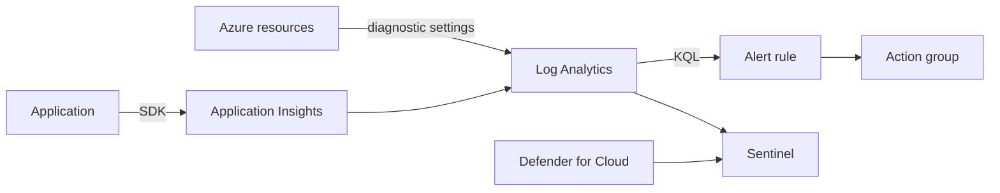

## 1. Core Concept

**Azure Monitor** collects and analyzes **metrics, logs and traces** so you know how the system is running; **Microsoft Defender for Cloud** assesses and protects your **security posture**; **Key Vault** keeps **secrets, keys and certificates** safe; **Sentinel** is a SIEM that detects and responds to incidents. They solve three pains: not seeing what the system is doing, not knowing where configuration is weak, and secrets scattered through code.

**Mental model:** Monitor is **the building's gauges and cameras**; Defender is **a security auditor** who scores you and points to weak spots; Key Vault is **a safe with a logbook** of who opened it; Sentinel is **the central control room** that gathers every camera to spot an intruder.

## 2. How It Works

**Azure Monitor → Observability**
- **Metrics**: lightweight, near real-time numbers (CPU, requests/second), kept for about **93 days**, used for dashboards and fast alerts.
- **Logs**: detailed data stored in a **Log Analytics workspace**, queried with **KQL** (Kusto Query Language). The **Activity Log** records control-plane operations at the subscription level; **resource logs** exist only after you configure **diagnostic settings** (sending them to Log Analytics, Storage or Event Hubs).
- **Application Insights**: APM for applications (requests, dependencies, exceptions, **distributed tracing**).
- An **alert rule** (metric, log search, activity log) → an **Action group** (email, SMS, webhook, Logic App, Function). An alert without an action group notifies nobody.

**Defender for Cloud → Security posture**
- **CSPM**: configuration assessment, **Secure Score**, recommendations, compliance against standards; **CWP/Defender plans** protect workloads (Servers, Storage, SQL, Containers, Key Vault). Supports **multicloud** (AWS/GCP). **Just-in-time VM access** reduces the attack surface.

**Sentinel → SIEM/SOAR**
- Collects logs across the organization via **data connectors**, **analytics rules** detect, **incidents**, **playbooks (Logic Apps)** respond automatically, **hunting** looks for threats.

**Key Vault → Keeping secrets**
- Stores **secrets**, **keys** (optionally HSM-backed) and **certificates** (with auto-renewal). Access through **Azure RBAC** (recommended) or access policies; applications get secrets with a **managed identity**, so no secrets live in code. Enable **soft delete** (on by default, 7–90 days retention) and **purge protection** (prevents permanent deletion during the retention period). Restrict the network with the firewall/**Private Endpoint**.

**Service health**
- **Service Health** (Azure incidents), **Resource Health** (your resources), **Azure Advisor** (optimization recommendations).

```kusto
AppRequests
| where TimeGenerated > ago(1h) and Success == false
| summarize failures = count() by Name
| order by failures desc
```

## 3. Visual Diagram



## 4. Rules of Thumb & Trade-offs

| Situation / Need | What to choose |
| --- | --- |
| A fast alert on a threshold (CPU > 80%) | Metric alert |
| Detect complex patterns in logs | Log search alert (KQL) |
| Track application requests/dependencies | Application Insights |
| Assess configuration and suggest improvements | Defender for Cloud / Secure Score |
| Detect attacks, investigate, automate response | Sentinel |
| Store secrets, keys, certificates | Key Vault + managed identity |

- **What you gain:** clear visibility, proactive security. **What you lose:** storing many logs for long **raises Log Analytics ingestion/retention cost** — collect only the logs you need.

## 5. Must Remember / Production Pitfalls

- **No resource logs to investigate with → diagnostic settings were never configured → enable diagnostic settings (can be enforced by Policy)**.
- **A secret is lost permanently after the vault is deleted → purge protection was off → enable soft delete + purge protection for production**.
- **An alert fires and nobody knows → no action group → attach an action group and verify the receiving channel**.
- **Confusing Service Health, Resource Health and Advisor → looking in the wrong place during an incident → Service Health for Azure incidents, Resource Health for your resources, Advisor for recommendations**.
- **The Log Analytics bill grows → every detailed log is collected → filter by table, set retention, use Basic logs for rarely queried data**.
- Exam trap: "which language queries logs" → **KQL**; "assess configuration safety and recommend" → **Defender for Cloud**; "manage secrets securely" → **Key Vault**.

## 6. Search Hooks

- `Azure Monitor metrics vs logs` — the two kinds of observability data and when to use each.
- `Log Analytics workspace KQL` — querying logs with Kusto Query Language.
- `Application Insights distributed tracing` — APM tracking requests and dependencies.
- `Azure Monitor alerts action groups` — alert rules and notification channels.
- `Microsoft Defender for Cloud Secure Score` — the security posture score.
- `Azure Key Vault soft delete purge protection` — protecting secrets and keys from accidental deletion.
