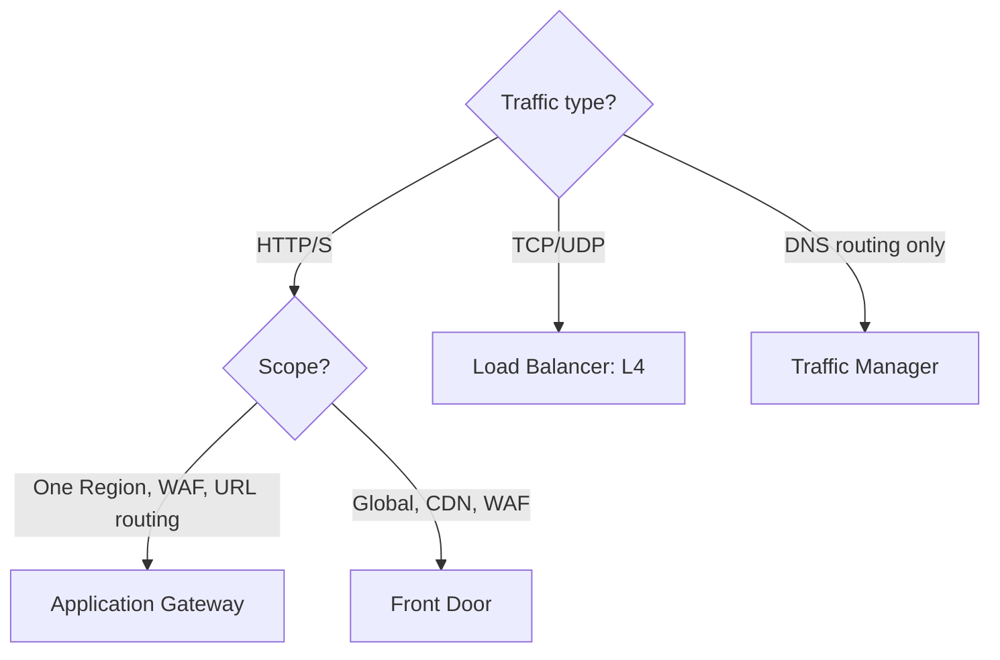

## 1. Core Concept

Azure networking revolves around the **Virtual Network (VNet)**: an isolated private network, divided into **subnets**, protected by **NSGs**, connected to each other/on-premises via **Peering, VPN, ExpressRoute**, and distributing traffic through **four load-balancing services** at different layers and scopes. The hardest question in design and exams is **choosing the right service by layer (L4/L7) and scope (Region/global)**.

**Mental model:** a VNet is **a walled industrial park**; an NSG is **the guard at each room's door**; Peering is **an internal road linking two parks** (not detouring through a third); and the four load balancers are **four kinds of dispatchers**: one splits trucks by plate (L4), one reads the order contents (L7), one coordinates globally, and one only hands out an address and stands aside (DNS).

## 2. How It Works

**VNet and NSG → Isolation and filtering**
- A **VNet** has a CIDR address space and belongs to **one Region**; subnets in a VNet **can talk to each other by default**; Azure reserves **5 IPs** in each subnet.
- An **NSG (Network Security Group)**: allow/deny rules on the 5-tuple, **stateful**, attached to a **subnet or NIC**; evaluated by **priority from 100 to 4096, lowest number first**. Default rules: allow traffic within the VNet and from the Load Balancer, **block inbound from the Internet**, allow outbound to the Internet. Traffic must pass **both the subnet NSG and the NIC NSG**. Use **service tags** and **ASGs** to keep rules concise.

**Connectivity → Peering, VPN, ExpressRoute**
- **VNet Peering**: same or different Region, traffic over the Microsoft backbone, **not transitive**; requires **non-overlapping address spaces**. For transit use **hub-and-spoke** with Azure Firewall/NVA + **UDR**, or **Virtual WAN**.
- **VPN Gateway**: site-to-site/point-to-site over the Internet, IPsec encryption. **ExpressRoute**: a private connection that **does not traverse the Internet**, stable and low latency but **expensive with a long lead time**.
- **Private Endpoint (Private Link)**: attaches PaaS (Storage, SQL) to the VNet with a private IP; a **Service Endpoint** only extends the VNet identity to the service (which still uses the service's public IP).

**The four load-balancing services**
- **Load Balancer**: **L4 (TCP/UDP)**, within a **Region**, high performance, health probes.
- **Application Gateway**: **L7 (HTTP/S)** within a **Region**, **WAF**, routing by URL path/host, SSL offload.
- **Front Door**: **global L7** (anycast), **CDN + WAF**, multi-Region failover.
- **Traffic Manager**: global **DNS-based**, only returns the best endpoint by method (priority, weighted, performance, geographic), **does not proxy traffic**; failover depends on the **DNS TTL**.

**Network security services**
- **Azure Firewall** (centrally managed firewall, FQDN filtering), **Bastion** (RDP/SSH through the browser, no public IP needed), **DDoS Protection**.

```bash
az network nsg rule create -g rg-net --nsg-name nsg-web -n allow-https \
  --priority 100 --access Allow --protocol Tcp --destination-port-ranges 443
```

## 3. Visual Diagram



## 4. Rules of Thumb & Trade-offs

| Situation / Need | What to choose |
| --- | --- |
| TCP/UDP within a Region | Load Balancer |
| Single-Region web app, WAF, URL routing | Application Gateway |
| Global web, acceleration, multi-Region failover | Front Door |
| Multi-Region DNS routing, any protocol | Traffic Manager |
| Connect on-premises fast and cheap | VPN Gateway |
| Connect on-premises with stability and high bandwidth | ExpressRoute |
| Private access to PaaS | Private Endpoint |
| Secure RDP/SSH without a public IP | Bastion |

- **What you gain:** network isolation, load distribution at the right layer. **What you lose:** ExpressRoute is expensive and slow to provision; Front Door/App Gateway cost more than Load Balancer; more network layers add complexity.

## 5. Must Remember / Production Pitfalls

- **A–B and B–C are peered but A cannot reach C → peering is not transitive → hub-and-spoke with Firewall/NVA or Virtual WAN**.
- **VNets/on-premises cannot connect → overlapping address spaces → plan non-overlapping CIDRs from the start**.
- **An Allow rule is correct yet there is no connectivity → NSGs on both the subnet and the NIC → check both and the priority order**.
- **Traffic Manager failover is slow → clients cache DNS by TTL → lower the TTL or use Front Door when you need fast failover**.
- **Confusing Service Endpoint with Private Endpoint → assuming PaaS has a private IP → only a Private Endpoint gives a private IP in the VNet**.
- Exam trap: "global HTTP load balancing with WAF" → **Front Door**; "NSG evaluates rules in order" → **lowest priority number first**; "secure RDP/SSH without a public IP" → **Bastion**.

## 6. Search Hooks

- `Azure Virtual Network subnets peering` — virtual networks and connecting VNets.
- `Network Security Group rules priority` — NSG rule evaluation order.
- `Azure Load Balancer vs Application Gateway vs Front Door` — choosing a load balancer by layer and scope.
- `Azure Traffic Manager routing methods` — global routing at the DNS layer.
- `ExpressRoute vs VPN Gateway` — a private line versus VPN over the Internet.
- `Azure Private Endpoint Private Link` — accessing PaaS services over a private IP.
