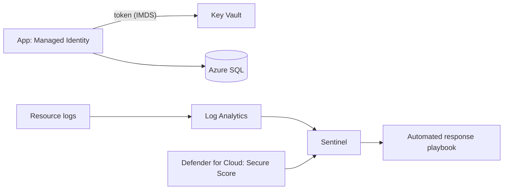

## 1. Core Concept

Azure security follows a principle: **eliminate secrets where possible** (Managed Identity), **protect the rest** (Key Vault, Private Endpoint, WAF), **assess posture** (Defender for Cloud) and **detect + respond** (Sentinel). Most cloud incidents come from **leaked secrets** and **misconfiguration**, so this playbook focuses on those two.

**Mental model:** Key Vault is **a safe with a camera**; Managed Identity is **a self-issued staff badge** that opens the safe without you remembering a combination; Defender for Cloud is **an auditor** scoring your configuration; Sentinel is **the control room** that gathers every camera and sounds the alarm when it sees an anomaly.

## 2. How It Works

**Managed Identity → Identity without secrets**
- Azure issues an identity to VMs, App Service, Functions…; the application requests a token from an internal endpoint (IMDS) and uses it to access Key Vault/Storage/SQL **without storing a secret**. **System-assigned** is tied to one resource's lifecycle (deleting the resource deletes the identity); **user-assigned** is a standalone resource **shared** across many resources.

**Key Vault → Secrets, keys, certificates**
- Stores **secrets**, **keys** (RSA/EC, the **Premium** tier has HSM, **Managed HSM** for the highest requirements) and **certificates** (with auto-renewal). The recommended access model is **Azure RBAC** (Key Vault Secrets User…) rather than access policies. **Soft delete** (on by default, 7–90 days retention) allows recovery; **purge protection** blocks permanent deletion during the retention period. App Service/Functions can reference secrets directly with a **Key Vault reference**. Restrict the network with the firewall and **Private Endpoint**; enable access logs via diagnostic settings.

**Defender for Cloud → Security posture**
- **CSPM**: configuration assessment, **Secure Score**, recommendations, compliance against standards. **Defender plans** protect workloads (Servers, Storage, SQL, Containers, Key Vault, App Service); multicloud is supported. **Just-in-time VM access** opens management ports only when needed.

**Sentinel → SIEM/SOAR**
- Collects logs through **data connectors**, **analytics rules** create incidents, **playbooks (Logic Apps)** respond automatically (lock an account, open a ticket), plus **hunting** and **UEBA**.

**Network and data layers**
- **NSG**, **Azure Firewall**, **WAF** (Application Gateway/Front Door), **DDoS Protection**; **Private Endpoint** keeps PaaS off the Internet; encryption at rest with a **customer-managed key** when needed.

```bash
az keyvault create -n kv-orders -g rg-app --enable-rbac-authorization true \
  --enable-purge-protection true --retention-days 90
az role assignment create --assignee-object-id <mi-principal> \
  --role "Key Vault Secrets User" --scope $(az keyvault show -n kv-orders --query id -o tsv)
```

## 3. Visual Diagram



## 4. Rules of Thumb & Trade-offs

| Situation / Need | What to choose |
| --- | --- |
| An app accessing Key Vault without storing credentials | Managed Identity |
| Many resources sharing one identity | User-assigned identity |
| Prevent permanent deletion of a vault/secret | Soft delete + purge protection |
| Assess configuration, suggest improvements | Defender for Cloud |
| Detect attacks and respond automatically | Sentinel + playbook |
| Keep PaaS off the Internet | Private Endpoint |

- **What you gain:** fewer secrets to manage, earlier detection. **What you lose:** Defender plans and Sentinel are billed per resource/log; extra RBAC/network configuration needs discipline.

## 5. Must Remember / Production Pitfalls

- **Secrets in app settings/code → leaked through the repo/logs → Key Vault + managed identity**.
- **A vault or secret is deleted by mistake → lost permanently without purge protection → enable soft delete and purge protection in production**.
- **Overly broad access (Get/List/Set on everything) → one hijacked identity exposes everything → minimal RBAC per secret/vault**.
- **Expecting Defender to fix things itself → it mainly recommends and detects → use Policy/automation to remediate**.
- **PaaS is still reachable from the Internet → no Private Endpoint/firewall → close public access and use Private Endpoint**.
- Exam trap: "an app accessing Key Vault without stored credentials" → **Managed Identity**; "prevent permanent deletion" → **soft delete + purge protection**; "system-assigned vs user-assigned" → **resource-bound lifecycle vs shared**.

## 6. Search Hooks

- `Azure Key Vault soft delete purge protection` — protection from accidental deletion.
- `Azure Managed Identity system vs user assigned` — the two kinds of identity.
- `Microsoft Defender for Cloud secure score` — the security posture score.
- `Microsoft Sentinel KQL analytics rules` — SIEM on Azure.
- `Azure Private Endpoint` — private access to PaaS.
