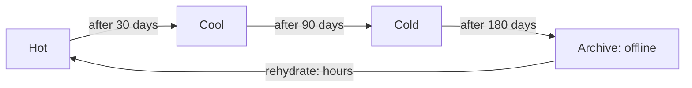

## 1. Core Concept

**Azure Storage** is a family of storage services inside a **storage account**: **Blob** (object), **Files** (SMB/NFS share), **Queue**, **Table** and **Disk**. Two key decisions always go together: the **redundancy** level (how far it survives failure) and the **access tier** (balancing storage cost against read cost).

**Mental model:** like **a personal storage unit**: you choose to keep one copy in one warehouse (LRS), three warehouses in the same city (ZRS), or add a warehouse in another city (GRS); and you choose a shelf **near the door** (Hot: expensive to rent, cheap to fetch) or **deep in the back** (Archive: cheap to rent, laborious and costly to retrieve).

## 2. How It Works

**Redundancy → How far it survives failure**
- **LRS**: 3 copies within **one datacenter** (about 11 nines of durability). **ZRS**: 3 copies across **3 AZs** in a Region (12 nines). **GRS**: LRS in the primary Region + **LRS in a secondary Region** (16 nines). **GZRS**: ZRS in the primary + LRS in the secondary Region. **RA-GRS/RA-GZRS** allow **reads** from the secondary Region when the primary has an incident.
- Replication to the secondary Region is **asynchronous**: a failover can **lose data that had not replicated yet** (RPO is not 0; check Last Sync Time).

**Blob access tiers → Balancing cost**
- **Hot** (highest storage cost, cheapest access), **Cool** (≥ **30 days**), **Cold** (≥ **90 days**), **Archive** (≥ **180 days**, **offline**: it must be **rehydrated** before reading, which takes hours; high priority can be under 1 hour for small blobs). Deleting or moving a blob earlier than the minimum period still incurs an **early deletion fee**.
- A **lifecycle management policy** automatically moves tiers or deletes blobs by age/last access time.

**Security → Encryption and access**
- Encryption at rest by default (AES-256, **Microsoft-managed key** or **customer-managed key** in Key Vault). Access through **Entra ID/RBAC** (recommended, with data roles such as Storage Blob Data Reader), **SAS** (limited temporary access; a **user delegation SAS** signed with Entra ID is safer than a SAS signed with the account key) or the **account key** (full access, avoid it). Restrict with the **firewall** and **Private Endpoint**.

**Data protection**
- **Soft delete** (blob/container), **blob versioning**, **point-in-time restore**, and **immutable storage (WORM)** with time-based retention or legal hold block modification/deletion.

**Tools**
- **AzCopy** copies large data, **Azure Files** replaces a file server (with **Azure File Sync** syncing to on-premises), **Data Box** for extremely large volumes, **Data Lake Storage Gen2** (hierarchical namespace) for analytics.

```bash
az storage account create -n stappprod -g rg-app --sku Standard_GZRS --kind StorageV2 \
  --min-tls-version TLS1_2 --allow-blob-public-access false
```

## 3. Visual Diagram



## 4. Rules of Thumb & Trade-offs

| Situation / Need | What to choose |
| --- | --- |
| Survive a datacenter failure, within a Region | ZRS |
| Survive a whole-Region failure | GRS or GZRS |
| Read data when the primary Region is down | RA-GRS / RA-GZRS |
| Cold, long-retained data | Lifecycle moving to Cool/Cold/Archive |
| Temporary sharing with outsiders | User delegation SAS, short expiry |
| Block deletion/modification for a legal period | Immutable storage (WORM) |

- **What you gain:** high durability, storage cost that falls by tier. **What you lose:** higher redundancy costs more for replication; colder tiers raise access fees, latency and early-deletion fees.

## 5. Must Remember / Production Pitfalls

- **You need to read an Archive blob right now → it is offline and must be rehydrated for hours → use Cool/Cold for data you may need quickly**.
- **Early deletion fees → you deleted/moved before 30/90/180 days → build lifecycle rules around the minimum durations**.
- **A leaked account key → full access to the account → disable shared key, use Entra ID/managed identity, rotate keys**.
- **A GRS failover loses the latest data → replication is asynchronous → check Last Sync Time and understand RPO**.
- **A blob becomes public unintentionally → anonymous access was allowed → disable public access at the account level, use Private Endpoint**.
- Exam trap: "data readable when the primary Region is down" → **RA-GRS/RA-GZRS**; "only survive an AZ failure within a Region" → **ZRS**; "read an Archive blob" → **rehydrate**.

## 6. Search Hooks

- `Azure Storage redundancy LRS ZRS GRS GZRS` — redundancy levels and their durability.
- `Azure Blob access tiers hot cool cold archive` — tiering blobs by access frequency.
- `Azure Blob lifecycle management` — automatically moving tiers or deleting blobs.
- `Azure Storage SAS user delegation` — temporary access signed with Entra ID.
- `Azure Blob soft delete versioning immutable` — protecting data from accidental deletion/overwrite.
- `Azure Files vs Azure File Sync` — SMB file shares and syncing with on-premises.
