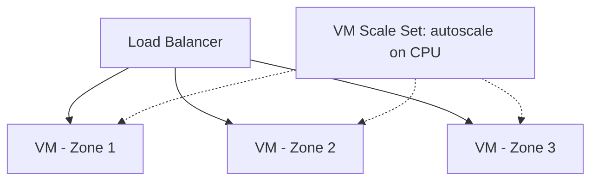

## 1. Core Concept

**Azure Virtual Machines** is **IaaS** compute: you control the operating system and software, and Azure handles hardware and the hypervisor. The real problem is not "creating a VM" but three decisions: **choosing the family/size** that fits the workload, **availability** (which SLA needs which structure) and the **pricing model** (pay flexibly or commit).

**Mental model:** renting a VM is like **renting a car**: pick the vehicle type for the need (size), keep a spare car in **a different lot** so a fire in one lot does not strand you (zone), rent by the hour or sign a yearly contract for a lower rate (reserved), and remember to **return the car (deallocate)** because one parked on the street is still billed.

## 2. How It Works

**VM families → Match the workload**
- **General purpose** (`D`, balanced CPU/RAM ratio), **compute optimized** (`F`), **memory optimized** (`E`, `M`), **storage optimized** (`L`), **GPU** (`N`), **HPC** (`H`) and **burstable** (`B`, accumulates credits when idle, suited to low load with occasional spikes).

**Disks → Type and durability**
- **OS disk + data disk** (managed disks): **Standard HDD**, **Standard SSD**, **Premium SSD** (needed for the high single-VM SLA), **Ultra Disk** (extreme IOPS/latency). The **temporary disk** is local storage that **loses data** when the VM is deallocated or moved to another host; never keep important data there.

**Availability → Reference SLAs**
- **Single VM** with Premium SSD/Ultra: **99.9%**. **Availability Set** (several VMs spread across **fault domains** for hardware/power and **update domains** for maintenance waves, within one datacenter): **99.95%**. **Availability Zones** (VMs in ≥ 2 zones): **99.99%**.
- **Virtual Machine Scale Sets (VMSS)**: a group of identical VMs with **autoscale** by metric (CPU) or schedule, paired with a **Load Balancer/Application Gateway**.

**Pricing model → Commit or stay flexible**
- **Pay-as-you-go**; **Reserved Instances** (1 or 3 years, tied to a VM configuration, up to ~72% off); **Savings Plan for compute** (an hourly $ commitment, more flexible); **Spot VM** (up to ~90% cheaper but subject to **eviction** when Azure needs the capacity); **Azure Hybrid Benefit** (use Windows Server/SQL Server licenses with Software Assurance).

**State and billing**
- **Stopped (deallocated)** stops compute charges but **disks are still billed**; shutting down only from inside the OS (state **Stopped**, not deallocated) **still bills compute**. Stopping from the portal/CLI usually deallocates automatically.

**Safe operations**
- **Azure Bastion** (RDP/SSH through the browser, no public IP), **Just-in-time access**, **Azure Backup**, **managed identity** instead of secrets.

```bash
az vm create -g rg-app -n web1 --image Ubuntu2204 --size Standard_D2s_v5 --zone 1
az vm deallocate -g rg-app -n web1   # stops compute charges
```

## 3. Visual Diagram



## 4. Rules of Thumb & Trade-offs

| Situation / Need | What to choose |
| --- | --- |
| Highest HA for VMs | Availability Zones (99.99%) |
| A Region without AZs | Availability Set |
| Variable load, add/remove VMs automatically | VMSS |
| Stable long-running workload | Reserved Instance / Savings Plan |
| Interruptible batch/CI | Spot VM |
| You already own Windows/SQL licenses | Azure Hybrid Benefit |
| PaaS is an option | App Service, Functions, Container Apps (less operations) |

- **What you gain:** full control over the OS and software. **What you lose:** you own patching, security, scaling and HA; operating cost is higher than PaaS.

## 5. Must Remember / Production Pitfalls

- **Data lost after a VM moves/deallocates → it was stored on the temporary disk → use a data disk or durable storage**.
- **Dev/test VMs still cost money → they were only Stopped inside the OS, not deallocated → deallocate or use auto-shutdown**.
- **A Spot VM is reclaimed mid-job → eviction can happen at any time → checkpoint, keep workloads stateless, or use On-Demand for the critical part**.
- **Wanting an Availability Set and an AZ together → they cannot be used simultaneously for one VM → choose one mechanism**.
- **The system still goes down when one zone fails → the VMs share a zone → spread the VMSS/VMs across multiple zones**.
- Exam trap: "highest SLA for a VM" → **Availability Zones (99.99%)**; "save using existing licenses" → **Azure Hybrid Benefit**; "automatically add/remove VMs" → **VMSS**; "Stopped but not deallocated" → **compute is still billed**.

## 6. Search Hooks

- `Azure VM sizes families` — VM size families and their purposes.
- `Azure availability sets fault domain update domain` — spreading VMs against hardware failure and maintenance.
- `Azure Virtual Machine Scale Sets autoscale` — autoscaling VM groups.
- `Azure Reserved Instances vs Savings Plan` — two discount commitment models.
- `Azure Spot VMs eviction` — cheap VMs that can be reclaimed.
- `Azure Hybrid Benefit` — reuse existing licenses to cut cost.
