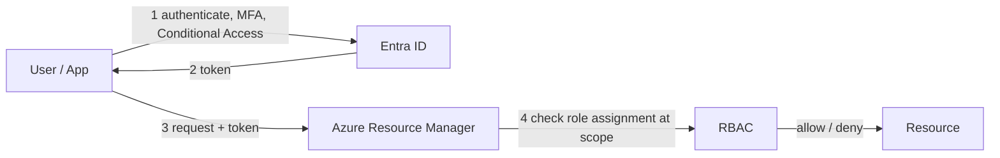

## 1. Core Concept

On Azure, **authentication** (who you are) and **authorization** (what you may do) are two different systems: **Microsoft Entra ID** (formerly Azure Active Directory) manages **identities** and issues tokens; **Azure RBAC** decides what that identity may do on **Azure resources** and at which scope. Confusing the two is a classic mistake in exams and in real permission grants.

**Mental model:** Entra ID is **the badge office** (it checks you really are you, and can ask for an extra fingerprint when you are off-site); RBAC is **the list of who may open each room** — a valid badge is not enough, your name must be on the access list of that room (or of the floor that contains it).

## 2. How It Works

**Entra ID → Identity and authentication**
- A **tenant** is an Entra ID instance holding users, groups and app registrations; one tenant can be linked to **many subscriptions**. The **Free / P1 / P2** licenses determine features.
- **MFA**, **SSO** and **passwordless** raise authentication assurance. **Conditional Access** (requires **P1**) is an "if-then" policy: if conditions are met (location, device, risk level) then **require MFA or block**; for example "sign-in from abroad → MFA required". **Identity Protection** (P2) detects risky sign-ins.
- Standard protocols: **OAuth 2.0, OpenID Connect, SAML**; applications are represented by an **app registration/service principal**.

**Azure RBAC → Authorization on resources**
- A **role assignment** has three parts: a **security principal** (user, group, service principal, managed identity) + a **role definition** + a **scope**.
- Core **built-in roles**: **Owner** (full access, including granting access), **Contributor** (full access except granting access), **Reader** (view only), **User Access Administrator** (manage access only). A **custom role** declares `Actions`, `NotActions`, `DataActions` and `AssignableScopes`.
- **Control plane vs data plane**: managing a resource (creating a storage account) differs from reading the data inside (a blob); the data plane has its own roles such as **Storage Blob Data Reader**.
- **Scope** is hierarchical: management group → subscription → resource group → resource, and permissions **inherit downward**. A **deny assignment** (created by Azure/Blueprints) wins over a role assignment.

**Managed identity → No stored secrets**
- An identity managed by Azure for VMs, App Service and Functions. **System-assigned** is tied to the resource lifecycle (deleting the resource deletes the identity); **user-assigned** is a standalone resource shared across many resources. The application gets tokens from an internal endpoint, so no connection string or secret is needed in code.

**PIM → Temporary access**
- **Privileged Identity Management** (requires **P2**) grants **just-in-time** access using **eligible → active** assignments, with approval, duration limits and access reviews; it reduces the risk of permanent Owner access.

```bash
az role assignment create --assignee <group-object-id> \
  --role "Reader" --scope /subscriptions/<sub>/resourceGroups/rg-orders-prod
```

## 3. Visual Diagram



## 4. Rules of Thumb & Trade-offs

| Situation / Need | What to choose |
| --- | --- |
| View only, no changes | Reader |
| Manage resources but not grant access | Contributor |
| An app accessing Key Vault/Storage without stored secrets | Managed identity |
| Require MFA for sign-ins from abroad | Conditional Access |
| Admins need temporary access with approval | PIM |
| Force resources to have tags/allowed Regions | Azure Policy (not RBAC) |

- **What you gain:** precise permissions by scope, no leaked secrets, temporary access. **What you lose:** Conditional Access/PIM need higher licenses and add sign-in friction; too many individual role assignments are hard to audit.

## 5. Must Remember / Production Pitfalls

- **Granting access per user → hard to audit when people change teams → assign to groups, at the smallest scope that works (least privilege)**.
- **Confusing Entra roles with Azure RBAC → granting Global Administrator to manage resources, or the reverse → Entra roles manage identity/tenant, RBAC manages Azure resources**.
- **Confusing Policy with RBAC → using roles to block creating resources in the wrong Region → Policy controls what resources may look like, RBAC controls who may do what**.
- **A service principal with an expiring secret/certificate takes down a pipeline → there was no expiry alert → use managed identity or federated credentials**.
- **A role was just assigned yet access is still denied → permissions need a few minutes to propagate and old tokens remain valid → wait or get a new token**.
- Exam trap: "who may only view, not change" → **Reader**; "an app accessing Key Vault without storing passwords" → **managed identity**; "require MFA for sign-ins from abroad" → **Conditional Access**.

## 6. Search Hooks

- `Microsoft Entra ID vs Azure AD` — the new name for Azure Active Directory.
- `Azure RBAC role assignment scope` — assigning roles by principal, role and scope.
- `Entra Conditional Access policies` — conditional access policies.
- `Azure managed identity system-assigned user-assigned` — identities for resources, no secrets needed.
- `Privileged Identity Management just-in-time` — temporary admin access with approval.
- `Azure RBAC vs Entra roles` — distinguishing resource permissions from identity permissions.
