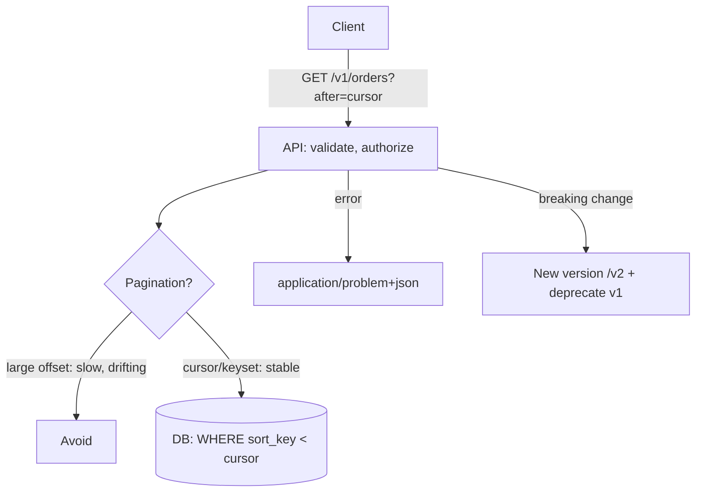

## 1. Core Concept

A **REST API** is a way of designing HTTP APIs around **resources** identified by URLs and manipulated with **HTTP verbs** that have standard semantics. A good API is a **contract** between the provider and many clients you **do not control**: every **breaking change** (renaming a field, changing a type) breaks someone. So API design is a problem of **consistency, backward compatibility and being easy to use correctly**.

**Mental model:** an API is like **a printed restaurant menu**: customers (clients) order by fixed names; you can freely **add new dishes**, but **renaming or removing a dish** makes customers order wrongly. Error codes are **how the kitchen says "sold out"** — they must be clear and consistent so customers know how to react.

## 2. How It Works

**Resources and verbs**
- URLs are **plural nouns** (`/orders`, `/orders/42/items`), the verb lives in the **method**: `GET` (read, **safe + idempotent**), `POST` (create, **not idempotent**), `PUT` (replace entirely, idempotent), `PATCH` (partial update), `DELETE` (idempotent). Status codes: `201 Created` + `Location`, `204 No Content`, `400/422` (bad data), `401/403`, `404`, `409` (conflict), `429`, `5xx`.

**Pagination → Cursor versus offset**
- **Offset** (`?page=5000&limit=20`): the DB must **read and discard** 100,000 rows (progressively slower) and **results drift** if data changes between pages. **Cursor/keyset** (`?after=<token>`): uses a condition on the sort key (`WHERE (created_at, id) < (...)`) → **near-constant, stable cost**; you cannot jump to an arbitrary page.

**Versioning and backward compatibility**
- Ways: **URL** (`/v1/`), **header**, or content negotiation. **Compatible changes**: adding new fields/endpoints (clients must **ignore unknown fields**). **Breaking**: removing/renaming/retyping a field, making an optional field required, changing semantics. When you must break: **a new version + a deprecation path** (`Deprecation`/`Sunset` headers).

**Standardized errors → Problem Details (RFC 9457)**
- Return `application/problem+json` with `type`, `title`, `status`, `detail`, `instance` (and extension fields) so clients can **handle errors by machine** instead of parsing strings.

**Idempotency and concurrency**
- Important `POST`s (payments) accept an **`Idempotency-Key`**; updates use **`ETag` + `If-Match`** (412 if changed) to prevent lost-update overwrites. Long jobs: **`202 Accepted`** + `Location` for polling.

**REST vs gRPC vs GraphQL**
- **REST**: simple, HTTP caching, good for public APIs. **gRPC**: binary Protobuf over HTTP/2, **streaming**, good for high-performance **internal services**. **GraphQL**: clients **choose fields** (reducing over/under-fetching), but you must control **query complexity and N+1** and caching is harder.

**OpenAPI**
- Describe the API in a standard format → **documentation, client/server generation, validation, contract testing** and **breaking-change detection in CI**.

```http
GET /v1/orders?limit=20&after=eyJjIjoiMjAyNi0xMS0yMSJ9 HTTP/1.1

HTTP/1.1 422 Unprocessable Content
Content-Type: application/problem+json
{"type":"https://api.example.com/errors/invalid-quantity","title":"Invalid quantity",
 "status":422,"detail":"quantity must be >= 1","instance":"/v1/orders/42"}
```

## 3. Visual Diagram



## 4. Rules of Thumb & Trade-offs

| Situation / Need | What to choose |
| --- | --- |
| Large lists, changing data | Cursor/keyset pagination |
| Need to jump to any page, small data | Offset |
| Adding a new field | A compatible change, no new version needed |
| Renaming/removing a field | A new version + deprecate |
| Payments/creating resources with consequences | `Idempotency-Key` |
| High-performance internal services, streaming | gRPC |
| Clients need to choose fields flexibly | GraphQL (with complexity limits) |
| Machine-readable errors | Problem Details |

- **What you gain:** an API that is easy to use and evolves without breaking clients. **What you lose:** keeping backward compatibility costs effort, many versions raise maintenance cost; a cursor cannot jump to an arbitrary page.

## 5. Must Remember / Production Pitfalls

- **The API slows down on deep pages → a large offset scans and discards many rows → keyset pagination**.
- **Old clients break after a deploy → a field was renamed/retyped (a breaking change) → add the new field, keep the old one, deprecate on a schedule, check with an OpenAPI diff in CI**.
- **An order is created twice when the client retries → POST is not idempotent → an `Idempotency-Key` that stores the result**.
- **Two clients overwrite each other on the same resource → no concurrency control → `ETag`/`If-Match` (412)**.
- **Clients cannot handle errors → free-form strings and a 200 code for errors → correct status codes + Problem Details**.
- **A chatty API (many requests to build one screen) → overly fine-grained design → aggregate endpoints or GraphQL/BFF**.
- Interview trap: "PUT vs POST?" → **PUT is idempotent and replaces everything, POST creates and is not idempotent**; "Offset vs cursor?" → **a cursor is stable and fast on deep pages**; "Does adding a field break things?" → **no, removing/renaming does**.

## 6. Search Hooks

- `REST API design best practices` — principles for designing REST APIs.
- `cursor vs offset pagination` — two ways to paginate.
- `API versioning backward compatibility` — evolving APIs without breaking clients.
- `Problem Details RFC 9457` — the standard error format.
- `REST vs gRPC vs GraphQL` — choosing an API style.
- `OpenAPI specification` — describing and testing API contracts.
