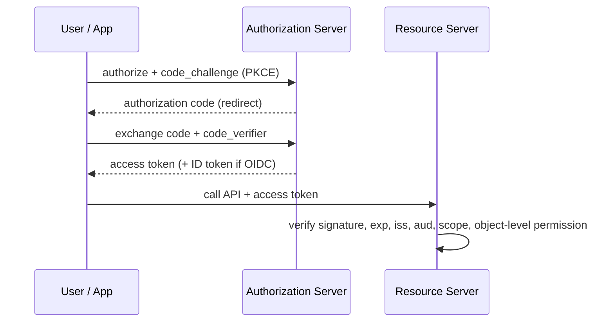

## 1. Core Concept

**Authentication (AuthN)** answers "**who are you**"; **Authorization (AuthZ)** answers "**what may you do**". **OAuth 2.0** is a **delegated authorization** framework (letting an application access resources on a user's behalf without exposing their password), **OpenID Connect (OIDC)** adds an **authentication** layer on top (the ID token), and **JWT** is a **token format** that carries its own data and signature. Most API security incidents come from **wrong token/permission checks**, not from encryption.

**Mental model:** OAuth is like **a valet key**: you hand the parking attendant a key that **only starts and drives the car within the lot** (limited scope, short lifetime) rather than your master key. OIDC is the **name badge** of the key holder ("who this is"). A JWT is **a card signed by the manufacturer** — anyone can read its content, but you trust it only if **the signature is valid**.

## 2. How It Works

**OAuth 2.0 → Roles and flows**
- Roles: **resource owner** (the user), **client** (the application), **authorization server** (issues tokens), **resource server** (the API). The flow for **web/mobile/SPA apps** is **Authorization Code + PKCE**: the client generates a random `code_verifier`, sends **`code_challenge = SHA256(verifier)`**, receives a `code` via redirect and **exchanges it for tokens together with the `code_verifier`** → someone who intercepts the `code` cannot use it. **The implicit flow is obsolete.** **Client credentials** is for **service-to-service** (no user). A **refresh token** reissues access tokens (ideally **rotated**), **scopes** limit permissions.

**OIDC → Authentication**
- Adds an **ID token** (a JWT with `sub`, `iss`, `aud`, `exp`, `nonce`…) that says **who signed in**; the access token is used to **call APIs**. Do not use an access token to infer identity.

**JWT → Structure and validation**
- `header.payload.signature` (base64url; **the payload is not encrypted**, never put secrets in it). You **must verify**: the **signature** (key from **JWKS**, chosen by `kid`), an **algorithm from a whitelist** (reject `none`, defend against RS256/HS256 confusion), and the claims **`exp`** (expiry), **`nbf`**, **`iss`** (the right issuer), **`aud`** (the token is meant for this API). **`jwt.decode` only reads the content and does NOT check the signature** — use `verify`. Access tokens are **short-lived** (5–15 minutes) because they are **hard to revoke** (stateless).

**Session cookies vs tokens and CSRF**
- A **session** (state on the server) + a `HttpOnly; Secure; SameSite=Lax/Strict` cookie protects against XSS theft and reduces **CSRF** (add a **CSRF token** for state-changing operations). Tokens stored in `localStorage` can be read by **XSS**.

**Authorization → RBAC, ABAC and per-object checks**
- **RBAC** (by role: admin/editor), **ABAC** (by attributes: department, time, sensitivity; more flexible). **IDOR/BOLA** (Insecure Direct Object Reference): an API accepts `GET /orders/42` **without checking that order 42 belongs to the caller** → reads other people's data (**OWASP's #1 API flaw**). You must **check permission per object** on the server and never trust ids from the client.

**Status codes**
- **401** unauthenticated/bad token; **403** authenticated but not permitted.

```python
# Correct: verify signature + algorithm + claims
claims = jwt.decode(token, key=jwks_key(token), algorithms=["RS256"],
                    audience="api://orders", issuer="https://login.example.com/")
order = db.get_order(order_id)
if order.owner_id != claims["sub"]:             # per-object authorization (prevents IDOR)
    raise Forbidden()
```

## 3. Visual Diagram



## 4. Rules of Thumb & Trade-offs

| Situation / Need | What to choose |
| --- | --- |
| A SPA/mobile app signing in and calling APIs | Authorization Code + PKCE |
| Service calling a service | Client credentials (or mTLS) |
| You need to know who signed in | OIDC (ID token) |
| Simple role-based permissions | RBAC |
| Context/attribute-based permissions | ABAC |
| Prevent XSS theft of the session | HttpOnly + SameSite cookie |
| Easy revocation | Short-lived tokens + refresh; or server-side sessions |

- **What you gain:** no password exposure, fine-grained permissions, SSO. **What you lose:** complexity (flows, token validation, JWKS key rotation); JWTs are **hard to revoke**; cookies/CSRF need correct configuration.

## 5. Must Remember / Production Pitfalls

- **Accepting forged tokens → only `jwt.decode` with no signature check → use `verify` with the key and an algorithm whitelist, check `iss`, `aud`, `exp`**.
- **Users view others' data by changing the id → IDOR/BOLA → check ownership per object on the server**.
- **A stolen token works for a long time → a long-lived access token/stored in `localStorage` → a short TTL, rotating refresh, HttpOnly cookies**.
- **Using an access token to know who the user is → confusing OAuth with OIDC → use the ID token (and `nonce`) for authentication**.
- **Dropping `SameSite`/CSRF tokens with cookies → CSRF → `SameSite=Lax/Strict` + a CSRF token for writes**.
- Interview trap: "OAuth or OIDC?" → **OAuth authorizes, OIDC authenticates**; "Why PKCE?" → **it stops someone who intercepts the authorization code from using it**; "401 vs 403?" → **unauthenticated vs not permitted**.

## 6. Search Hooks

- `OAuth 2.0 authorization code PKCE` — the standard flow for SPA/mobile.
- `OpenID Connect ID token` — the authentication layer on top of OAuth.
- `JWT validation exp aud iss` — validating tokens correctly.
- `session cookies HttpOnly SameSite CSRF` — protecting sessions and preventing CSRF.
- `RBAC vs ABAC` — two authorization models.
- `IDOR insecure direct object reference` — missing per-object permission checks.
