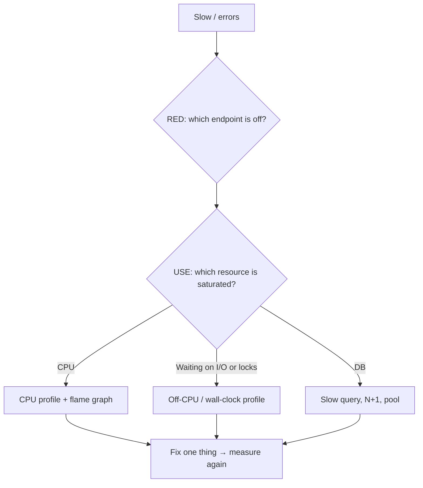

## 1. Core Concept

Optimizing backend performance means **measure, find the bottleneck, fix the right place, measure again** — not guess. Most "slowness" comes from **a few hot spots**: DB queries (especially **N+1**), an exhausted **connection pool**, a **saturated thread pool**, lock contention or one CPU-hungry function. The mental tools: **RED/USE** to learn **where something is abnormal**, **profiling/flame graphs** to learn **which function is hot**, and **load testing done right** (avoiding coordinated omission) to learn **the real limit**.

**Mental model:** a system is like **a water pipe**: the **narrowest section** decides the flow, and widening other sections does nothing. Profiling is **measuring pressure at each section** to find the narrow spot instead of smashing the whole pipe.

## 2. How It Works

**RED and USE → Knowing where to look**
- **RED** (for **services/endpoints**): **R**ate (requests/second), **E**rrors (error rate), **D**uration (latency, by **percentile**). **USE** (for **resources**): **U**tilization, **S**aturation, **E**rrors. Always look at **p95/p99**, not just the average (see the Scalability playbook).

**Profiling → Finding the hot function**
- A **CPU profiler** samples stacks periodically; a **flame graph** shows it: **width = share of time**, look for **wide "plateaus"**. Distinguish a **CPU profile** (time on the CPU) from **wall-clock/off-CPU** (time waiting on I/O or locks — important when the CPU is idle yet things are slow). There are also **allocation profiles** (memory allocation/GC) and **continuous profiling** in production (low overhead).

**Connection pool sizing**
- A pool that is too small → requests **queue for a connection**; too large → **DB overload** (`max_connections`, context switching). A reference formula (HikariCP): **`((DB core count × 2) + effective disk count)`**, usually only **~10–30 connections** are enough; or Little's Law: **`pool ≈ TPS × average connection hold time`** (500 TPS × 20 ms = ~10). With many app instances → total connections = instances × pool → use **PgBouncer**.

**N+1 queries**
- One query to fetch the list + **N queries** for each element (usually caused by ORM lazy loading). 100 orders → **101 queries**, each adding ~1 ms of RTT. Fix: **JOIN/prefetch/IN**, count queries per request in tests.

**Thread pool starvation**
- A small pool holding **blocking** tasks (synchronous HTTP/DB calls) or **tasks waiting on other tasks in the same pool** → threads run out, producing a **logical deadlock** or latency spikes while the CPU is idle. Remedies: a **separate pool for blocking I/O**, timeouts, async, concurrency limits (bulkhead).

**Coordinated omission → Load tests that lie**
- A tool that sends the **next request only after receiving the previous response** **throttles itself** exactly when the system is slow → **artificially low p99**. Use a **fixed arrival rate model (open model)**: `wrk2`, k6 `constant-arrival-rate`, and compute latency from **when the request should have been sent**. Also: ramp-up, a steady-state phase, a **soak test** to reveal leaks.

**The optimization process**
- **Measure (baseline) → find the bottleneck → fix one thing → measure again**; for slow queries look at `pg_stat_statements`/the slow log; remember **Amdahl**: optimizing something that takes 5% of the time gains at most 5%.

```python
# Wrong: leaks a connection on early return (only collapses after a few hours when the pool is exhausted)
def get_user(uid):
    conn = pool.acquire()
    row = conn.fetch(uid)
    if not row: return None          # forgot to release!
    pool.release(conn); return row

# Right: always return the connection
def get_user(uid):
    with pool.connection() as conn:
        return conn.fetch(uid)
```

## 3. Visual Diagram



## 4. Rules of Thumb & Trade-offs

| Situation / Need | What to choose |
| --- | --- |
| Find which endpoint is abnormal | RED (Rate, Errors, Duration) |
| Find which resource is saturated | USE |
| Find CPU-hungry functions | CPU profile + flame graph |
| CPU idle but still slow | Off-CPU/wall-clock profile, look at locks/I/O |
| Queries repeated per element | Fix N+1 (JOIN/prefetch) |
| Sizing a pool | The Hikari formula / Little's Law, small is still good |
| A trustworthy load test | Open model, fixed arrival rate |

- **What you gain:** you fix the right place, with large effect for few changes. **What you lose:** profiling adds small overhead and needs a production-like environment; premature optimization makes code hard to read.

## 5. Must Remember / Production Pitfalls

- **An endpoint works in tests but collapses after a few hours → a connection leak (early return without release) → try/finally or a context manager, monitor the pool**.
- **High latency despite idle CPU → thread pool starvation or waiting on locks/I/O → a separate pool for blocking I/O, timeouts, an off-CPU profile**.
- **The number of queries per request grows with the data → N+1 → JOIN/prefetch, query-counting tests**.
- **You raised the pool to 500 and the DB got slower → DB overload → shrink the pool, use PgBouncer, measure throughput**.
- **A load test shows a great p99 but production is bad → coordinated omission → an open model (wrk2/k6 arrival-rate)**.
- **Optimizing by feel without measuring → fixing the wrong place → profile first, measure before/after**.
- Interview trap: "How do RED and USE differ?" → **RED for services (Rate/Errors/Duration), USE for resources (Utilization/Saturation/Errors)**; "Is a bigger pool always better?" → **no, too large overloads the DB**; "How do you read a flame graph?" → **width is the share of time, look for wide plateaus**.

## 6. Search Hooks

- `RED method USE method` — two frameworks for observing systems.
- `flame graphs CPU profiling` — finding hot functions with flame graphs.
- `connection pool sizing HikariCP` — choosing the connection pool size.
- `N+1 query problem` — queries repeated per element.
- `coordinated omission load testing` — why load tests report falsely low latency.
- `thread pool starvation` — a pool saturated by blocking tasks.
