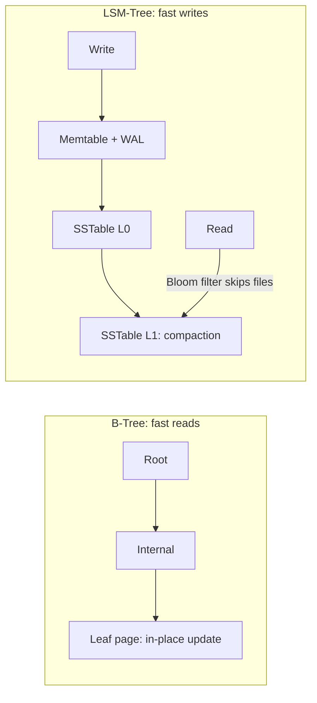

## 1. Core Concept

An **index** is a secondary data structure that helps the DB **find records without scanning the whole table** — turning a query from **O(n) into O(log n)**. The price is that **every index slows writes and costs space**. How the DB **stores data on disk** (the storage engine) decides who wins at reads or writes: **B-Tree** (fast reads, in-place updates) and **LSM-Tree** (very fast sequential writes, more complex reads). Understanding this lets you **design indexes, read `EXPLAIN` and choose an engine**.

**Mental model:** an index is **the index at the back of a book**: instead of flipping through every page, you look up a name and jump to the page. But every time you add/edit/delete content you must **update the index too**, so the more indexes, the slower the book is to write.

## 2. How It Works

**B-Tree → A page-oriented balanced tree**
- Data is split into **4–16 KB pages**; each node has **hundreds of pointers**, so the tree is only **3–4 levels** high even with billions of records (a lookup ≈ a few page reads). It **updates in place** and keeps keys ordered, so it supports **range queries**; writes can cause **page splits** and WAL logging. It is the default of PostgreSQL and MySQL InnoDB.

**LSM-Tree → Sequential writes, merged gradually**
- Writes go to a **memtable** (RAM, with a WAL) → when full it is **flushed** as an **immutable, sorted SSTable** → in the background **compaction** merges files by level. **Writes are very fast** (sequential), but **reads** must check the memtable and many SSTables (reduced with a **Bloom filter** to skip files that certainly do not hold the key) and there is **write amplification** from compaction. Used in RocksDB, Cassandra, LevelDB.

**Write/read/space amplification → The trade-off triangle**
- **Write amplification**: one logical write becomes several physical writes (page splits, compaction). **Read amplification**: one read touches many places. **Space amplification**: surplus data/old versions. No engine optimizes all three.

**Composite index → The leftmost prefix rule**
- An index `(a, b, c)` serves conditions on **`a`**, **`a,b`**, **`a,b,c`** but **not** `b` or `c` alone. Column order: **equality columns first**, then the **range** column, then the **sort** column; prefer **high selectivity (cardinality)** columns.

**Covering index → Index-only scan**
- If the index **contains every column the query needs** (including `INCLUDE`), the DB returns the result **from the index alone** without reading the main table. By contrast a **secondary index** usually stores the **primary key**, so one more lookup is needed (InnoDB: the PK is the **clustered index**).

**Reading `EXPLAIN ANALYZE`**
- Compare **estimated rows with actual rows** (a big gap = stale statistics); distinguish **Seq Scan**, **Index Scan**, **Index Only Scan**, **Bitmap Scan**; look for **Sort spilling to disk** and **nested loops** over large tables. **Non-sargable** conditions (`WHERE date(created_at) = ...`, `LIKE '%x'`, implicit casts) defeat the index.

```sql
CREATE INDEX idx_orders_cust_date ON orders (customer_id, created_at) INCLUDE (total);
EXPLAIN (ANALYZE, BUFFERS)
SELECT total FROM orders
WHERE customer_id = 42 AND created_at >= '2026-11-01' ORDER BY created_at;   -- index-only scan
```

## 3. Visual Diagram



## 4. Rules of Thumb & Trade-offs

| Situation / Need | What to choose |
| --- | --- |
| Read-heavy, range queries, ordinary OLTP | B-Tree (PostgreSQL, MySQL) |
| Very write-heavy (logs, time series, events) | LSM-Tree (Cassandra, RocksDB) |
| Queries filtering on several columns | A composite index in the right order (equality → range → sort) |
| Avoid reading the main table | Covering index (INCLUDE) |
| Small table, or queries returning most rows | No index needed (a seq scan may be faster) |
| Only part of the data is queried often | Partial index |

- **What you gain:** reads get faster by orders of magnitude. **What you lose:** every index **slows INSERT/UPDATE/DELETE** and costs memory/disk; LSM trades reads and compaction for writes.

## 5. Must Remember / Production Pitfalls

- **An index exists but you still get a seq scan → a function wrapping the column, a type mismatch, low selectivity or stale statistics → write sargable conditions, `ANALYZE`, check `EXPLAIN`**.
- **An index `(a, b)` does not help a query filtering only on `b` → a leftmost prefix violation → create the index in the right order or a separate index**.
- **Writes slow down as indexes are added → every index must be updated → drop unused indexes, only index queries that really run**.
- **Random UUIDs as the PK cause page splits and fragmentation → inserts land at random positions → sequential UUIDv7/ULID or an increasing key**.
- **Reads on an LSM are slow after many writes → compaction is behind, many files → tune compaction, Bloom filters**.
- Interview trap: "B-Tree or LSM?" → **B-Tree optimizes reads, LSM optimizes sequential writes in exchange for compaction**; "Does an index `(a,b,c)` serve `b`?" → **no, leftmost prefix**; "Why do many indexes slow writes?" → **every write updates every index**.

## 6. Search Hooks

- `B-Tree vs LSM-Tree` — two storage engine architectures.
- `write amplification read amplification` — the engine's amplification trade-offs.
- `composite index leftmost prefix` — column order in an index.
- `covering index index-only scan` — queries that read only from the index.
- `EXPLAIN ANALYZE query plan` — reading the execution plan.
- `Bloom filter` — skip files/keys that certainly do not contain it.
