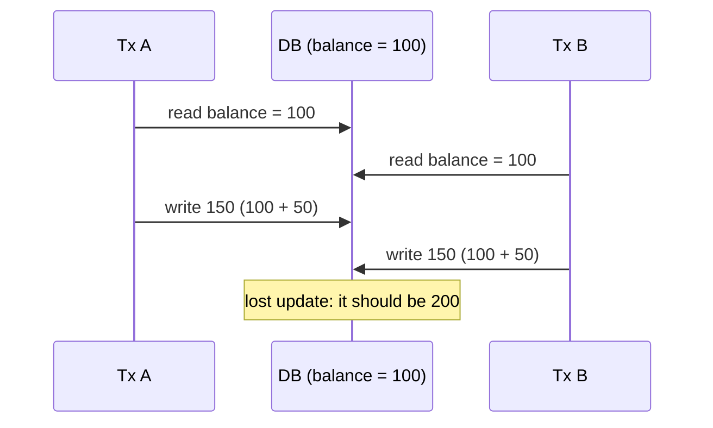

## 1. Core Concept

A **transaction** groups several operations into one **"all or nothing"** unit and **isolates** it from concurrent transactions. Perfect isolation (serializable) is **expensive**, so DBs let you choose an **isolation level** — each level **allows some anomalies** in exchange for performance. The most dangerous bugs are not crashes but **silently wrong data when two requests overlap** (lost updates, write skew).

**Mental model:** several people editing **one shared spreadsheet**: isolation is **the rule about who may see whose draft**. The stricter it is (serializable), the more it feels like "one person edits at a time" — safe but slow; the looser it is (read committed), the faster, but two people can **overwrite each other's work without knowing**.

## 2. How It Works

**ACID**
- **Atomicity** (either everything commits or everything rolls back, thanks to **undo/WAL**), **Consistency** (constraints are kept; partly the application's job), **Isolation** (isolation between transactions), **Durability** (once committed it is not lost, thanks to **WAL writes and fsync**).

**Anomalies and isolation levels**
- **Dirty read** (reading uncommitted data), **non-repeatable read** (re-reading the same row gives a different value), **phantom** (re-reading shows new rows), **lost update**, **write skew**.
- **Read Committed** (PostgreSQL/Oracle default): prevents dirty reads. **Repeatable Read** (MySQL InnoDB default; in PostgreSQL it is **snapshot isolation**): each transaction sees a **consistent snapshot**. **Serializable**: the result is as if run **sequentially**, preventing every anomaly but possibly **aborting (serialization failure)** → the application must **retry**.

**MVCC and snapshot isolation**
- **MVCC**: keeps **multiple versions** of each row; a transaction reads **the version valid for its snapshot**, so **reads do not block writes and writes do not block reads**; old versions are cleaned up (VACUUM). Snapshot isolation still **permits write skew**.

**Lost update vs write skew**
- **Lost update**: two transactions **read-modify-write** the same row and the later overwrites the earlier (`balance` read as 100, both write 150 instead of 200). Fix: **`UPDATE accounts SET balance = balance + ?`** (atomic), **`SELECT ... FOR UPDATE`**, or **optimistic locking** with a `version` column.
- **Write skew**: two transactions **read the same set of rows and then write different rows**, violating a shared constraint (for example two on-call doctors each check "at least 2 people remain" and both ask for leave → 0 remain). Fix: **Serializable**, lock the whole set that was read (`SELECT ... FOR UPDATE`), or a constraint/row that "materializes the conflict".

**Locks and deadlock**
- **Pessimistic** (`SELECT FOR UPDATE`, `SKIP LOCKED` for queues) vs **optimistic** (`WHERE version = ?` then retry). **Deadlock**: the DB detects it and **aborts a "victim"** → the application **retries** (with backoff); reduce it by **acquiring locks in a consistent order** and **keeping transactions short**.

```sql
BEGIN;
UPDATE accounts SET balance = balance + 50 WHERE id = 1;      -- atomic, no lost update
COMMIT;
-- Optimistic locking
UPDATE items SET qty = qty - 1, version = version + 1 WHERE id = 7 AND version = 12;  -- 0 rows → retry
```

## 3. Visual Diagram



## 4. Rules of Thumb & Trade-offs

| Situation / Need | What to choose |
| --- | --- |
| Adding/subtracting balances, counters | Atomic `UPDATE ... SET x = x + ?` |
| High-contention read-modify-write | `SELECT FOR UPDATE` (pessimistic) |
| Low contention, high throughput | Optimistic locking (version) + retry |
| Multi-row constraints (write skew) | Serializable or lock the whole set that was read |
| A job queue in the DB | `FOR UPDATE SKIP LOCKED` |
| Reports needing a consistent snapshot | Repeatable Read / snapshot |

- **What you gain:** correct data under concurrency. **What you lose:** stronger isolation = **less parallelism, possible aborts/retries**; long-held locks cause blocking and deadlocks.

## 5. Must Remember / Production Pitfalls

- **Balances/stock are occasionally wrong → read-modify-write in the application (lost update) → push the arithmetic into the statement `SET x = x + ?`, or locks/version**.
- **An "at least N" constraint is violated although each transaction checked it → write skew under snapshot isolation → Serializable or locking the row set**.
- **A long-running transaction slows the whole system/vacuum bloats → it holds locks and old versions → keep transactions short, no external HTTP calls inside a transaction**.
- **Occasional deadlock errors → two transactions take locks in opposite order → a fixed lock order, retry when chosen as the victim**.
- **After raising to Serializable you hit serialization failures → this is expected → catch the error and retry the whole transaction**.
- Interview trap: "Does Repeatable Read prevent write skew?" → **no, snapshot isolation still allows it**; "How do you fix a lost update?" → **an atomic UPDATE, SELECT FOR UPDATE or an optimistic version**; "What does the I in ACID cost?" → **parallelism and the possibility of abort/retry**.

## 6. Search Hooks

- `ACID transactions` — the four properties of a transaction.
- `transaction isolation levels anomalies` — isolation levels and anomalies.
- `MVCC snapshot isolation` — multiple versions and consistent snapshots.
- `lost update vs write skew` — two classic concurrency anomalies.
- `SELECT FOR UPDATE optimistic locking` — two ways to control concurrency in a DB.
- `deadlock detection retry` — the DB aborts a victim and the application retries.
