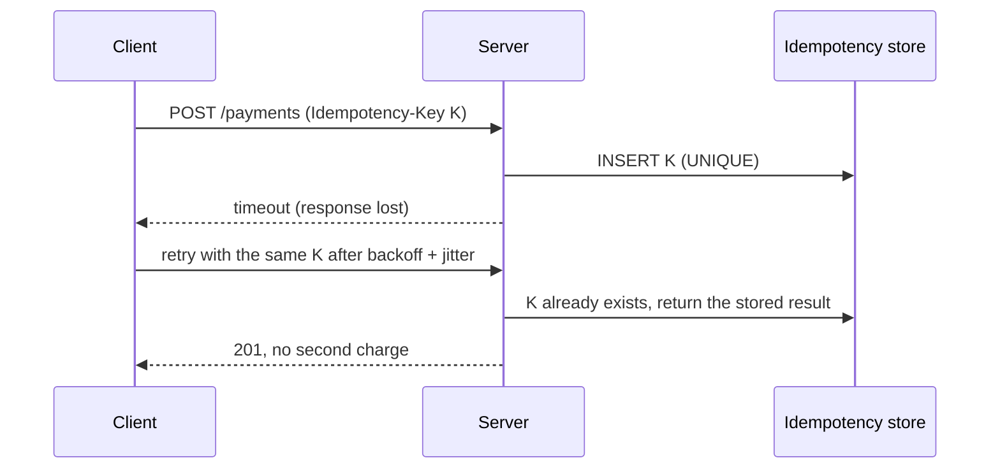

## 1. Core Concept

On a network you **cannot distinguish "the request failed" from "the request succeeded but the response was lost"** — a **timeout does not mean failure**. That is why distributed systems **must retry**, and when they retry the operation must be **idempotent**: doing it again **adds no further effect**. Without idempotency, retries turn a transient fault into **double charges and duplicate orders**; without backoff, retries turn a small fault into a **retry storm** that takes the whole system down.

**Mental model:** like **pressing an elevator button**: pressing it several more times still calls **one** elevator (idempotent) — safe when you are unsure you pressed it. By contrast, a **"buy now" button is not idempotent**: two presses buy two items. Retrying is safe only when the action behaves like the elevator button.

## 2. How It Works

**What idempotent means**
- Doing it once or many times **gives the same result**. HTTP: `GET`, `PUT`, `DELETE` are **idempotent**; **`POST` is not**. For example `balance = balance + 50` is **not** idempotent, while `set status = 'PAID'` is.

**The idempotency key pattern**
- The client generates a **UUID** per intent (header **`Idempotency-Key`**) and resends the **same key** on every retry. The server **inserts the key into a table with a UNIQUE constraint before processing** (atomically) and stores the **result** under the key (typically ~24 hours): a retry returns the **stored result** instead of processing again; concurrent requests with the same key get `409`/wait; **the same key with a different payload** → `422`. (For example how Stripe does it.)

```sql
INSERT INTO idempotency (key, request_hash, status) VALUES ($1, $2, 'IN_PROGRESS')
ON CONFLICT (key) DO NOTHING;      -- 0 rows → it already exists: return the stored result / report in progress
```

**Retry only transient errors**
- **Do**: timeouts, lost connections, `429`, `503`, `502/504`. **Do not**: client-caused `4xx` (`400`, `401`, `403`, `404`, `422`) because retrying does not change the outcome. Set a **maximum number of attempts** and a **total deadline**.

**Exponential backoff with jitter**
- Wait progressively longer: `sleep = random(0, min(cap, base × 2ⁿ))` (**full jitter**). **Jitter** (randomness) spreads retry times so they are **not simultaneous**; without jitter, thousands of clients retry **at the same instant** → a **retry storm / thundering herd**.

**Retry amplification**
- Retries at **several layers multiply**: 3 layers × 3 attempts = **27 calls** to a weak dependency. Reduce it by **retrying at one layer**, a **retry budget** (cap the retry ratio), combined with a **circuit breaker** and **timeouts**.

**At-least-once vs exactly-once**
- Real messaging is **at-least-once** (duplicates possible). **"Exactly-once" at the system boundary = at-least-once + idempotent processing**: an **idempotent consumer** (a `processed_message_id` table, upsert by business key, a UNIQUE constraint) and **message deduplication** (for example SQS FIFO dedups within 5 minutes).

```python
def retry(fn, attempts=5, base=0.2, cap=10, deadline=30):
    start = time.monotonic()
    for n in range(attempts):
        try: return fn()
        except TransientError:
            if n == attempts - 1 or time.monotonic() - start > deadline: raise
            time.sleep(random.uniform(0, min(cap, base * 2 ** n)))   # full jitter
```

## 3. Visual Diagram



## 4. Rules of Thumb & Trade-offs

| Situation / Need | What to choose |
| --- | --- |
| A create/payment operation that may be retried | Idempotency key + store the result |
| Retrying transient errors | Exponential backoff + jitter, limit attempts and deadline |
| Retries at several layers | Retry at one layer + a retry budget + a circuit breaker |
| A consumer receives duplicate messages | Idempotent consumer (dedup by id/UNIQUE) |
| Updates should be idempotent | Set an absolute state instead of accumulating |
| Client-side 4xx errors | Do not retry |

- **What you gain:** safe tolerance of transient faults. **What you lose:** storing and managing keys, extra complexity, retry latency; old keys must be cleaned up.

## 5. Must Remember / Production Pitfalls

- **A double charge/duplicate order when a client retries → the operation is not idempotent → an Idempotency-Key storing the result, a UNIQUE constraint**.
- **All clients retry at once and take down a recovering service → fixed backoff, no jitter → exponential backoff + full jitter**.
- **A small fault multiplies into huge load → retries at several layers → one retrying layer, a retry budget, a circuit breaker**.
- **Retrying 400/422 errors → useless and wasteful → retry only transient errors**.
- **Treating a timeout as failure and recording an error → it actually succeeded → check the state before retrying/dedupe with a key**.
- **Retrying with no time limit → hung threads → a maximum attempt count and a total deadline**.
- Interview trap: "Does a timeout mean failure?" → **no, it may have succeeded**; "Is exactly-once real?" → **in practice it is at-least-once + idempotent**; "Why jitter?" → **to avoid simultaneous retries (thundering herd)**.

## 6. Search Hooks

- `idempotency key pattern` — prevent duplicate processing on retry.
- `exponential backoff with jitter` — retrying with random spreading.
- `at-least-once vs exactly-once delivery` — delivery semantics.
- `retry storm retry amplification` — retries amplifying load.
- `message deduplication` — removing duplicate messages.
- `idempotent consumer` — processing safely when receiving duplicates.
