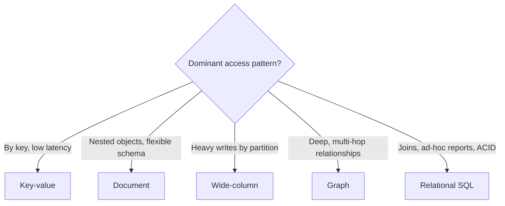

## 1. Core Concept

NoSQL has four main families — **key-value**, **document**, **wide-column** and **graph** — each **optimized for one access pattern** and trading away **query flexibility** (few joins, few constraints). The design principle is inverted compared with SQL: **SQL starts from the data (normalization) and then queries arbitrarily; NoSQL starts from the list of queries (access patterns) and then designs the data (denormalizes) so every query touches exactly one partition**. Choosing NoSQL because it is "trendy" without knowing the access patterns is a common mistake.

**Mental model:** SQL is like **a data warehouse with a normalized drawer system**: you can look things up any way you like but must pass through several drawers. NoSQL is like **pre-printing each kind of report exactly the way you will read it**: extremely fast to read, but if you need a report type that was not printed it is very hard, and updates must be made across many printed copies.

## 2. How It Works

**The four models**
- **Key-value** (Redis, DynamoDB): get/put by key, low latency, scales horizontally. **Document** (MongoDB, Cosmos): nested JSON, flexible schema, queries by field. **Wide-column** (Cassandra, Bigtable): **partition key + clustering key**, very fast writes (LSM), queries within a partition. **Graph** (Neo4j, Neptune): vertices and edges, efficient **multi-hop relationship traversal**.

**Designing by access pattern**
- List the queries → design the **keys** → **denormalize/duplicate** data so each query reads **one partition/document**. **DynamoDB single-table design** puts several entity types in one table with composite keys (`PK = CUSTOMER#42`, `SK = ORDER#2026-11-21`) so one `Query` fetches the customer and their orders.

**Document: embed vs reference**
- **Embed** data that is **read together** (an order + its lines) → one read; **reference** when the data is **large, shared or changes independently**. Beware of **unboundedly growing** arrays inside a document (size limits, slow writes).

**Consistency and scale**
- Mostly **eventual consistency**, tunable with **quorum** (`R + W > N`, see the CAP playbook). **Shard by partition key**; the **hot partition** is the main risk — choose keys with **high cardinality and even distribution**. **Transactions** are usually limited to one partition/document.

**Wide-column: partition and clustering keys**
- The **partition key** decides **which node** holds the data; the **clustering key** sorts **within** the partition and enables range queries inside it. A query **without the partition key** is a scatter-gather and very expensive.

**When to choose**
- Access patterns that are **clear and key-based**, needing **horizontal scale and predictable latency**; conversely, when you need **joins, ad-hoc reports, integrity constraints, multi-entity transactions**, **SQL** is better.

```javascript
// MongoDB: embed order lines inside the order → one read
db.orders.insertOne({ _id: "o-1", customerId: 42,
  items: [{ sku: "A1", qty: 2 }, { sku: "B7", qty: 1 }], total: 250000 });
db.orders.find({ customerId: 42 }).sort({ _id: -1 }).limit(20);   // a query shaped by the access pattern
```

## 3. Visual Diagram



## 4. Rules of Thumb & Trade-offs

| Situation / Need | What to choose |
| --- | --- |
| Key-based access at large scale | Key-value / Wide-column |
| Nested objects, changing schema | Document |
| Deep relationships (friends of friends, fraud) | Graph |
| Joins, ad-hoc reports, integrity constraints | SQL |
| Range queries within one key | Wide-column (clustering key) |
| Access patterns unclear | Start with SQL |

- **What you gain:** horizontal scale and predictable latency. **What you lose:** ad-hoc queries, joins, constraints and transactions are limited; denormalizing means **updating in several places**.

## 5. Must Remember / Production Pitfalls

- **You only realize you chose wrong when you need joins/complex reports → picking NoSQL before knowing the access patterns → list the queries first, consider SQL**.
- **Throttling although total capacity remains → a hot partition from a skewed key → a high-cardinality key, add a suffix/split the hot key**.
- **A document grows past its limit → embedding an unbounded array → split into its own collection (reference)**.
- **Denormalized copies drift apart → updating only one place → a synchronous update strategy (or accept eventual) and CDC**.
- **"Schemaless" means no management is needed → the application still has to manage data versions → schema versioning, validation in the application layer**.
- Interview trap: "When do you choose NoSQL?" → **clear access patterns, needing horizontal scale/predictable latency more than flexible querying**; "Where does NoSQL design start?" → **from the list of queries (access patterns)**; "What is a good partition key?" → **high cardinality, even distribution, present in the queries**.

## 6. Search Hooks

- `document vs key-value vs wide-column vs graph` — the four NoSQL models.
- `DynamoDB single table design` — designing by access pattern.
- `Cassandra partition key clustering key` — the wide-column model.
- `MongoDB embed vs reference` — choosing how to model documents.
- `eventual consistency quorum` — consistency and quorum.
