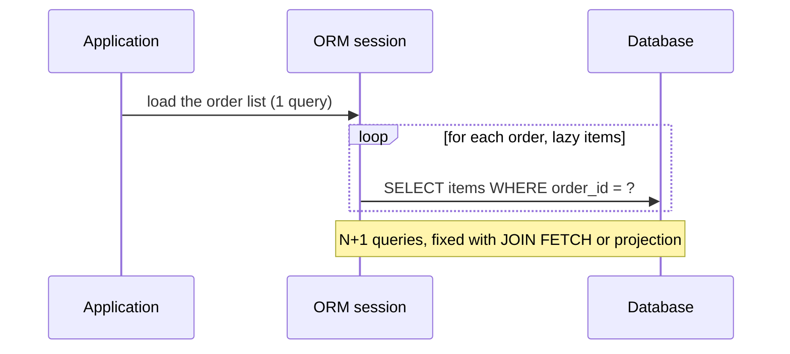

## 1. Core Concept

An **ORM** (Hibernate/JPA, SQLAlchemy, Entity Framework, Prisma, ActiveRecord) maps relational tables to objects so you write code faster. The price is that it **hides the SQL that is really generated**, so performance and correctness bugs live where you **cannot see them**: **N+1**, **lazy loading**, **transaction boundaries**, the **persistence context**. An ORM is not slow by nature — it is slow when used as if SQL did not exist.

**Mental model:** an ORM is like **an interpreter**: convenient, but if you say "bring me every book by each author" it will **run to the library 101 times** instead of once. You do not have to fire the interpreter, only **always know what it said** (turn on SQL logging) and know when to speak the original language yourself (plain SQL).

## 2. How It Works

**Unit of Work / persistence context → The ORM tracks changes**
- The ORM keeps loaded entities in a **persistence context** (**identity map**: the same id → the same object), detects changes by **dirty checking** and **flushes** them as `INSERT/UPDATE` on commit or **before a query** (flush mode). Consequence: modifying an object **writes to the DB automatically** at a moment you may not notice.

**Lazy vs eager loading → The source of N+1**
- **Lazy**: a relation loads only when accessed → one query for the list and then **N queries** for each element (**N+1**; 100 orders = **101 queries**, each adding ~1 ms of RTT). **Eager** loads right away but may pull too much data. Deliberate solutions: **`JOIN FETCH`/entity graph** (JPA), **`selectinload`/`joinedload`** (SQLAlchemy), **`include`** (Prisma/EF), or **projection**.

**Projection/DTO → Fetch only the needed columns**
- For **read** queries, do not load the whole entity graph: use a **DTO/projection** with a few columns, reducing memory and data transferred and avoiding needless dirty checking.

**Transaction boundaries → Short and in the right place**
- Put the transaction at the **use-case/service layer**, one request = one **short** transaction. **Do not** wrap an external HTTP call inside a transaction (it holds a DB connection for a long time → **connection pool exhaustion**).

**Optimistic locking**
- A **`@Version`** column: `UPDATE ... WHERE id = ? AND version = ?`; if 0 rows are affected it throws → **prevents lost updates** without holding locks.

**Bulk writes**
- **Batch insert/update** (`saveAll` with `hibernate.jdbc.batch_size`, `bulk_create`, `executeBatch`) instead of row by row; for very large volumes use **bulk/COPY**. Beware: an `IDENTITY` key generation strategy can **disable batching** in Hibernate.

**Migrations**
- Manage the schema with **versioned** tools (**Flyway, Liquibase, Alembic**); **never** let the ORM `auto-ddl/update` the schema in production.

**When to drop the ORM**
- Complex reports, large bulk jobs, hand-tuned queries → **plain SQL/a query builder** (jOOQ, SQLAlchemy Core) — use the ORM for CRUD and SQL for the rest.

```java
// N+1: 1 order query + N item queries
List<Order> orders = repo.findAll();
orders.forEach(o -> o.getItems().size());                 // lazy → N queries

// Fix: load the relation deliberately
@Query("select o from Order o join fetch o.items where o.customerId = :c")
List<Order> findWithItems(@Param("c") long customerId);
```

## 3. Visual Diagram



## 4. Rules of Thumb & Trade-offs

| Situation / Need | What to choose |
| --- | --- |
| Ordinary CRUD | ORM |
| A list with its relations | `JOIN FETCH` / selectinload / include |
| A read query needing only a few columns | DTO/projection |
| Reports, large bulk jobs | Plain SQL / a query builder |
| Prevent lost updates | `@Version` (optimistic locking) |
| Writing many rows | Batch insert/update, COPY |
| Production schema changes | Flyway/Liquibase/Alembic |

- **What you gain:** high developer productivity. **What you lose:** less control over SQL and performance; it easily generates poor queries if you do not monitor.

## 5. Must Remember / Production Pitfalls

- **A page slows down as the data grows → N+1 does not show with 5 records in dev → turn on SQL logs, tests asserting the number of queries per request, JOIN FETCH/projection**.
- **A `LazyInitializationException` "fixed" by keeping the session open throughout (open-session-in-view) → hides N+1 → clear DTO design, deliberate loading in the service**.
- **The connection pool is exhausted → a transaction wraps an HTTP call/slow processing → the transaction contains only DB work**.
- **Loading a whole table into memory to filter in the application → OOM/slow → filter in SQL, keyset pagination**.
- **INSERT/UPDATE order differs from expectations or writes happen unexpectedly → automatic flush → understand the flush mode, avoid modifying entities needlessly**.
- **Data lost on deploy → `auto-ddl` changed the production schema → versioned, reviewed migrations**.
- **AI-generated code often repeats queries inside loops and forgets JOIN FETCH → always count queries**.
- Interview trap: "Is an ORM slow?" → **not by nature; it is slow because of N+1, over-fetching and long transactions**; "What is N+1?" → **1 list query + N child queries caused by lazy loading**; "When to drop the ORM?" → **complex reports/bulk work that needs hand-tuned SQL**.

## 6. Search Hooks

- `N+1 select problem lazy loading` — the most common ORM performance trap.
- `JPA fetch join entity graph` — deliberate relation loading.
- `DTO projection vs entity` — fetch only the needed columns for read queries.
- `Unit of Work identity map dirty checking` — how the ORM tracks changes.
- `optimistic locking @Version` — preventing lost updates at the ORM layer.
- `Flyway Liquibase database migrations` — versioned schema change management.
