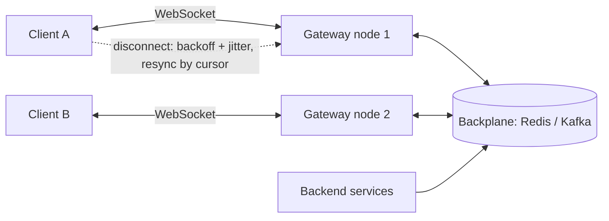

## 1. Core Concept

Standard HTTP is **the client asks, the server answers**. For real-time data (chat, stock prices, notifications, collaboration) the server must **push** data to the client. There are four ways: **short polling**, **long polling**, **Server-Sent Events (SSE)** (one-way, over HTTP) and **WebSocket** (two-way, persistent connection). The more "real-time + two-way" you need, the more you pay in **persistent connections, server-side state and scaling complexity**.

**Mental model:** polling is **phoning repeatedly to ask "any news yet?"**; long polling is **phoning and holding the line until there is news**; SSE is **a one-way radio station** (you listen, you do not talk back); WebSocket is **a phone line left open all the time** with both sides talking — convenient but **holding the line costs resources**, and if the signal drops you must call again and **ask what you missed**.

## 2. How It Works

**Four techniques**
- **Short polling**: the client calls repeatedly every N seconds — simple, wastes requests, latency up to N seconds. **Long polling**: the server **holds the request open** until data arrives or a timeout, then the client calls again — lower latency, works through every proxy, still costs connections.
- **SSE**: one long HTTP request, the server streams `text/event-stream`; the browser **reconnects automatically** and sends **`Last-Event-ID`** to resume; **one-way** server → client; runs over plain HTTP (easy for proxies/CDNs, fits HTTP/2).
- **WebSocket**: upgrades HTTP (`Upgrade: websocket`) into a **two-way full-duplex** channel with small per-message overhead; **you handle** heartbeats, reconnects and recovering missed messages yourself.

**Horizontal scaling → The backplane**
- A persistent connection is **attached to one node**. To send a message to a user connected to **another node**, use a **pub/sub backplane** (Redis Pub/Sub, Kafka, NATS) or a **user → node registry**; the load balancer must support WebSocket (L7, suitable timeouts).

**Heartbeat and reconnect**
- Proxies/LBs cut **idle** connections (usually ~60 seconds) → send periodic **ping/pong**. On disconnect → **reconnect with exponential backoff + jitter**, then **resynchronize state** using a **cursor/sequence number** (WebSocket **does not guarantee delivery across connections**).

**Reconnect storm**
- After a deploy/incident, **millions of clients reconnect at once** and knock over the freshly recovered server → client-side **jitter**, **rate limiting of accepted connections**, **gradual draining** on deploy.

**Backpressure and limits**
- A slow client makes the send queue bloat memory → **bound the queue, disconnect slow clients**. Each connection costs **a file descriptor and memory** (tens of thousands of connections per node with an async I/O model).

**Security**
- Authenticate at the handshake (a short-lived token), check **`Origin`**, rate limit messages, and **check permissions per channel/room** (not only at the handshake).

**Alternatives**
- **gRPC streaming**, **WebTransport**, and **push notifications** for mobile when the app is not running.

```javascript
// Client-side SSE: reconnects automatically, resumes from Last-Event-ID
const es = new EventSource("/stream/notifications");
es.onmessage = (e) => render(JSON.parse(e.data));
// WebSocket needs you to build reconnect + heartbeat yourself
```

## 3. Visual Diagram



## 4. Rules of Thumb & Trade-offs

| Situation / Need | What to choose |
| --- | --- |
| The server pushes one-way updates (notifications, feeds, progress) | SSE |
| Two-way, low latency (chat, games, collaboration) | WebSocket |
| Rare updates, maximum compatibility | Polling / long polling |
| Sending messages across several nodes | A pub/sub backplane |
| Mobile when the app is closed | Push notifications |
| Streaming between services | gRPC streaming |

- **What you gain:** low latency, proactive push. **What you lose:** persistent connections, server-side state, harder scaling and operations; **start with the simplest thing that suffices** (SSE or polling) before using WebSocket.

## 5. Must Remember / Production Pitfalls

- **Idle connections drop after ~60 seconds → a proxy/LB timeout → heartbeat ping/pong**.
- **After a deploy millions of clients reconnect and take the server down → a reconnect storm → jitter, rate-limited acceptance, gradual draining**.
- **Messages are lost on reconnect → no sequence/ack/replay → sequence numbers/cursors and resync after reconnecting**.
- **Sending every event to every client → wasted bandwidth → subscribe by topic/room, filter on the server**.
- **The send queue bloats when a client is slow → no backpressure → bound the queue, disconnect slow clients**.
- **Permissions checked only at the handshake → data leaks between users → check permissions per channel/room**.
- Interview trap: "SSE or WebSocket?" → **SSE for one-way push (cheap, auto-reconnect), WebSocket when you truly need two-way**; "How do you scale WebSocket across nodes?" → **a pub/sub backplane**; "What is a reconnect storm?" → **clients reconnecting simultaneously, countered with jitter and acceptance limits**.

## 6. Search Hooks

- `WebSocket vs Server-Sent Events` — choosing between a two-way channel and one-way push.
- `long polling vs short polling` — two ways to fake real time over HTTP.
- `WebSocket scaling pub/sub backplane` — scaling persistent connections across nodes.
- `WebSocket heartbeat reconnect backoff` — keeping and restoring persistent connections.
- `reconnect storm thundering herd` — mass reconnects causing overload.
- `gRPC streaming WebTransport` — other streaming options.
