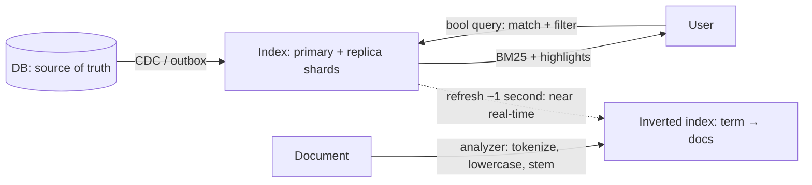

## 1. Core Concept

**Elasticsearch/OpenSearch** is a distributed search engine built on the **inverted index**: it **finds text by keyword, ranks by relevance, filters and aggregates** very fast over hundreds of millions of documents. It is used for **text search, logs and analytics** — it is **not** a primary transactional database. Understanding analyzers, shards and "near real-time" helps you avoid the common mistakes (mapping, shards, data synchronization).

**Mental model:** an inverted index is like **the index at the back of a book**, but by word: for each **word** it records **the list of pages (documents)** containing it. Searching "redis cache" = take the two lists, intersect them and score, instead of reading page by page. This index is **derived** from the original book (the DB) and can **drift** if you do not synchronize carefully.

## 2. How It Works

**Inverted index and analyzers**
- Text passes through an **analyzer**: a **tokenizer** (splits words) + **filters** (lowercase, stemming `running → run`, remove stop words) into **terms**; each term points to a list of **documents**. **The same analyzer** must be applied at indexing time and at search time.

**Index, shards, replicas**
- An **index** is split into **primary shards** (distributed across nodes), each with **replicas** (fault tolerance + read scaling). Writes go to **immutable segments**; a **refresh (~1 second)** is what makes documents **searchable** → **near real-time**, not instant real-time. **The number of primary shards cannot be changed** after creation (you must **reindex/split**).

**Queries**
- **`match`** (full-text, analyzed, scored), **`term`** (exact match, used on `keyword` fields), **`bool`** (`must`/`should`/`filter`/`must_not`), **`range`**. Conditions in **`filter`** **do not score** and are **cached** → cheaper than `must`.

**Ranking → BM25**
- **BM25** (an improvement on TF-IDF): **rare** terms matter more, term frequency in a document **saturates**, and **long** documents are normalized. Increase field weight with `boost` (title > body).

**Mapping → `text` vs `keyword`**
- **`text`**: analyzed, for full-text search. **`keyword`**: verbatim, for **filtering, sorting, aggregation**. Declare mappings **explicitly** instead of **dynamic mapping** (avoiding **mapping explosion** when thousands of unfamiliar fields appear).

**Aggregations, vectors and operations**
- **Aggregations** (grouping, statistics, histograms) power facets/dashboards. **Hybrid search**: **kNN vector + BM25**. Logs/time series use **time-based indexes + ILM** (hot–warm–cold–delete) and snapshots.

**Synchronizing with the source DB**
- **The DB is the source of truth**; ES is a **derived index**, synchronized through **CDC/outbox** or reindex jobs, with a **reconciliation** mechanism.

```json
GET /products/_search
{ "query": { "bool": {
    "must":   [ { "match": { "title": "mechanical keyboard" } } ],
    "filter": [ { "term": { "in_stock": true } }, { "range": { "price": { "lte": 2000000 } } } ] } },
  "sort": [ "_score", { "price": "asc" } ] }
```

## 3. Visual Diagram



## 4. Rules of Thumb & Trade-offs

| Situation / Need | What to choose |
| --- | --- |
| Full-text search, ranked by relevance | Elasticsearch/OpenSearch |
| Exact-match queries by ID/enum | SQL/DB or a `keyword` field + `filter` |
| Conditions that need no scoring | `filter` (cached) |
| Deep pagination | `search_after` (do not use a large `from`) |
| Time-based logs | Daily indexes + ILM |
| Semantic + keyword search | Hybrid (kNN + BM25) |

- **What you gain:** powerful search, near real-time, fast aggregations. **What you lose:** resource cost, **eventual consistency** with the DB, shards/mappings to operate; it does not replace a transactional DB.

## 5. Must Remember / Production Pitfalls

- **You just wrote a document and cannot find it yet → near real-time, not yet refreshed → accept ~1 second of delay or `refresh=wait_for` where needed**.
- **The cluster is slow and memory-starved → too many small shards → size the shard count by data size (tens of GB per shard), merge indexes**.
- **You only learn you cannot change the primary shard count when you need to → reindex/split is expensive → estimate sizes from the start**.
- **The field count explodes (mapping explosion) → uncontrolled dynamic mapping → explicit mappings, a cap on field count**.
- **Using ES as the primary DB → data loss/no transactions → the DB is the source of truth, ES is a derived index with reconciliation**.
- **Deep pagination with a large `from + size` → memory/CPU cost → `search_after`**.
- Interview trap: "Why can't I find what I just wrote?" → **it has not refreshed (near real-time)**; "`text` vs `keyword`?" → **text for full-text (analyzed), keyword for filtering/sorting/aggregation**; "Does ES replace the DB?" → **no, it is a derived index**.

## 6. Search Hooks

- `inverted index analyzer` — how a search engine works.
- `Elasticsearch BM25 relevance` — ranking by relevance.
- `Elasticsearch shards replicas sizing` — shard design.
- `Elasticsearch search_after deep pagination` — deep pagination.
- `Elasticsearch mapping text vs keyword` — field types.
