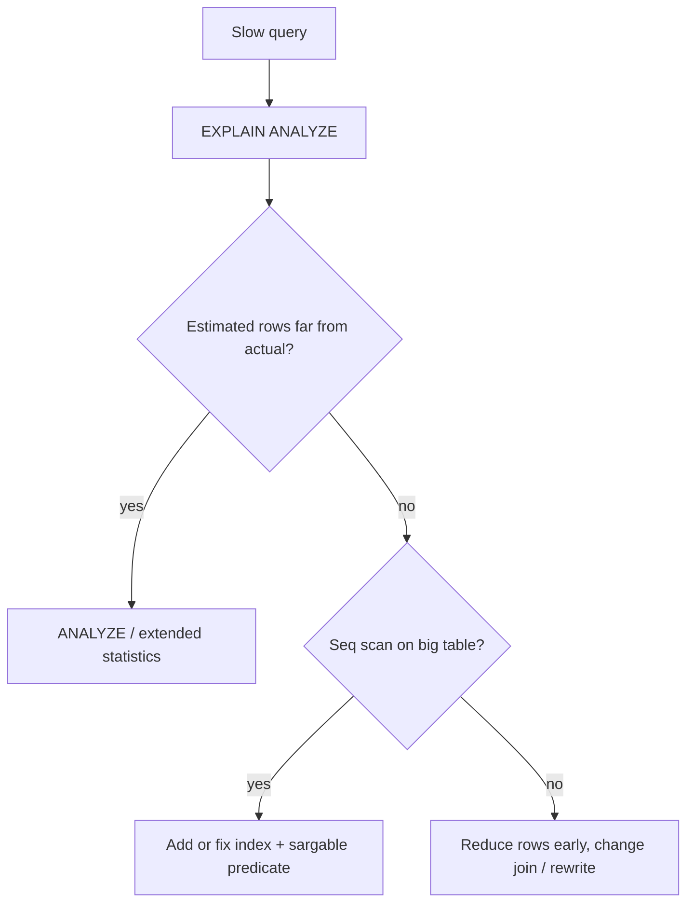

## 1. Core Concept

SQL is a **declarative** language: you say **what you need** and the **query planner** decides **how** (join order, which index to use). Advanced optimization means understanding how the planner thinks so you can write queries that **let it pick a good plan**, and recognizing when it picks a bad one. Mental model: *the planner relies on **statistics** and **estimated costs** — if the row estimate is wrong, the plan is wrong, and the query can be thousands of times slower.*

## 2. How It Works

- **Reading the plan**: `EXPLAIN (ANALYZE, BUFFERS)` compares **estimated vs actual rows**; a large gap = **stale statistics** (`ANALYZE`) or correlated columns.
- **Scans**: **Seq Scan** (whole table), **Index Scan**, **Index-Only Scan** (the index holds every column), **Bitmap Scan**. An index does not always beat a seq scan when the query returns **most of the rows**.
- **Join algorithms**: **Nested Loop** (suits few outer rows + an index on the inner side), **Hash Join** (large tables, `=` conditions), **Merge Join** (both sides already sorted). The join order determines how much intermediate data there is.
- **Sargable predicates**: conditions the index can use — `WHERE created_at >= '2026-01-01'`; **non-sargable**: `WHERE date(created_at) = ...`, `WHERE lower(email) = ...` (needs a functional index), `LIKE '%x'`, implicit casts.
- **Pagination**: **keyset** (`WHERE (created_at, id) < (:c, :i) ORDER BY created_at DESC, id DESC LIMIT 20`) instead of a large `OFFSET`.
- **Window functions** (`ROW_NUMBER`, `LAG`, `SUM() OVER`) replace self-joins/correlated subqueries for top-N-per-group and running totals.
- **Reduce data early**: filter before joining, select only the columns you need (avoid `SELECT *`), `EXISTS` instead of `IN` for large correlated sets.

```sql
-- Top-3 newest orders per customer: a window function instead of N queries
SELECT * FROM (
  SELECT o.*, ROW_NUMBER() OVER (PARTITION BY customer_id ORDER BY created_at DESC) rn
  FROM orders o WHERE created_at >= now() - interval '30 days'
) t WHERE rn <= 3;
```

## 3. Visual Diagram



## 4. Rules of Thumb & Trade-offs

- **Measure, do not guess**: always look at the real plan on production-sized data.
- **Indexes serve queries that actually run**; every index slows writes — drop unused ones.
- **Denormalize or use a materialized view** when an expensive aggregate read runs very often.
- Trade-off: **fast queries** (indexes, denormalization) vs **write cost, storage and synchronization complexity**.

## 5. Must Remember / Production Pitfalls

- **A function wrapping a column** in `WHERE` defeats the index; rewrite it as a range comparison on the raw column.
- **A large `OFFSET`** scans and discards thousands of rows; results also drift when the data changes.
- **`NOT IN` with NULL** gives surprisingly empty results; use `NOT EXISTS`.
- **N+1 from an ORM** and **`SELECT *`** reading large columns you do not need.
- **A plan that was good yesterday and bad today**: different parameters (parameter sniffing), changed statistics, skewed data — track slow queries with `pg_stat_statements`/the slow log.
- **A join on columns of different types** forces a cast and drops the index.
- Interview trap: "There is an index but the query still does a seq scan, why?" → **low selectivity**, a function wrapping the column, stale statistics, or mismatched data types.

## 6. Search Hooks

- `EXPLAIN ANALYZE reading query plans` — read the execution plan and compare estimates with reality.
- `nested loop vs hash join vs merge join` — three join algorithms and when to use them.
- `sargable queries` — conditions that allow index use.
- `keyset pagination vs OFFSET` — fast and stable pagination.
- `window functions ROW_NUMBER LAG` — per-group computation without a self-join.
- `pg_stat_statements slow query log` — find the most time-consuming queries.
