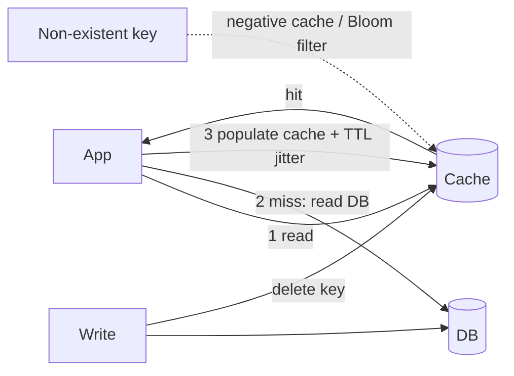

## 1. Core Concept

A **cache** is fast memory placed in front of a slow/expensive data source (database, API) to **reduce latency and load** on that source. The difficulty is not "adding Redis" but the **strategy**: when to read/write the cache, when to **invalidate**, what to evict when full and how to handle the characteristic failures (stampede, penetration, avalanche). The famous line: *"there are only two hard things in computer science: cache invalidation and naming things"*.

**Mental model:** a cache is **a shelf of frequently used items right next to your desk**: grabbing from it is extremely fast compared with walking down to the warehouse (the DB). But items on the shelf **may be stale** after the warehouse changed, the shelf is small so it needs a clearing rule (eviction), and if the whole team runs to the warehouse when the shelf is empty the warehouse jams.

## 2. How It Works

**Read/write strategies**
- **Cache-aside (lazy loading)**: the application reads the cache itself; on a **miss** it reads the DB and then **populates the cache** with a TTL. The most common and easy to implement; the first read is slow and data may be stale.
- **Read-through**: the cache layer loads from the DB itself on a miss (the application only talks to the cache).
- **Write-through**: write **both the DB and the cache synchronously** → the cache is always fresh, writes are slower.
- **Write-behind (write-back)**: write the cache first and **write the DB asynchronously later** → fast writes, but **data is lost if the cache dies before flushing**.
- **Write-around**: write straight to the DB and skip the cache (avoids polluting the cache with rarely read data).

**Invalidation**
- **TTL** (simple, tolerates staleness for its duration), **delete/update the key on write** (more precise but easy to miss), **events/CDC** (delete the cache when the DB changes, even from other services), **versioned keys** (`user:42:v7`). **Always keep a TTL as a safety net** even when you invalidate actively.
- **The classic race** in cache-aside on writes: the order should be **write the DB, then delete the cache** (do not "update the cache"); a rare race remains (a stale read overwriting a fresh cache), mitigated by a short TTL or a second delayed delete.

**Eviction → When the cache is full**
- **LRU** (drop the least recently used), **LFU** (drop the least frequently used; suits skewed distributions), **TTL/FIFO/random**. Redis: `maxmemory-policy` such as `allkeys-lru`, `volatile-ttl`; **TinyLFU** (Caffeine) is good for hit ratio.

**Characteristic failures**
- **Cache penetration**: queries for **non-existent keys** constantly punch through the cache to the DB → **negative caching** (cache the "not found" result with a short TTL) or a **Bloom filter**.
- **Cache avalanche**: **many keys expire at once** (same TTL) or the cache goes down → the DB is overloaded → **randomized TTL (jitter)**, multiple cache tiers, rate limiting towards the DB.
- **Cache stampede**: **a hot key expires** and thousands of requests miss together → single-flight, locks, early refresh (see the Redis Cache Stampede playbook).

**Hit ratio → Measuring value**
- **Hit ratio = hits/(hits + misses)**; average latency = `h·t_cache + (1−h)·t_db`. Example `h = 95%`, cache 1 ms, DB 50 ms → `0.95·1 + 0.05·50 = 3.45 ms` (versus 50 ms without a cache); if `h` drops to 80% it becomes `10.8 ms`.

**Multiple tiers**
- **L1 (in-process)** + **L2 (Redis)** + **CDN**; faster but adds consistency problems between tiers.

```python
def get_user(uid):
    v = redis.get(f"u:{uid}")
    if v is not None:
        return None if v == "NULL" else json.loads(v)          # negative cache
    row = db.fetch(uid)
    redis.setex(f"u:{uid}", 300 + random.randint(0, 60),       # TTL + jitter
                json.dumps(row) if row else "NULL")
    return row

def update_user(uid, data):
    db.update(uid, data)           # write the DB first
    redis.delete(f"u:{uid}")       # then delete the cache
```

## 3. Visual Diagram



## 4. Rules of Thumb & Trade-offs

| Situation / Need | What to choose |
| --- | --- |
| Read-heavy, slightly stale is acceptable | Cache-aside + TTL |
| The cache must be fresh after writes | Write-through |
| Very write-heavy, loss risk acceptable | Write-behind |
| Data written a lot but rarely re-read | Write-around |
| Constant queries for non-existent keys | Negative caching / Bloom filter |
| Mass expiry | TTL jitter |
| Heavily skewed access distribution | LFU/TinyLFU |

- **What you gain:** a large drop in latency and DB load. **What you lose:** possibly stale data, invalidation complexity, memory cost, one more point of failure; **the cache is only a copy, the DB is the source of truth**.

## 5. Must Remember / Production Pitfalls

- **Users see stale data → writing the DB without deleting/updating the cache → delete the key on write or use CDC, plus a safety TTL**.
- **The DB is hammered by queries for non-existent keys → penetration → negative cache or a Bloom filter, validate input**.
- **Many keys expire at once and the DB collapses → avalanche (same TTL) → randomized TTL, warm-up, multiple tiers**.
- **Data lost when the cache dies (write-behind) → not yet flushed → only for data that may be lost, or with a durable log/queue**.
- **Updating the cache instead of deleting causes out-of-order overwrites (race) → two concurrent writes → write the DB then delete the cache, short TTL**.
- Interview trap: "Cache-aside or write-through?" → **cache-aside reads lazily, write-through writes both synchronously**; "How do penetration, avalanche and stampede differ?" → **non-existent keys / many keys expiring at once / one hot key expiring**; "Compute average latency?" → **h·t_cache + (1−h)·t_db**.

## 6. Search Hooks

- `cache-aside write-through write-behind` — cache read/write strategies.
- `cache invalidation strategies` — TTL, delete on write, CDC, versioned keys.
- `LRU LFU eviction policy` — the clearing rules when the cache is full.
- `cache penetration avalanche` — two characteristic cache failures.
- `cache hit ratio` — measuring cache effectiveness.
- `cache stampede` — many requests reloading when a hot key expires.
