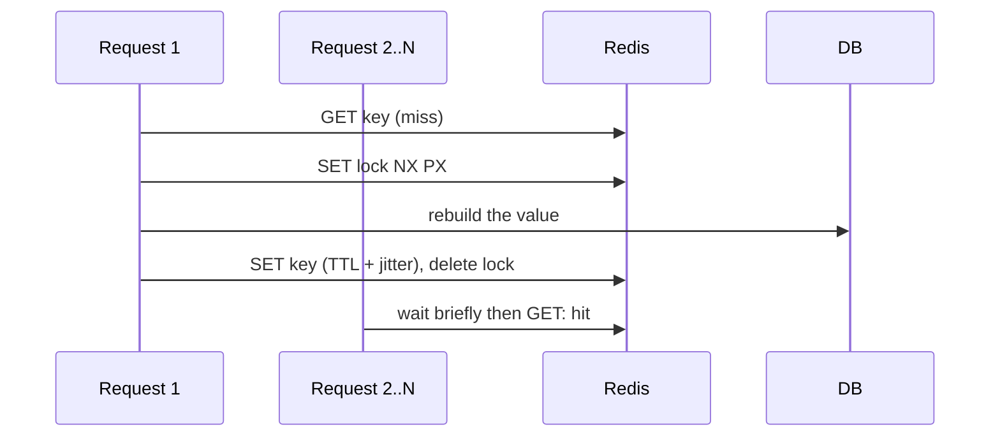

## 1. Core Concept

A **cache stampede** (also called **thundering herd / dogpile**) happens when **a hot key expires** and **thousands of requests see a cache miss at the same moment**, all running to the DB to rebuild the value — overloading the DB exactly when it has the heaviest work, and potentially taking down the whole system. The cache that was meant to protect the DB becomes its most dangerous moment.

**Mental model:** like **a shop running out of its best seller**: if every customer runs into the kitchen demanding a re-cook, the kitchen jams. The right way is **one person** goes into the kitchen to cook, the others **wait or take the old dish for now**, and the manager **prepares the dish before it runs out**.

## 2. How It Works

**When it happens**
- **A very hot key expires** (its TTL ends), a **cold start** (empty cache), or **many keys with the same TTL** expire at once. Example: a hot product gets **5,000 requests/second** and the rebuild query takes **200 ms** → within 200 ms **~1,000 requests** miss together and hit the DB.

**Solution 1 → Request coalescing (single-flight)**
- Inside one process, **merge requests for the same key** into a single load while the others **wait for that result** (Go `singleflight`, a shared `Promise`, a per-key lock).

**Solution 2 → Distributed lock (`SET NX PX`)**
- Across instances: the first request takes the lock with **`SET lock:key token NX PX 5000`**; whoever gets it rebuilds and writes the cache; the others **wait briefly and re-read the cache** or **return the stale copy**. Notes: the lock needs a **TTL** (against crashes), its value is a **unique token**, and **delete the lock only if the token matches** (Lua compare-and-delete) so you do not delete someone else's lock.

**Solution 3 → TTL jitter**
- Add a **random number** to the TTL (for example 300 ± 60 seconds) so keys **do not expire together**.

**Solution 4 → Probabilistic early expiration (XFetch)**
- Each request has a **small probability of refreshing early** before the real expiry; the probability **rises as expiry approaches** and with the rebuild time: `refresh if now − Δ·β·ln(rand) ≥ expiry`. The result: one request refreshes **before** the key expires, so **there is no collective miss moment**.

**Solution 5 → Stale-while-revalidate / soft TTL**
- Store **two deadlines**: a **soft TTL** (when it passes, refresh in the background) and a **hard TTL** (when it passes, delete). While refreshing, **return the old value** to other requests — users do not wait.

**Secondary defenses**
- **Pre-warm** important keys at startup, **refresh in the background on a schedule**, **limit concurrency towards the DB** (semaphore/circuit breaker), **negative caching** for non-existent keys.

```python
def get_product(pid):
    key = f"p:{pid}"
    v = redis.get(key)
    if v: return json.loads(v)
    token = uuid4().hex
    if redis.set(f"lock:{key}", token, nx=True, px=5000):        # only one rebuilds
        try:
            row = db.query("SELECT * FROM products WHERE id=%s", pid)
            redis.set(key, json.dumps(row), ex=300 + random.randint(0, 60))  # TTL + jitter
            return row
        finally:
            if redis.get(f"lock:{key}") == token.encode():       # delete only your own lock (better in Lua)
                redis.delete(f"lock:{key}")
    time.sleep(0.05); return get_product(pid)                    # others wait, then re-read
```

## 3. Visual Diagram



## 4. Rules of Thumb & Trade-offs

| Situation / Need | What to choose |
| --- | --- |
| One process, many requests for the same key | Single-flight / coalescing |
| Many instances | Distributed lock (NX PX) or stale-while-revalidate |
| Many keys expiring at once | TTL jitter |
| Avoid collective misses entirely | XFetch / soft TTL |
| Short-term staleness is acceptable | Stale-while-revalidate |
| Cold start | Pre-warm |
| A last line of defense for the DB | Concurrency limit / circuit breaker |

- **What you gain:** the DB is not hammered when a hot key expires. **What you lose:** extra complexity (locks, TTL management), possibly serving slightly stale data, and a lock can become a bottleneck if implemented wrongly.

## 5. Must Remember / Production Pitfalls

- **The DB collapses exactly when a hot key expires → every request rebuilds → single-flight/lock + early refresh**.
- **The lock expires before the rebuild finishes → two rebuilders → a lock TTL long enough, a token, consider extending it**.
- **You delete someone else's lock → release without checking the token → Lua compare-and-delete**.
- **All keys expire at the same hour → the same TTL set during a bulk load → add jitter**.
- **Users wait long while a key is rebuilding → an unbounded wait for the lock → wait briefly then return the stale copy or fail fast**.
- Interview trap: "How do you prevent a stampede?" → **single-flight/lock, TTL jitter, early refresh (XFetch), stale-while-revalidate**; "Why does a lock need a token?" → **to avoid deleting someone else's lock**; "How does a stampede differ from penetration?" → **an existing key that expired vs a non-existent key**.

## 6. Search Hooks

- `cache stampede thundering herd` — many requests rebuilding when a key expires.
- `probabilistic early expiration XFetch` — refreshing early by probability.
- `Redis distributed lock SET NX PX` — a distributed lock with Redis.
- `single flight request coalescing` — merging requests for the same key.
- `TTL jitter` — avoid simultaneous expiry.
