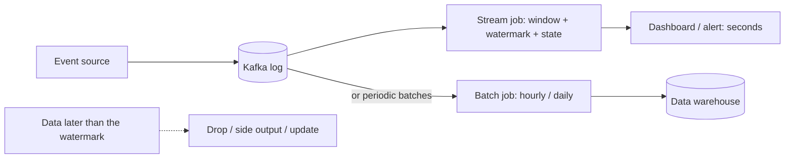

## 1. Core Concept

**Batch processing** handles **finite (bounded) datasets** in periodic batches (nightly, hourly); **stream processing** handles **infinite (unbounded) streams of data** continuously as events arrive. Choosing between them trades **latency ↔ complexity/cost**: batch is simple, cheap and easy to fix and rerun; streaming gives results in **seconds** but must contend with **late data, state and consistency**.

**Mental model:** batch is like **collecting a whole day's mail and reading it once in the afternoon** (efficient, but you learn news late); streaming is like **taking and handling each phone call the moment it rings** (fast response, but you must handle calls arriving **out of order** and **missing calls while busy**).

## 2. How It Works

**Bounded vs unbounded**
- Batch knows the data's **end point**, so it can sort/join everything and **rerun** easily when wrong. A stream **never ends**, so every computation must rely on **windows** and **state**.

**Event time vs processing time**
- **Event time**: when the event **actually happened** (recorded in the data). **Processing time**: when the system **receives/processes** it. They **diverge** because of the network, offline devices and retries (a click at 10:00 may arrive at 10:07). Computing by processing time gives wrong results; you need **event time**.

**Windows and watermarks**
- **Windows**: **tumbling** (fixed, non-overlapping frames, 5 minutes), **sliding** (moving, overlapping), **session** (by gaps in user activity). A **watermark**: an estimate that "by this point, **data with event time ≤ W has mostly arrived**" → when the watermark passes **the end of a window**, the window is **closed and its result emitted**. Data **arriving later than the watermark** is **late data**: drop it, route it to a **side output**, or **update** the result again (allowed lateness). Trade-off: **a lagging watermark** → more accurate but **higher latency**; **an early one** → fast but misses more data.

**Lambda vs Kappa**
- **Lambda**: two paths — a **batch layer** (accurate, slow) + a **speed layer** (fast, approximate) then merged; drawbacks: **writing the logic twice**, hard to keep in sync. **Kappa**: a **single streaming pipeline**, **recomputing by replaying the log** (Kafka retained long). Simpler but needs a durable log and efficient replay.

**Micro-batch vs true streaming**
- **Micro-batch** (Spark Structured Streaming): groups into **small batches** (a few seconds) then processes — **high throughput**, easy, latency ≥ a few hundred ms to seconds. **True streaming** (Flink): processes **each event** — millisecond-level low latency, a powerful state model. Choose by the **latency SLA** you really need.

**Exactly-once**
- In streaming, "exactly-once" means **the effect on state and output is as if each event were processed once**, achieved with **checkpoints + idempotent/transactional sinks**, not "never processed twice" at the physical level.

```sql
-- Flink SQL: a 5-minute window by EVENT TIME, tolerating 1 minute of lateness (watermark)
SELECT window_start, COUNT(*) AS orders
FROM TABLE(TUMBLE(TABLE orders, DESCRIPTOR(event_time), INTERVAL '5' MINUTES))
GROUP BY window_start, window_end;
-- WATERMARK FOR event_time AS event_time - INTERVAL '1' MINUTE
```

## 3. Visual Diagram



## 4. Rules of Thumb & Trade-offs

| Situation / Need | What to choose |
| --- | --- |
| Daily/hourly reports, latency tolerated | Batch |
| Fraud detection, alerts within seconds | Stream |
| Only near real-time (a few seconds), reuse Spark | Micro-batch |
| Millisecond latency, complex state | Flink (true streaming) |
| One codebase, replay from the log | Kappa |
| Late, out-of-order data | Event time + watermark |

- **What you gain:** streaming gives instant results; batch is simple, cheap and easy to debug/rerun. **What you lose:** streaming is far more complex (state, late data, 24/7 operations); batch has high latency.

## 5. Must Remember / Production Pitfalls

- **Hourly figures are wrong when the network is slow → computed by processing time → use event time + watermark**.
- **A window never closes/emits results → the watermark is stuck (an idle source/a partition with no data) → configure idle sources, per-partition watermarks**.
- **Late data is silently lost → the watermark is too tight → allowed lateness, a side output counting late data**.
- **Batch and stream logic diverge (Lambda) → maintaining two codebases → consider Kappa/a unified engine**.
- **Using streaming when hourly batch is enough → needless complexity and operating cost → choose by the latency SLA you truly need**.
- Interview trap: "event time vs processing time?" → **event time is when it happened, processing time is when it is processed**; "what does a watermark do?" → **estimates event-time progress to know when to close a window**; "what is exactly-once in practice?" → **checkpoints + idempotent/transactional sinks**.

## 6. Search Hooks

- `batch vs stream processing` — the two data processing models.
- `event time vs processing time` — when it happened versus when it was processed.
- `watermarks windowing streaming` — windows and watermarks.
- `lambda vs kappa architecture` — two architectures combining batch and stream.
- `Spark Structured Streaming micro-batch` — streaming in small batches.
- `exactly-once stream processing` — exactly-once semantics in streams.
