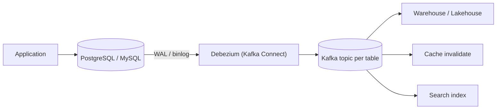

## 1. Core Concept

**Change Data Capture (CDC)** captures **every change (insert/update/delete)** in a database and emits it as an **event stream**, by reading the **transaction log** (WAL/binlog) instead of querying tables. CDC solves **near-real-time data synchronization** to warehouses/caches/search **without adding load to the source DB** and **without missing deletes**.

**Mental model:** CDC is like **a note-taker standing next to the bank's ledger**: each line written to the ledger (the log) is copied and sent on, **without asking every account again**. Polling is like asking each account periodically "anything new?" — slow, and it misses things.

## 2. How It Works

**Log-based vs query-based**
- **Query-based** (polling `updated_at`): simple, but it **cannot catch hard deletes**, misses changes between two polls and **adds load to the DB**. **Log-based** (Debezium reading PostgreSQL's **WAL** / MySQL's **binlog**): captures **complete insert/update/delete in commit order**, with **low latency** and small load.

**Debezium + Kafka Connect**
- **Debezium** is a source connector running on **Kafka Connect**: it reads the log and emits each change as an event to a **Kafka topic** (usually one topic per table, **key = primary key** to keep per-row ordering). An event has `before`, `after`, `op` (c/u/d), `source` (log position, ts).

**Snapshot and streaming**
- On first start: an **initial snapshot** (reading the whole table) and then a switch to **streaming** from the recorded log position. The connector stores an **offset** (LSN/binlog position) to **resume after a restart**.

**Replication slot (PostgreSQL)**
- Postgres retains **WAL** until the connector confirms it has read it (a replication slot). If the connector **is down for long**, WAL **is not cleaned → the source disk fills up**. You must **monitor slot lag** and drop abandoned slots.

**Schema evolution**
- Changing a column at the source changes the event structure. Use a **Schema Registry** (Avro/Protobuf) with compatibility rules so consumers do not break.

**Applications**
- Sync to a **data warehouse/lakehouse**, **cache invalidation**, updating **search indexes**, the **Outbox pattern** (reading the outbox table via CDC instead of dual-write), building **materialized views**.

**Delivery semantics**
- Usually **at-least-once** → consumers must be **idempotent** (upsert by key, compare log position).

```json
{
  "name": "orders-cdc",
  "config": {
    "connector.class": "io.debezium.connector.postgresql.PostgresConnector",
    "table.include.list": "public.orders",
    "plugin.name": "pgoutput",
    "slot.name": "orders_slot",
    "snapshot.mode": "initial"
  }
}
```

## 3. Visual Diagram



## 4. Rules of Thumb & Trade-offs

| Situation / Need | What to choose |
| --- | --- |
| Need to capture deletes and commit order | Log-based CDC |
| A small table, latency tolerated, no log-read permission | Polling on `updated_at` |
| Avoid dual-write to DB + broker | Outbox + CDC |
| Frequent schema changes | Schema Registry + compatibility |
| Sync to an analytical warehouse | CDC → Kafka → lakehouse (upsert/MERGE) |

- **What you gain:** near real time, complete changes, little load on the source. **What you lose:** operating connectors/Kafka, managing slots and schemas, at-least-once so consumers must be idempotent.

## 5. Must Remember / Production Pitfalls

- **The source DB disk fills up → the replication slot is not consumed → monitor slot lag, alert, drop abandoned slots**.
- **Data is missing deleted records → polling `updated_at` was used → log-based CDC**.
- **Duplicate records at the destination → at-least-once → upsert/MERGE by primary key and log position**.
- **Consumers break after a column change → no schema evolution → Schema Registry, compatible changes**.
- **No primary key → rows cannot be identified on update/delete → always have a primary key, a suitable `REPLICA IDENTITY`**.
- **The initial snapshot locks/loads a large table heavily → configure incremental snapshots, run at off-peak hours**.
- Interview trap: "polling vs CDC?" → **polling misses deletes and loads the DB, CDC reads the log completely**; "how does CDC solve dual-write?" → **Outbox + CDC reading the outbox table**; "the replication slot risk?" → **WAL swells and fills the disk if the connector stops**.

## 6. Search Hooks

- `Change Data Capture CDC` — capturing changes from a database log.
- `Debezium Kafka Connect` — a popular CDC connector.
- `PostgreSQL logical replication slot WAL` — the source log mechanism and its risk.
- `Debezium initial snapshot` — load everything first then stream.
- `Schema Registry Avro compatibility` — safe schema evolution.
- `transactional outbox CDC` — replacing dual-write with outbox + CDC.
