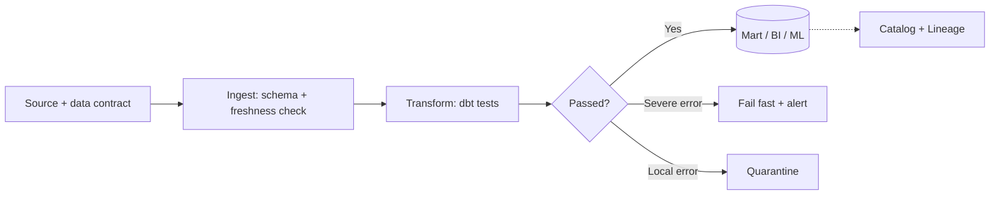

## 1. Core Concept

**Data quality** ensures data is **correct, complete, fresh and consistent** before people make decisions; **data governance** defines **who owns it, who may access it and where data goes** (lineage, catalog, PII, compliance). Together they solve the problem of "**wrong numbers that nobody notices**" — data errors are usually **silent** and costlier than code errors because they spread into reports, ML and business decisions.

**Mental model:** a data pipeline is like **a water plant**: quality checks are **water-quality checkpoints** at each stage; governance is **a register of pipes plus rules on who may open the valves**. Without checkpoints, dirty water flows all the way to the tap before anyone notices.

## 2. How It Works

**Quality dimensions**
- **Completeness** (nothing missing), **Validity** (right format/value domain), **Uniqueness** (no duplicate keys), **Freshness/Timeliness** (recent enough), **Consistency** (consistent across systems), **Accuracy** (matches reality).

**Layered checks**
- **Schema checks** (types, required columns), **constraint checks** (not null, unique, allowed values, foreign keys), **volume/anomaly** (unusual row counts), **freshness** (the latest data is no older than N hours), **reconciliation** (totals match the source). Tools: **dbt tests**, **Great Expectations**, **Soda**, Deequ.

**Shift-left and Data Contracts**
- **Shift-left**: check **early** (at the source/ingest) instead of at the end of the chain. A **data contract**: a written agreement between **producer and consumer** on schema, semantics, SLA and owner; breaking changes must go through review → preventing a source column change from breaking downstream.

**Lineage and Catalog**
- **Lineage**: where this table/column **comes from and goes to** → assess the **impact** of changes/fixes and **trace** wrong figures. A **data catalog** (DataHub, Amundsen, Glue/Unity Catalog): find data, descriptions, owners, trust level.

**PII and security**
- Classify **PII**, **mask/hash/tokenize**, **column-level security**, **row-level security**, **encryption**, **audit logs**, **retention/deletion on request** (GDPR "right to be forgotten"). The **least privilege** principle and clear **ownership**.

**Handling failed checks**
- **Fail fast** (stop the pipeline so bad data does not spread) for severe errors; **quarantine** (route bad records to a separate table) for local errors; **alert** for minor errors. Define **severity** levels.

```yaml
# dbt schema tests: checks right inside the transform pipeline
models:
  - name: orders
    columns:
      - name: order_id
        tests: [unique, not_null]
      - name: status
        tests:
          - accepted_values: {values: [placed, paid, shipped, cancelled]}
      - name: customer_id
        tests:
          - relationships: {to: ref('customers'), field: customer_id}
```

## 3. Visual Diagram



## 4. Rules of Thumb & Trade-offs

| Situation / Need | What to choose |
| --- | --- |
| Stop the source from changing schema and breaking downstream | A data contract |
| Catch errors early | Shift-left checks at ingest |
| A severe error makes reports wrong | Fail fast |
| A few bad records | Quarantine |
| Know the impact of changing a table | Lineage |
| Sensitive data | Mask/hash/tokenize + RLS/CLS |

- **What you gain:** trustworthy figures, early detection, compliance. **What you lose:** extra cost to build/maintain checks, too many alerts cause "alert fatigue", an ownership culture is needed.

## 5. Must Remember / Production Pitfalls

- **Reports are silently wrong → no checks → unique/not_null/freshness tests right in the pipeline**.
- **Downstream breaks when the source changes a column → no contract → a data contract and review of breaking changes**.
- **Nobody knows who is responsible when something fails → missing ownership → assign owners in the catalog**.
- **Too many alerts get ignored → no severity levels → tier them, only page for severe errors**.
- **PII leaks in analytics tables → no masking → classify PII, mask/CLS, audit**.
- **Data is stale yet the pipeline is "green" → only job success is checked, not freshness → a freshness SLA**.
- Interview trap: "which dimensions does data quality include?" → **completeness, validity, uniqueness, freshness, consistency, accuracy**; "what is a data contract?" → **a producer–consumer schema/SLA agreement**; "what is lineage used for?" → **impact assessment and tracing errors**.

## 6. Search Hooks

- `data quality dimensions` — the dimensions of data quality.
- `data contracts` — schema and SLA agreements between producer and consumer.
- `Great Expectations dbt tests` — quality-check tools in the pipeline.
- `data lineage catalog` — data provenance and the catalog.
- `PII masking tokenization` — protecting personal data.
- `data observability freshness volume` — monitoring freshness and volume.
