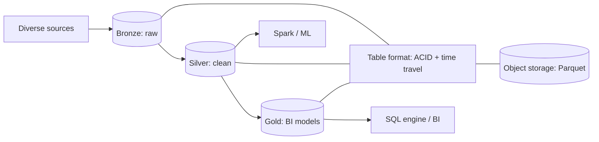

## 1. Core Concept

Three architectures for storing analytical data: the **data warehouse** (**structured** data, schema-on-write, fast SQL queries, ACID — but expensive and poor for unstructured data), the **data lake** (stores **any format** on **cheap object storage**, schema-on-read — but easily becomes a "swamp" and lacks ACID), and the **lakehouse** (a lake + an **open table format** such as Iceberg/Delta/Hudi for ACID, schema evolution and time travel — **one copy of data** serving both BI and ML). The key point: **separate storage from compute**.

**Mental model:** a warehouse is **a neatly catalogued library** (quick to search, but only accepts books of the right mold); a lake is **a giant warehouse where everything is thrown in** (cheap, accepts everything, but hard to find things without a register); a lakehouse is **a warehouse with a cataloguing system (the table format) laid over it**, both cheap and quick to search.

## 2. How It Works

**Warehouse vs Lake vs Lakehouse**
- **Warehouse**: schema-on-write, columnar internal storage, strong BI performance, strong governance; a high cost per capacity in the older model. **Lake**: files (Parquet/JSON/images…) on S3/ADLS/GCS, **cheap**, flexible, but **no transactions**, messy schemas, corrupted concurrent writes. **Lakehouse**: a lake + a **table format** → **ACID, upsert/delete, time travel**, with SQL/Spark/Trino engines reading together.

**Parquet → Columns, statistics, pushdown**
- **Parquet**: a well-compressed **columnar** format split into **row groups**, each column having **min/max statistics**. Engines use **column pruning** (read only needed columns) and **predicate pushdown** (skip row groups/files that fail the condition) → scanning far less data. **Partition** by a frequently filtered column (`dt`) to skip whole directories.

**The small files problem**
- Too many **small files** (from streaming/frequent writes) → **opening/listing files costs** more than reading the data, queries slow down, metadata swells. Remedy: **compaction** merging into files of **~128–512 MB**, adjusting commit frequency.

**Medallion architecture**
- **Bronze** (raw, as-is), **Silver** (cleaned, deduplicated, standardized), **Gold** (models serving business/BI). Each layer has increasing **quality control** and can be **rebuilt** from the layer below.

**Separating storage and compute**
- Data lives in **object storage** (cheap, durable), compute is a **cluster/warehouse that scales independently** (Snowflake, BigQuery, Redshift RA3, Databricks). **Multiple engines** can read the same data; you pay for compute by usage; in exchange you need **catalog governance** (Glue, Unity Catalog) and data transfer fees.

**Choosing an architecture**
- Mostly **BI on structured data** → a warehouse. **Diverse data + ML + BI** → a lakehouse. A raw lake without a table format should only be a **landing zone**.

```sql
-- Predicate pushdown + partition pruning on a Parquet/Iceberg table
SELECT country, SUM(amount)
FROM lake.sales            -- partitioned by dt, Parquet
WHERE dt BETWEEN DATE '2026-11-01' AND DATE '2026-11-07'   -- scans only 7 partitions
GROUP BY country;
```

## 3. Visual Diagram



## 4. Rules of Thumb & Trade-offs

| Situation / Need | What to choose |
| --- | --- |
| BI on structured data, low operations | A data warehouse |
| Diverse data, ML + BI on one copy | A lakehouse |
| Cheaply store everything, use unclear | A lake (with a catalog) |
| Queries touching only a few columns/days | Parquet + partitions + pushdown |
| Many small files slowing things down | Compaction |
| Progressive refinement models | Medallion |

- **What you gain:** low storage cost, one copy of data for many engines, independent scaling. **What you lose:** a lakehouse/lake needs catalog governance and maintenance (compaction, snapshots), BI performance may trail a dedicated warehouse.

## 5. Must Remember / Production Pitfalls

- **The lake becomes a swamp and nobody knows what data it holds → no catalog/schema/owner → a catalog, naming conventions, ownership, a table format**.
- **Queries get slower over time → too many small files → periodic compaction, a target file size**.
- **A full scan despite filtering by date → no partitioning/wrong type → partition by the filter column, exploit predicate pushdown**.
- **Concurrent writes corrupt data on a raw lake → no ACID → a table format (Iceberg/Delta/Hudi)**.
- **An unexpected compute bill → decoupled engines with no limits → quotas, auto-suspend, per-query cost tracking**.
- Interview trap: "warehouse vs lake vs lakehouse?" → **structured + ACID / any format, cheap / lake + a table format for ACID**; "why is Parquet fast?" → **columnar, compressed, min/max statistics for pushdown**; "the small files problem?" → **many small files → open/list overhead, fixed by compaction**.

## 6. Search Hooks

- `data lake vs warehouse vs lakehouse` — three analytical storage architectures.
- `Apache Iceberg Delta Lake Hudi` — table formats for the lakehouse.
- `Parquet columnar predicate pushdown` — why Parquet scans less data.
- `medallion architecture bronze silver gold` — progressive refinement layers.
- `small files problem compaction` — merging small files.
- `separation of storage and compute` — separating storage from compute.
