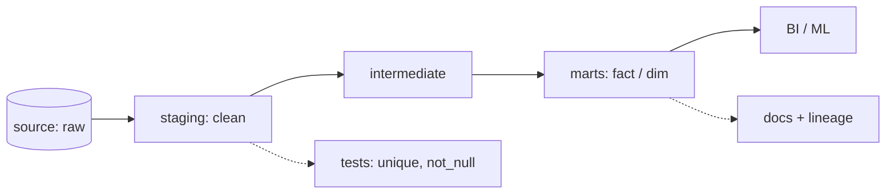

## 1. Core Concept

**dbt** (data build tool) is a tool that **transforms data with SQL inside the warehouse** in the spirit of **ELT**, bringing **software practices** (version control, tests, documentation, CI/CD) into **analytics engineering**. You write **models** (`SELECT` statements), dbt builds the **dependency DAG** with `ref()`, compiles and **materializes** them as tables/views in the warehouse.

**Mental model:** dbt is like **a Makefile for SQL**: each model is a step, `ref()` declares dependencies, and dbt decides the **run order**, runs **tests** and generates **docs + lineage**. You only write "what the final data looks like", never `CREATE TABLE`/`INSERT`.

## 2. How It Works

**Models and ref/source**
- A model is a `.sql` file containing a `SELECT`. `{{ ref('stg_orders') }}` creates a **dependency** and points to the right schema per environment; `{{ source('raw','orders') }}` declares a **source table** (with freshness checks).

**Layering**
- **staging** (clean, rename, cast 1–1 with the source) → **intermediate** (combining logic) → **marts** (fact/dimension tables serving BI). Keep staging thin and business logic in marts.

**Materialization**
- **view** (not stored, always fresh), **table** (stored, fully rebuilt), **incremental** (only processes new/changed rows → saves cost on large tables), **ephemeral** (a CTE, no object created). Choose by size and read frequency.

**Incremental models**
- Use `is_incremental()` to filter new data and `unique_key` to **merge/upsert**. Beware of **late-arriving data** → use a **lookback window** and periodically run `--full-refresh`.

**Tests**
- **Generic tests**: `unique`, `not_null`, `accepted_values`, `relationships`. **Singular tests**: custom SQL returning bad rows. Run with `dbt test` or `dbt build` (run + test following the DAG).

**Snapshots (SCD Type 2)**
- A `snapshot` records the **change history** of a source table (adding `dbt_valid_from/to`), serving SCD Type 2.

**Docs, macros, CI**
- `dbt docs` generates **a catalog + lineage**; **Jinja macros** reuse logic; **CI** runs `dbt build --select state:modified+` only on changed models and their downstream (slim CI), using **dev/prod targets**.

```sql
-- models/marts/fct_orders.sql
{{ config(materialized='incremental', unique_key='order_id') }}
SELECT o.order_id, o.customer_id, o.amount, o.updated_at
FROM {{ ref('stg_orders') }} o

WHERE o.updated_at > (SELECT max(updated_at) - interval '3 hours' FROM {{ this }})  -- lookback

```

## 3. Visual Diagram



## 4. Rules of Thumb & Trade-offs

| Situation / Need | What to choose |
| --- | --- |
| A small/rarely read model | `view` |
| Frequent queries, fast build | `table` |
| A large table where only new data is appended | `incremental` |
| Keep change history | `snapshot` |
| Quality checks in the pipeline | dbt tests |
| Fast CI | Slim CI `state:modified+` |

- **What you gain:** versioned SQL, tests, automatic lineage, team collaboration. **What you lose:** it only covers transforms (you need a loading tool), incremental is easy to get wrong without handling late data, dependence on the warehouse's capability.

## 5. Must Remember / Production Pitfalls

- **Incremental misses late updates → a tight `updated_at` filter → a lookback window + a periodic full-refresh**.
- **Duplicate data after a rerun → missing `unique_key` → declare `unique_key` to merge**.
- **A change breaks downstream unnoticed → missing tests/contracts → tests + model contracts + CI**.
- **Business logic scattered across staging → hard to reuse → thin staging, logic in marts**.
- **Slow builds → every model is a `table` → use `view`/`incremental` sensibly**.
- **Figures differ between dev and prod → targets are not separated → dev/prod profiles, CI**.
- Interview trap: "does dbt do E, T or L?" → **only T (inside the warehouse)**; "what is ref() for?" → **creating dependencies and the DAG**; "the risk of incremental?" → **late-arriving data/updates**.

## 6. Search Hooks

- `dbt models ref source` — SQL models and dependencies.
- `dbt incremental models` — processing only the new data.
- `dbt tests generic singular` — quality checks.
- `dbt snapshots SCD type 2` — recording change history.
- `dbt materializations view table incremental` — the kinds of materialization.
- `analytics engineering` — software practices for data analytics.
