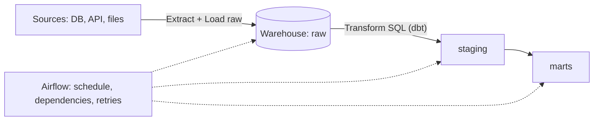

## 1. Core Concept

**ETL** (Extract–Transform–Load) transforms data **before loading** it into the warehouse; **ELT** loads **raw** data into the warehouse first and then **transforms inside the warehouse** (using the power and low cost of modern warehouses, often with **dbt**). **Orchestration** (Airflow, Dagster, Prefect) **schedules, manages dependencies, retries and monitors** those steps. The most important property of a good data pipeline is being **idempotent**: rerunning it any number of times yields the same result.

**Mental model:** a pipeline is like **a night production line**: the orchestrator is **the foreman** who knows which station runs first, which waits and which retries when broken. If each shift's rerun **doubles the product**, that line cannot be trusted; to be trustworthy **each shift overwrites exactly its own portion** instead of piling on more.

## 2. How It Works

**ETL vs ELT**
- **ETL**: transform on a **separate machine** before loading — suited to legacy/limited warehouses and sensitive data that must be cleaned first. **ELT**: **load raw** (keeping the original for reruns), transform with **SQL inside the warehouse** (scales with the warehouse, dbt manages models/tests). The modern trend is ELT.

**Airflow basics**
- A **DAG** (directed acyclic graph) consists of **tasks** (operators) and dependencies; the **scheduler** triggers on a schedule; the **executor** runs tasks; **XCom** passes **small** data between tasks; **sensors** wait for a condition (prefer **deferrable** ones so they do not hold a slot).

**Data interval and backfill**
- Each run is tied to a **data interval** `[start, end)`; the run for that interval is triggered **after the interval ends** (the "21st" run executes at the start of the 22nd and processes the 21st's data). **Do not use `now()` in tasks** — use `data_interval_start/end` so results are **deterministic**. **Catchup/backfill** reruns past intervals.

**Idempotent pipelines**
- Run twice → the same result. Approaches: **overwrite by partition** (`INSERT OVERWRITE`/delete-then-insert for the interval), **`MERGE` upsert by key**, avoid unconditional appending `INSERT`, name temporary files/tables by interval. This makes **retries and backfills safe**.

**Incremental load with a watermark**
- Load only **new/changed records** since last time: `WHERE updated_at > :last_watermark`. Beware: it **does not catch hard deletes** and **late updates** (updated_at arriving after the watermark) → use a **lookback window** (reload the last N hours) or **CDC**; run a periodic **full refresh** to reconcile.

**Tools**
- **Airflow** (mature, many integrations, task-centric), **Dagster** (**asset-centric**: models tables/datasets, lineage, good testability), **Prefect** (Python-native, flexible). **dbt** handles the SQL transforms with tests.

```python
@dag(schedule="@daily", start_date=datetime(2026, 1, 1), catchup=True, max_active_runs=1)
def sales_pipeline():
    @task(retries=3, retry_delay=timedelta(minutes=5))
    def load_partition(data_interval_start=None, data_interval_end=None):
        # idempotent: delete then insert exactly this interval
        run_sql("DELETE FROM sales WHERE ts >= %s AND ts < %s", data_interval_start, data_interval_end)
        run_sql("INSERT INTO sales SELECT * FROM staging WHERE ts >= %s AND ts < %s",
                data_interval_start, data_interval_end)
    load_partition()
sales_pipeline()
```

## 3. Visual Diagram



## 4. Rules of Thumb & Trade-offs

| Situation / Need | What to choose |
| --- | --- |
| A modern warehouse (Snowflake/BigQuery/Redshift), wanting to keep raw data | ELT |
| Need to clean/mask PII before it enters the warehouse | ETL (or ELT with an early masking step) |
| Safe reruns/backfills | An idempotent pipeline (overwrite by partition/MERGE) |
| Load only what is new | Incremental + watermark + lookback |
| Capture deletes and changes exactly | CDC |
| Asset/lineage-based management | Dagster |
| A broad integration ecosystem, an industry standard | Airflow |

- **What you gain:** repeatability, easy debugging, safe reruns. **What you lose:** ELT costs storage for raw data and compute in the warehouse; the orchestrator adds operational infrastructure.

## 5. Must Remember / Production Pitfalls

- **A backfill/retry duplicates data → an appending, non-idempotent task → overwrite by partition or MERGE**.
- **Results differ on each rerun → `now()` is used in tasks → use `data_interval_start/end`**.
- **Late updates are missing → a `updated_at` watermark misses late updates/deletes → a lookback window, CDC, a full-refresh reconciliation**.
- **Slots run out and pipelines slow down → sensors hold workers while waiting → deferrable sensors, timeouts**.
- **Heavy tasks run directly on Airflow workers → overload → push computation to Spark/the warehouse, Airflow only orchestrates**.
- **Passing large data through XCom → the metadata DB swells → pass only references (paths), keep the data in storage**.
- Interview trap: "ETL vs ELT?" → **ELT loads raw then transforms in the warehouse**; "an idempotent pipeline?" → **a rerun gives the same result (overwrite by partition/MERGE)**; "when does the 21st's run execute?" → **after the 21st's interval ends**.

## 6. Search Hooks

- `ETL vs ELT` — the order of transforming and loading.
- `Airflow DAG data interval backfill` — interval-based scheduling and reruns.
- `idempotent data pipelines` — pipelines that are safe to rerun.
- `incremental load watermark` — loading only the new part.
- `Airflow vs Dagster vs Prefect` — popular orchestrators.
- `dbt models tests` — SQL transforms with tests.
