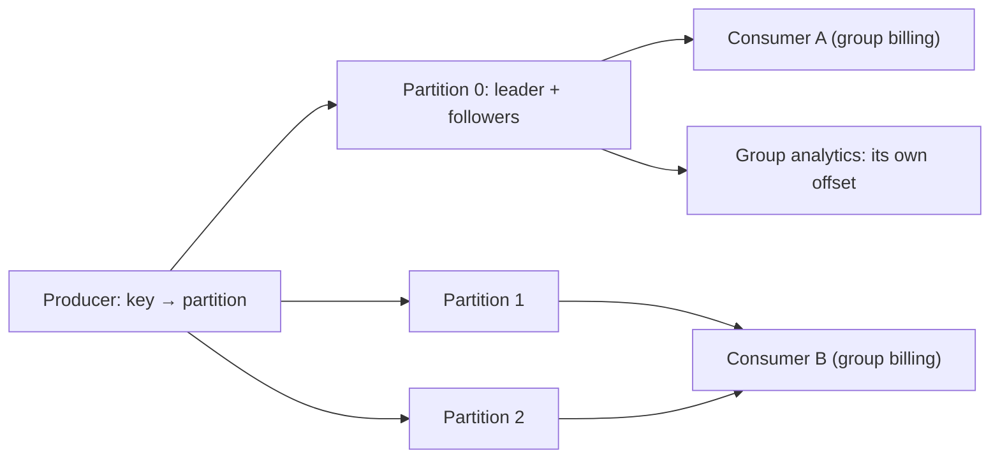

## 1. Core Concept

**Apache Kafka** is a **durable, partitioned, distributed log** used to transport and store high-volume **event streams**. Producers **append** to a topic, consumers **read at their own offset** so many applications read independently and can **replay**. Kafka solves **decoupling, absorbing spikes and very high throughput** (hundreds of thousands to millions of messages per second) — but demands that you understand **partitions, offsets, replication and delivery guarantees**.

**Mental model:** Kafka is **a shared journal split into several volumes (partitions)**, append-only and kept for a retention period. Each reader has **their own bookmark (offset)** and reads at their own pace; a group of readers sharing a task (a consumer group) **splits the volumes, one reader per volume**, so nobody reads the same thing twice.

## 2. How It Works

**Topic, partition, offset**
- A topic is split into **partitions**; each partition is an **ordered append-only log** and every record has an increasing **offset**. **Ordering is guaranteed only within a partition**; a message's **key** decides the partition (same key → same partition). Data is **retained by retention policy** (time/size), not deleted on read.

**Consumer group**
- Within a **group**, each partition is read by **exactly one consumer** ⇒ **maximum parallelism = the number of partitions**; many groups read independently (billing, analytics). The processed **offset** is committed; committing **after processing** → **at-least-once**, **before** → **at-most-once**. **Consumer lag** = the log end position − the committed offset (a key health metric).

**Replication and durability**
- Each partition has a **replication factor (usually 3)**: one **leader** takes writes, **followers** replicate; the **ISR** (in-sync replicas) are the replicas that keep up. **`acks`**: `0` (do not wait), `1` (leader wrote), **`all`** (wait for every ISR). **`min.insync.replicas=2`** with **RF=3, `acks=all`** → survive losing **1 broker** **without losing acknowledged messages** (if the ISR < 2 writes are rejected — trading availability for durability). Disable `unclean.leader.election`.

**Idempotent producer and transactions**
- An **idempotent producer** (`enable.idempotence=true`): the broker uses a **producer id + sequence** to **deduplicate on retry** within a partition. **Transactions**: **atomic writes across partitions** and committing offsets in the same transaction (the **consume–transform–produce** pattern), consumers with `read_committed` only see committed data → **exactly-once within Kafka**.

**Log compaction**
- Instead of deleting by time, **keep only the latest record for each key**; write a **tombstone** (null value) to delete a key. Used for **changelogs/state** (tables, configuration, CDC).

**Rebalance**
- When consumers join/leave or **process too slowly** (exceeding `max.poll.interval.ms`/missing the `session.timeout.ms` heartbeat), the group **rebalances** and pauses reading. Reduce it with: **cooperative rebalancing**, **static membership**, short processing, a higher `max.poll.interval.ms`.

**KRaft**
- Newer Kafka uses an **internal Raft (KRaft)** to manage metadata instead of ZooKeeper → simpler operations, better scaling of partition counts.

**Choosing the number of partitions**
- It determines **maximum parallelism** and throughput; it can be **increased but not decreased**, and **increasing changes the key → partition mapping** (breaking per-key ordering). Estimate from target throughput per consumer.

```properties
# A durable producer: no loss of acked messages, no duplicates on retry
acks=all
enable.idempotence=true
retries=2147483647
delivery.timeout.ms=120000
# Topic: replication.factor=3, min.insync.replicas=2
```

## 3. Visual Diagram



## 4. Rules of Thumb & Trade-offs

| Situation / Need | What to choose |
| --- | --- |
| Do not lose acked messages | RF=3, `acks=all`, `min.insync.replicas=2` |
| No duplicates on retry | Idempotent producer |
| Atomic writes across partitions + offsets | Transactions |
| Keep the latest state per key | Log compaction |
| Ordering per entity | Key = entity id |
| A slow consumer | Add consumers (≤ the number of partitions), process faster |
| Processing without losing messages | Commit the offset after processing + idempotent |

- **What you gain:** high throughput, durability, replay, many consumers. **What you lose:** operational complexity, ordering only within a partition, `acks=all` adds latency, rebalances cause interruptions.

## 5. Must Remember / Production Pitfalls

- **Messages are lost after a broker dies → `acks=1` or a low RF → RF=3, `acks=all`, `min.insync.replicas=2`**.
- **Duplicate messages after a retry → the producer is not idempotent → `enable.idempotence=true`; consumers still need to be idempotent (at-least-once)**.
- **Adding consumers does not speed things up → exceeding the number of partitions → increase partitions (mind the key mapping) or parallelize within the consumer**.
- **Consumer lag rises and rebalances continuously → processing takes too long, exceeding `max.poll.interval.ms` → lighter/asynchronous processing, raise the timeout, cooperative rebalancing**.
- **One partition is too hot → a skewed key (a hot partition) → choose an evenly distributed key/add a suffix**.
- **Increasing partitions scrambles per-key ordering → the mapping changes → plan the number of partitions up front**.
- Interview trap: "where is ordering guaranteed?" → **within a single partition**; "exactly-once in Kafka?" → **idempotent producer + transactions (within Kafka), and consumers must still be idempotent beyond that**; "maximum parallelism?" → **the number of partitions**.

## 6. Search Hooks

- `Kafka partitions offsets consumer groups` — the log model, parallelism and independent reads.
- `Kafka acks min.insync.replicas` — write durability configuration.
- `Kafka idempotent producer transactions` — deduplication and exactly-once within Kafka.
- `Kafka log compaction` — keeping the latest record per key.
- `Kafka consumer lag rebalancing` — the lag metric and rebalancing.
- `KRaft Kafka without ZooKeeper` — metadata with an internal Raft.
