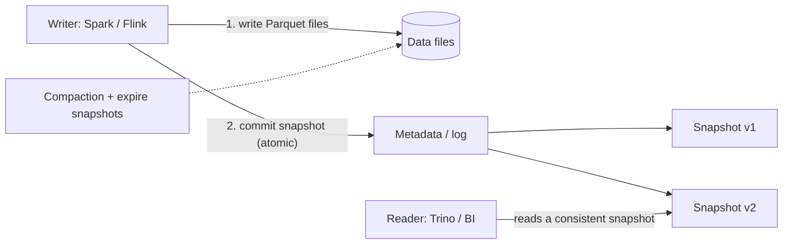

## 1. Core Concept

An **open table format** (**Apache Iceberg**, **Delta Lake**, **Apache Hudi**) is a **metadata** layer placed over **Parquet** files in object storage, turning "a pile of files" into **a table with ACID transactions**: upsert/delete, **schema evolution**, **time travel** and safe concurrent reads/writes. It solves the biggest drawbacks of a raw data lake (no ACID, small files, chaotic schemas) and is the foundation of the **lakehouse**.

**Mental model:** a table format is like **a Git commit ledger laid over a folder of files**: the real data is immutable files; each write creates **a new commit (snapshot)** pointing to the current set of files. A read always sees **one consistent snapshot**, and going back to an **old snapshot = time travel**.

## 2. How It Works

**Structure**
- **Data files** (Parquet, immutable) + **metadata** (the file list, statistics, schema, snapshots). **Iceberg**: metadata file → manifest list → manifests → data files. **Delta**: a **transaction log** `_delta_log` (JSON + Parquet checkpoints). **Hudi**: a **timeline** + indexes.

**ACID through optimistic concurrency**
- A writer writes new files and then **commits atomically** by adding a metadata version. Two writers at once: **the first to commit wins**, the second **checks for conflicts** and retries/fails. Readers **are not blocked** and read the committed snapshot (**snapshot isolation**).

**Update/Delete: copy-on-write vs merge-on-read**
- **Copy-on-write (CoW)**: modifying a row **rewrites the whole file** containing it; fast reads, costly writes. **Merge-on-read (MoR)**: writes small **delta/delete files**, merged at read time or by compaction; fast writes, slower reads until compaction. `MERGE INTO` provides **upsert** and **CDC**.

**Time travel and schema evolution**
- Query by **snapshot/timestamp** (`VERSION AS OF`) for audit, rollback and reproducing results. **Schema evolution**: adding/renaming columns **without rewriting data** (Iceberg uses **column ids**, safe on rename). **Partition evolution** (Iceberg): change the partition strategy without a rewrite.

**Maintenance**
- **Compaction** (merging small files), **expire snapshots** (deleting old snapshots to reclaim space), **remove orphan files**, **VACUUM** (Delta). Without maintenance, metadata/files swell and queries slow down.

**Choosing a format**
- **Iceberg**: multi-engine (Spark/Trino/Flink/Snowflake…), partition evolution, an open catalog. **Delta**: deeply integrated with Databricks/Spark. **Hudi**: strong at upsert/near-real-time streaming. Choose by **the engine and catalog ecosystem** you use.

```sql
-- Upsert CDC into an Iceberg/Delta table with MERGE (ACID)
MERGE INTO lake.orders t
USING staging.orders_cdc s ON t.order_id = s.order_id
WHEN MATCHED AND s.op = 'd' THEN DELETE
WHEN MATCHED THEN UPDATE SET *
WHEN NOT MATCHED THEN INSERT *;

SELECT * FROM lake.orders VERSION AS OF 1234;   -- time travel
```

## 3. Visual Diagram



## 4. Rules of Thumb & Trade-offs

| Situation / Need | What to choose |
| --- | --- |
| Many engines reading together, an open catalog | Iceberg |
| The Databricks/Spark ecosystem | Delta Lake |
| High-frequency upserts, streaming | Hudi / MoR |
| Read-heavy, write-light | Copy-on-write |
| Write-heavy, slower reads acceptable | Merge-on-read + compaction |
| Audit/rollback | Time travel |

- **What you gain:** ACID, upsert/delete, time travel, one copy of data for many engines. **What you lose:** needs maintenance (compaction, expiry), CoW costs on writes, MoR costs on reads, tight coupling to a compatible catalog/engine.

## 5. Must Remember / Production Pitfalls

- **Queries slow down and metadata swells → many small files/snapshots → compaction, periodic expire snapshots**.
- **Storage keeps growing even after deleting data → old snapshots hold the files → expire snapshots + remove orphan files**.
- **Two jobs writing at once fail → an optimistic-concurrency conflict → retry, split the written partitions**.
- **MoR reads are slow → many uncompacted deltas → scheduled compaction**.
- **Time travel is lost after VACUUM → old files were deleted → keep retention long enough for audit needs**.
- **An engine cannot read the table → an incompatible catalog/version → choose a standard catalog (REST/Glue/Unity) and check versions**.
- Interview trap: "what does a table format provide on a lake?" → **ACID, time travel, schema evolution through metadata**; "CoW vs MoR?" → **CoW reads fast and writes costly, MoR writes fast and reads costly**; "how is ACID achieved?" → **an atomic metadata commit + optimistic concurrency**.

## 6. Search Hooks

- `Apache Iceberg table format` — snapshot metadata for tables on object storage.
- `Delta Lake transaction log` — Delta's transaction log.
- `Apache Hudi copy-on-write merge-on-read` — two update strategies.
- `lakehouse time travel` — querying old versions.
- `Iceberg compaction expire snapshots` — table maintenance.
- `optimistic concurrency control table formats` — handling concurrent writes.
